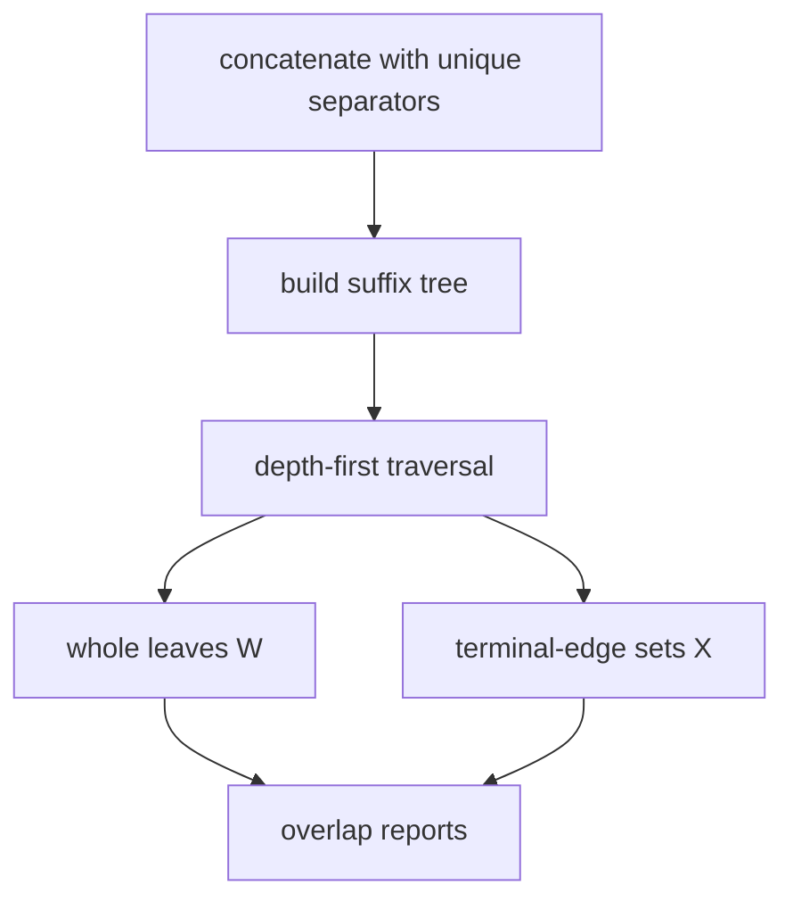

# All-Pairs Suffix-Prefix Matching

## Definition

For a set of sequences `S={s_0,...,s_{k-1}}`, suffix-prefix matching finds overlaps where a suffix
of `s_i` equals a prefix of `s_j`. The minimum-length version reports overlaps of length at least
`ell`; the maximal version reports the longest such overlap for every ordered pair (gik_5,
pp. 25-32).

## Why it matters

Suffix-prefix overlaps are the string-indexing primitive behind overlap graphs for read or contig
assembly. Unit 5 shows how one suffix tree over all strings can solve all pairs at once
(gik_5, pp. 25-32). Unit 6 uses those overlaps as edges in [[overlap-graph|overlap graphs]] for
[[fragment-assembly]] (gik_6, pp. 16, 21).

## Construction / Mechanism

Concatenate all strings with unique separators and build `ST(T)`, where
`T=s_0$_0s_1$_1...s_{k-1}$_{k-1}`. Terminal edges starting with separators mark complete input
strings; whole leaves mark complete suffix paths (gik_5, pp. 25-27).



## Pseudocode

```text
ALGORITHM MinimumAPSPM(T, ell)
  perform depth-first traversal of T
  for each node v in postorder:
    W(v) <- whole leaves reached below v
    X(v) <- input-string ids whose terminal edge leaves v
    if depth(v) >= ell:
      for each i in X(v):
        for each whole leaf of string j in W(v):
          output (s_i, s_j, depth(v))
```

```text
ALGORITHM MaximumAPSPM(T)
  for each string id i:
    stack[i] <- empty stack
  depth-first traverse T
  when first visiting node v:
    push depth(v) on stack[i] for each i in X(v)
  when a whole leaf for string j is reached:
    for each i with non-empty stack[i]:
      output longest current overlap (s_i, s_j, top(stack[i]))
  when leaving node v:
    pop depth(v) from stack[i] for each i in X(v)
```

## Invariant / correctness argument

A node path label `w` is an overlap from `s_i` to `s_j` exactly when a terminal edge for `s_i`
starts at that node and a whole leaf for `s_j` lies below it. In the maximum version, the stack
for `i` stores depths of currently active overlap nodes, so its top is the deepest valid overlap
when a whole leaf is visited (gik_5, pp. 26-31).

## Complexity

| Problem | Time | Space |
|---|---:|---:|
| Minimum APSPM | `O(n + z)` | `O(n)` |
| Maximum APSPM | `O(n + k^2)` | `O(n)` |
| Suffix tree storage | `O(n)` | `O(n)` |

`n = sum(|s|+1)` and `z` is output size (gik_5, pp. 29, 32).

## Worked example

Let `s_0=abc`, `s_1=bca`, `s_2=cab`, `ell=2`. The overlap `bc` is a suffix of `abc` and a prefix
of `bca`, so the minimum problem reports `(s_0,s_1,2)`. The maximum problem reports the same
length for that ordered pair because no longer suffix-prefix match exists.

## Variants

- Minimum APSPM reports all overlaps at least `ell`.
- Maximum APSPM reports one longest overlap per ordered pair and uses stacks instead of storing
  every active set explicitly (gik_5, pp. 30-32).

## Pitfalls & exam traps

> [!warning]
> - Separators must be unique; otherwise overlaps can cross sequence boundaries.
> - Suffix-prefix matching is directional: overlap from `s_i` to `s_j` differs from `s_j` to
>   `s_i`.
> - The minimum version's output can dominate runtime; include `z`.

## Related

- [[suffix-tree]] — underlying index.
- [[enhanced-suffix-array]] — compact alternative representation of the same suffix order.
- [[fragment-assembly]] — biological reason for computing all suffix-prefix overlaps.
- [[overlap-graph]] — stores the overlap candidates as directed edges.
- [[match-chaining]] — a different way to combine local exact matches into global structure.

## Sources

- gik_5, pp. 25-32
- gik_6, pp. 16, 21-23
