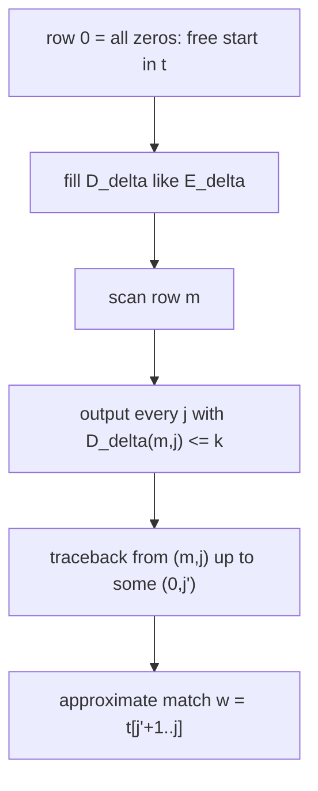

# Approximate String Matching

## Definition

**APSMP** (approximate string matching problem): given a **pattern** (Muster) `p ∈ A*` of length
`m`, an **input string** `t ∈ A*` of length `n` and a **threshold value** (Schwellenwert)
`k ∈ ℝ⁺`, find the positions in `t` where an approximate match **ends** (fsa_part1, p. 17). An
**approximate match** is a substring `w` of `t` with

```
edist_δ(p, w) <= k
```

This is a **semi-global alignment**: the pattern is aligned globally, the text locally
(fsa_part1, p. 17).

## Why it matters

Searching a DNA database for a pattern must tolerate a few errors — sequences of the same species
differ slightly and base calling is imperfect. The script calls APSMP "one of the most
well-studied problems" (fsa_part1, p. 17).

## Construction / Mechanism

Compute an `(m+1) × (n+1)` table `D_δ` with (fsa_part1, p. 17):

```
D_δ(i, j) = min { edist_δ(p[1..i], w) | w is a suffix of t[1..j] }
```

Then an approximate match ends at position `j` iff `edist_δ(p, w) <= k` for some suffix `w` of
`t[1..j]`, i.e. iff

```
D_δ(m, j) <= k
```

**Solving APSMP:** compute `D_δ` and output all `j` with `D_δ(m,j) <= k` (fsa_part1, p. 17).

Recurrence (fsa_part1, p. 18):

```text
D_δ(i,j) = 0                                                   , i = 0
         = D_δ(i-1, 0) + δ(p[i] -> ε)                           , i > 0 and j = 0
         = min { D_δ(i-1, j)   + δ(p[i] -> ε),
                 D_δ(i,   j-1) + δ(ε    -> t[j]),
                 D_δ(i-1, j-1) + δ(p[i] -> t[j]) }              , i > 0 and j > 0
```

> [!warning] The one line that matters
> `D_δ(0, j) = 0` for **all** `j` — the free start in `t`. That single change to
> [[edit-distance-dp]] is what makes the table semi-global: a match may begin anywhere in the
> text at no cost. Column 0 is *not* free: `D_δ(i,0)` still accumulates the cost of deleting
> `p[1..i]`.



## Pseudocode

```text
ALGORITHM ApproximateStringMatching(p[1..m], t[1..n], δ, k)
  for j = 0 to n:  D[0][j] <- 0                  // free start in t
  for i = 1 to m:  D[i][0] <- D[i-1][0] + δ(p[i] -> ε)
  Matches <- empty list
  for j = 1 to n:
    for i = 1 to m:
      D[i][j] <- min( D[i-1][j]   + δ(p[i] -> ε),
                      D[i][j-1]   + δ(ε    -> t[j]),
                      D[i-1][j-1] + δ(p[i] -> t[j]) )
    if D[m][j] <= k:
      append j to Matches
  return Matches
```

Traceback: for a reported end position `j`, trace minimising edges from `D_δ(m,j)` to an entry
`D_δ(0, j')`, `0 <= j' <= j-1`; the match is `w = t[j'+1 .. j]` and the path is labelled by an
optimal alignment of `p` and `w` (fsa_part1, p. 18).

## Invariant / correctness argument

By induction over a columnwise topological order of the [[edit-graph]] of `p` and `t`:
`D_δ(i,j)` is the shortest-path weight from the whole **free** node set `{(0,j') | 0 <= j' <= j}`
to `(i,j)`. The base `D_δ(0,j) = 0` encodes exactly "entering the graph anywhere in row 0 is
free". Since paths from `(0,j')` to `(m,j)` are labelled by alignments of `p[1..m]` with
`t[j'+1..j]` (fsa_part1, p. 9), minimising over `j'` yields
`min{ edist_δ(p, w) | w suffix of t[1..j] }`, which is the stated definition of `D_δ(m,j)`.

## Space: the traceback bound

One does **not** have to store the entire table to recover matches (fsa_part1, p. 18):

- `k` bounds the number of indels and replacements (I & R) in the alignment.
- A minimising path from `D_δ(m,j)` to `D_δ(0,j')` has **maximum length `m + γ`**, where

  ```
  γ <= k / min{ δ(ε -> b) | b ∈ A }
  ```

  i.e. `γ` is the largest number of insertions the budget `k` can buy at the cheapest insertion
  price.
- **Deletions here do not affect the length of a match** (they consume pattern, not text).
- Space requirement `O(m · (m + γ))` — only the last `m + γ` columns must be kept.
- For the unit cost function `min δ(ε→b) = 1`, hence `γ = k` and the space is `O(m · (m + k))`.

## Variants

- **Positions only**: `O(m)` space — keep two columns (fsa_part1, p. 18).
- **Positions + matches**: `O(m·(m+γ))` space using the window bound above.
- Other endpoint relaxations: [[overlap-alignment]] (row 0 **and** column 0 free),
  [[smith-waterman]] (arbitrary start and end, maximising), [[edit-distance-dp]] (both endpoints
  fixed) — the four differ **only** in which nodes may start and end the path (fsa_part1, p. 24).
- Exact matching (`k = 0` with unit costs) is better served by
  [[naive-exact-matching|the bad-character rule]].

## Complexity

| Operation | Time | Space |
|---|---:|---:|
| Compute `D_δ`, report end positions | `O(mn)` | `O(m)` |
| With traceback of matches | `O(mn)` + `O(m+γ)` per match | `O(m · (m + γ))` |
| Unit cost, with traceback | `O(mn)` | `O(m · (m + k))` |

(fsa_part1, p. 18.)

## Worked example

`p = ACG` (`m = 3`), `t = TTACCG` (`n = 6`), unit cost, `k = 1`.

`D_δ`, rows `i = 0..3` (`p = A C G`), columns `j = 0..6` (`t = T T A C C G`):

| `i \ j` | **0** | **1** `T` | **2** `T` | **3** `A` | **4** `C` | **5** `C` | **6** `G` |
|---|---:|---:|---:|---:|---:|---:|---:|
| **0** | 0 | 0 | 0 | 0 | 0 | 0 | 0 |
| **1** `A` | 1 | 1 | 1 | **0** | 1 | 1 | 1 |
| **2** `C` | 2 | 2 | 2 | 1 | **0** | 1 | 2 |
| **3** `G` | 3 | 3 | 3 | 2 | **1** | **1** | **1** |

Sample cell: `D(2,4)`, `p[2] = C`, `t[4] = C` (match):
`min( D(1,4)+1 = 2 , D(2,3)+1 = 2 , D(1,3)+0 = 0 ) = 0`.

Row `m = 3` holds the answers. Entries `<= k = 1` occur at `j = 4, 5, 6`, so three end positions
are reported. Tracing each back to row 0:

| `j` | `D_δ(3,j)` | match `w` | optimal alignment | why |
|---:|---:|---|---|---|
| 4 | 1 | `t[3..4] = AC` | `ACG` / `AC-` | one deletion of `G` |
| 5 | 1 | `t[3..5] = ACC` | `ACG` / `ACC` | one replacement `G→C` |
| 6 | 1 | `t[3..6] = ACCG` | `AC-G` / `ACCG` | one insertion of `C` |

All three tracebacks leave row 0 at `j' = 2`, i.e. every match starts at text position 3.
No match ends at `j <= 3`, since `D(3,j) >= 2` there.

## Pitfalls & exam traps

> [!warning]
> - Row 0 is zero, column 0 is **not**. Zeroing both gives [[overlap-alignment]].
> - Reported positions are **end** positions in `t`; the start is only recovered by traceback.
> - `γ` counts **insertions**, which is why deletions "do not affect the length of a match": a
>   deletion shortens the pattern side, not the text window.
> - For non-unit costs `γ = k / min δ(ε→b)` can exceed `k`; cheap insertions widen the window.
> - This DP **minimises a distance** — do not add a `0` to the min, that is the local
>   ([[smith-waterman|maximising]]) recurrence.

## Related

- [[edit-distance-dp]] — identical recurrence; only the base case of row 0 differs.
- [[edit-graph]] — the free start is "all of row 0 is a source node".
- [[cost-function]] — supplies `δ` and the meaning of `edist_δ(p,w) <= k`.
- [[smith-waterman]] — fully free endpoints, maximising a score.
- [[overlap-alignment]] — free start row *and* column, used for read overlaps.
- [[naive-exact-matching]] — the `k = 0` case, solved faster by shift heuristics.

- [[fsa_part1]] ? source page for this part of the module.

## Sources

- fsa_part1, pp. 17–18, 24 (`raw/foundations_sequence_analysis_part1.pdf`)
