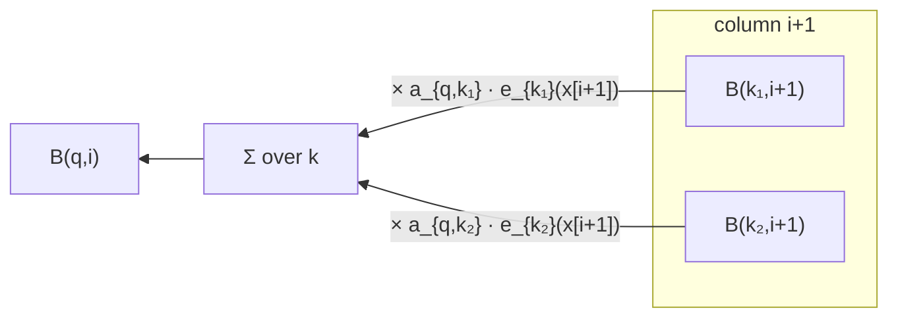

# Backward Algorithm

## Definition

The complement of the [[forward-algorithm|Forward algorithm]]: it also solves the **evaluation
problem**, but tabulates suffixes instead of prefixes (gik_1_2, p. 19).

**Backward table:**

```
B_x(q, i) = P(x[i+1..ℓ], π_i = q)
```

the probability to start in state `π_i = q` and then generate the suffix `x[i+1..ℓ]` of `x`.

## Pseudocode

```text
ALGORITHM Backward(M, x[1..ℓ])
  In:  HMM M and sequence x[1..ℓ]
  Out: P(x | M)

  Init:
    for each q in Q:
      B_x(q, ℓ) <- a_{q,0}

  Iteration:
    for i = ℓ-1 down to 1:
      for each q in Q:
        B_x(q, i) <- SUM{ a_{q,k} * e_k(x[i+1]) * B_x(k, i+1) | k in Q }

  Termination:
    return SUM{ a_{0,k} * e_k(x[1]) * B_x(k, 1) | k in Q }
```



## Complexity

| Resource | Bound |
|---|---|
| Time | `O(\|Q\|² · ℓ)` |
| Space | `O(\|Q\| · ℓ)` |

## Pitfalls & exam traps

> [!warning]
> - The emission factor is **shifted**: `B_x(q, i)` multiplies `e_k(x[i+1])`, the emission of
>   the *next* symbol in the *next* state — unlike Forward, where `e_q(x[i])` is the emission in
>   the current state. Getting this off by one is the classic Backward mistake.
> - Correspondingly, the initialisation is at `i = ℓ` with `a_{q,0}` (the transition to the end
>   state), not at `i = 0`.
> - `B_x(q, i)` is *not* a conditional probability either — it is the joint probability of the
>   suffix together with being in state `q` at position `i`.

## Invariant / correctness argument

Both algorithms must return the same number, `P(x | M)`, since both sum over exactly the same
set of paths — Forward accumulating them from the left, Backward from the right. This makes
them a useful mutual check when implementing.

## Variants

| Variant | Change | Why |
|---|---|---|
| Scaled Backward | reuse the Forward column scale factors | underflow control; the factors must be the *same* ones, otherwise Forward and Backward no longer multiply correctly |
| Log-space Backward | store `log B`, combine with log-sum-exp | see [[log-space-computation]] |
| Posterior-decoding use | keep the full table | required, since [[posterior-decoding]] needs every cell |

## Related

- [[forward-algorithm]] — the prefix counterpart.
- [[posterior-decoding]] — multiplies the two tables together.
- [[baum-welch-algorithm]] — uses both tables in its E-step.
- [[hmm-tables-comparison]] — the three DP tables side by side.

## Sources

- gik_1_2, p. 19 (unit 2).
