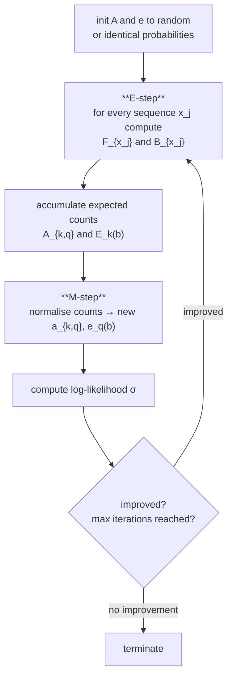

# Baum–Welch Algorithm

## Definition

The training algorithm for an [[hidden-markov-model|HMM]] when **the state sequence is
unknown** — the realistic case (gik_1_2, p. 22). It is
[[expectation-maximization|Expectation Maximization]] specialised to HMMs.

Goal: choose `(A, e)` such that

```
P(x₁,…,x_n | M = (Σ,Q,A,e))  ≥  P(x₁,…,x_n | M' = (Σ,Q,A',e'))
```

The problem is **NP-hard**, so Baum–Welch is a heuristic converging to a local optimum.

## Mechanism



## Pseudocode

```text
ALGORITHM BaumWelch(Σ, Q, x₁..x_n, r)
  In:  alphabet Σ, state set Q of an HMM, sequences x₁,…,x_n,
       and pseudocounts r_{k,q} and r_k(b)
  Out: M = (Σ, Q, A, e), an HMM

  Init: set all entries in A and e to random probabilities
        or to identical probabilities

  repeat
    1) for all j in [1,n]: compute F_{x_j}(q,i) and B_{x_j}(q,i)
         for all q in Q and i in [0, |x_j|]

    2) for all j in [1,n]: add the contribution of x_j to A and E

         // expected number of transitions k -> q
         A_{k,q} = SUM(j=1..n) (1/P(x_j)) *
                     SUM(i=1..|x_j|) F_{x_j}(k,i) * a_{k,q} * e_q(x_j[i+1]) * B_{x_j}(q,i+1)

         // expected number of times b is emitted in state k
         E_k(b)  = SUM(j=1..n) (1/P(x_j)) *
                     SUM(i in [1,|x_j|] with x_j[i] = b) F_{x_j}(k,i) * B_{x_j}(k,i)

    3) calculate new model parameters
         a_{k,q} <- A_{k,q} / SUM(q' in Q) A_{k,q'}
         e_q(b)  <- E_q(b)  / SUM(c in Σ)  E_q(c)

    4) set A <- (a_{k,q})_{k,q in Q},  e <- (e_q(b))_{q in Q, b in Σ}

    5) compute the log-likelihood σ(x₁,…,x_n | (A,e))

  until the log-likelihood did not improve
        or the maximum number of iterations is reached

  return M = (Σ, Q, A, e)
```

> [!note] Inference
> The pseudocounts `r_{k,q}` and `r_k(b)` are listed as inputs in the lecture notes
> (gik_1_2, p. 23) but the update formulas on that page are written without them. They are added
> to `A_{k,q}` and `E_k(b)` before the normalisation in step 3, exactly as in
> [[pseudocounts]] — otherwise an unobserved transition would stay at 0 forever.

## Why the E-step formula looks like that

The quantity `F_{x_j}(k,i) · a_{k,q} · e_q(x_j[i+1]) · B_{x_j}(q,i+1)` is the joint probability
of generating all of `x_j` *while* using the transition `k → q` between positions `i` and `i+1`.
Dividing by `P(x_j)` turns it into a posterior probability, and summing over all positions and
all sequences gives the **expected number of times** that transition was used. Exactly the
counting of case 1 in [[hmm-parameter-training]], but with expected counts instead of observed
ones.

Compare the structure to [[expectation-maximization]] on a [[mixture-model]]: the
responsibilities `r_i` play the same role as these posterior transition probabilities.

## Complexity

| Step | Cost |
|---|---|
| Forward + Backward, per sequence of length `ℓ` | `O(\|Q\|² · ℓ)` |
| One full iteration over `n` sequences | `O(\|Q\|² · Σ_j \|x_j\|)` |
| Space | `O(\|Q\| · max_j \|x_j\|)` |

## Invariant / correctness argument

Each iteration never decreases the log-likelihood. Termination: when the log-likelihood did not
improve, or a maximum number of iterations is reached. **It converges to a local maximum — run
it several times to reach the global maximum** (gik_1_2, p. 23).

## Pitfalls & exam traps

> [!warning]
> - Local maximum only. The result depends on the initialisation; multiple restarts are part of
>   the method, not an optional extra.
> - The `1/P(x_j)` normaliser is **per sequence** — each `x_j` has its own `P(x_j)`, obtained
>   from its own Forward/Backward termination.
> - The emission count `E_k(b)` sums only over positions where `x_j[i] = b`, and uses
>   `F·B` at the *same* index `i`; the transition count uses `i` and `i+1`.
> - The topology of the HMM is fixed in advance and is not learned.

## Variants

- When the state sequences **are** known, no iteration is needed — count directly, see
  [[hmm-parameter-training]] case 1.
- The general template is [[expectation-maximization]].

## Related

- [[expectation-maximization]] — the general algorithm this instantiates.
- [[forward-algorithm]], [[backward-algorithm]] — called in every E-step.
- [[hmm-parameter-training]] — the problem statement and the known-states case.
- [[pseudocounts]] — required inputs.
- [[hmm-three-problems]] — Baum–Welch solves the learning problem.

## Sources

- gik_1_2, pp. 22–23 (unit 2).
