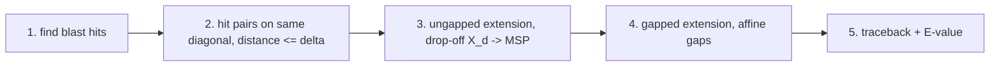
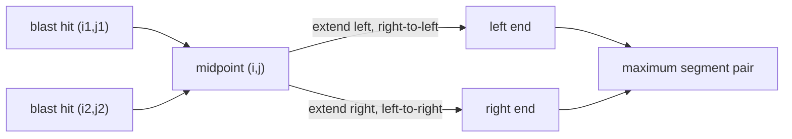
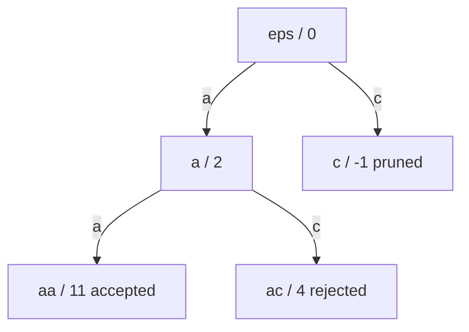

# BLAST

## Definition

**BLAST** — **B**asic **L**ocal **A**lignment **S**earch **T**ool — is a database-search method
organised as **five stages**, each reducing the search space further while being more fine-grained
and slower than the previous one (fsa_part2, p. 21):

1. find blast hits
2. identify pairs of hits on the same diagonal
3. perform **ungapped** extension
4. perform **gapped** extension
5. collect traceback information and display alignments

Symbols: `w` — query, `n = |w|`; `u` — database sequence, `m = |u|`; `q ∈ N` — seed length;
`k >= 0` — hit score threshold; `σ` — scoring function; `r = |A|`; `δ` — maximal distance between
two hits on a diagonal; `X_d > 0` — drop-off.

## Why it matters

Where [[fasta-database-search]] seeds on **exact** q-gram matches, BLAST seeds on q-grams that
merely **score well** against a query q-gram. That makes it far more sensitive for proteins, where
conservative substitutions are common and exact 6-mers are rare. The cost of the extra sensitivity
is the `k`-environment construction, which is paid once per query.

## Construction / Mechanism



### Stage 1 — blast hit

Each database sequence is compared with the query sequence; **no indels are allowed** at this stage
(fsa_part2, p. 21). For `q ∈ N` and `k >= 0`, a **blast hit** is a pair `(i, j)` of indices with

```
score_σ( u[i..i+q-1], w[j..j+q-1] ) >= k
```

This generalises exact q-gram identity (cf. [[match-count]]) to a scoring threshold.

### Stage 1 machinery — the `k`-environment and its trie

Preprocess the query `w` by constructing the **`k`-environment** (k-Umgebung) (fsa_part2, p. 22):

```
Env_k(w) = { (s, j) | s ∈ A^q,  1 <= j <= |w| - q + 1,
                      score_σ( s, w[j .. j+q-1] ) >= k }
```

— for every position in `w`, all q-grams `s` achieving score `>= k` against the query q-gram at
that position.

`Env_k(w)` is computed by a **trie** `S` over `A^q` with branch-and-bound pruning
(fsa_part2, p. 22):

- A trie node `x` represents a sequence `y` of length `q'` with `q' <= q`; at the node one maintains
  the partial score `score_σ( y, x[1..q'] )` against the current query q-gram.
- Each node at depth `q` whose score is `>= k` represents a sequence of `Env_k(w)`.
- **Stop descending into a subtrie as soon as score `>= k` can no longer be reached** — this is
  what keeps the enumeration far below `r^q`.

Representation of `Env_k(w)` (fsa_part2, p. 23):

- each `s ∈ A^q` is coded as an integer `c` with `0 <= c <= r^q - 1` (see [[q-gram]]);
- a **bit vector** `V` of `r^q` bits with `V[s] = 1` iff `(s, j) ∈ Env_k(w)` for some `j`;
- for each `s` with `V[s] = 1`, the position list `Pos(s) = { j | (s, j) ∈ Env_k(w) }` — the
  analogue of `h_w` in FASTA.

Steps (1)–(3) depend only on `w` and are done **once**; step (4) depends only on `u`. After
preprocessing, a database sequence is processed in `O(|u| + z)` where `z` is the number of blast
hits (fsa_part2, p. 23).

### Stage 2 — hit pairs on one diagonal

Look for pairs of blast hits on the **same diagonal** within maximal distance `δ`
(fsa_part2, p. 24). Hits `(i, j)` and `(i', j')` are on the same diagonal iff

```
d = j - i = j' - i'
```

and with `i < i'` there is `h > 0` with `i + h = i'` and `j + h = j'`. Hits on a given diagonal
arrive in increasing position order, so one keeps `f(d) = i` of the **last** hit seen on diagonal
`d`; a new hit `(i', j')` forms a **relevant blast hit pair** with `( f(d), d + f(d) )` iff
`i' - f(d) <= δ`; then `f(d) <- i'`.

### Stage 3 — ungapped extension and the MSP

Determine whether the hit pair lies in a region of pairwise similarity (fsa_part2, p. 25). The
**midpoint** `(i, j)` between the two hits is the starting point:

- **extension to the left**: `u[1..i-1]` and `w[1..j-1]` compared **right-to-left**, character
  pairs `( u[i-l], w[j-l] )` with `1 <= l <= min{i-1, j-1}`;
- **extension to the right**: `u[i..m]` and `w[j..n]` compared **left-to-right**, character pairs
  `( u[i+r], w[j+r] )` with `0 <= r <= min{m-i, n-j}`.

Scores are accumulated and the maximum `X_max` reached during extension is tracked. **Stop** when
the running score has fallen to `X_max - X_d`, where the **drop-off** `X_d > 0` controls
sensitivity. The sequence pair delivered by the extensions `(l, r)` is the **maximum segment pair
(MSP)**. For every MSP a significance score is computed; if it beats a predefined significance
threshold, the MSP goes to the next stage (fsa_part2, p. 25).



### Stage 4 — gapped extension

Determine whether the high-scoring ungapped region is part of a larger, higher-scoring alignment
(fsa_part2, p. 26). Only insertions and deletions that **augment** the high-scoring ungapped
alignment are explored:

- identify a **seed point** lying within a high-scoring portion of the ungapped region;
- use **affine gap scores** (see [[gap-cost-model]], [[gotoh-affine-gap-alignment]]);
- stop when the score falls below the drop-off `X_d`;
- when the overall score exceeds some value, pass to stage 5.

### Stage 5 — traceback and E-value

Collect traceback information, display the alignments, and report significance using
[[karlin-altschul-statistics]]: nominal score `S`, normalized score `S' = (λ·S − ln K)/ln 2`, and
`E = m·n / 2^{S'}`, which gives the cutoff parameter (fsa_part2, p. 26).

## Pseudocode

```text
ALGORITHM BuildEnvironment(w[1..n], q, k, sigma)       // stage 1 preprocessing
  for c = 0 to r^q - 1:  V[c] <- 0
  for j = 1 to n - q + 1:
    x <- w[j .. j+q-1]
    TrieWalk(root, empty, 0, x, j)                     // branch-and-bound over A^q
  return V, Pos

ALGORITHM TrieWalk(node, y, score, x, j)
  q' <- |y|
  if q' = q:
    if score >= k:
      c <- code(y)
      V[c] <- 1
      append j to Pos(c)
    return
  if score + maxRemaining(q - q') < k:                 // bound: best possible completion
    return                                             // prune this subtrie
  for each a in A:
    TrieWalk( child(node, a), y·a, score + sigma(a, x[q'+1]), x, j )
```

```text
ALGORITHM BlastStages1to3(u[1..m], w[1..n], q, k, delta, X_d, V, Pos, sigma)
  for d = -m to n:  f[d] <- undefined                  // last hit position per diagonal
  for i = 1 to m - q + 1:                              // slide window of length q over u
    c <- code(u[i .. i+q-1])                           // O(1) rolling update
    if V[c] = 1:
      for each j in Pos(c):                            // (i, j) is a blast hit
        d <- j - i
        if f[d] is defined and i - f[d] <= delta:      // stage 2: relevant hit pair
          mid <- midpoint of ( f[d], d + f[d] ) and (i, j)
          MSP <- UngappedExtend(u, w, mid, X_d, sigma) // stage 3
          if significance(MSP) > threshold:
            report MSP to stage 4
        f[d] <- i
```

```text
ALGORITHM UngappedExtend(u[1..m], w[1..n], (i, j), X_d, sigma)
  score <- 0;  X_max <- 0;  best_l <- 0
  l <- 1                                               // extend left, right-to-left
  while l <= min{ i-1, j-1 }:
    score <- score + sigma( u[i-l], w[j-l] )
    if score > X_max:  X_max <- score;  best_l <- l
    if score <= X_max - X_d:  break
    l <- l + 1
  score <- 0;  X_max <- 0;  best_r <- 0
  rr <- 0                                              // extend right, left-to-right
  while rr <= min{ m-i, n-j }:
    score <- score + sigma( u[i+rr], w[j+rr] )
    if score > X_max:  X_max <- score;  best_r <- rr
    if score <= X_max - X_d:  break
    rr <- rr + 1
  return ( u[i-best_l .. i+best_r], w[j-best_l .. j+best_r] )   // the MSP
```

## Invariant / correctness argument

- **Trie pruning is sound.** The maintained value at a node is the exact partial score of the
  prefix; a subtrie is cut only when `score + maxRemaining < k`, i.e. even the best possible
  completion cannot reach `k`. No element of `Env_k(w)` is lost, so stage 1 enumerates `Env_k(w)`
  exactly (fsa_part2, p. 22).
- **`f(d)` is sufficient.** Hits on a diagonal are generated in increasing `i`, so when a new hit
  `(i', j')` arrives, the closest earlier hit on `d` is the last one seen. Storing one value per
  diagonal therefore loses no pair within distance `δ` (fsa_part2, p. 24).
- **Drop-off is a heuristic stop.** The extension stops at `X_max - X_d`; a higher-scoring
  continuation beyond the drop-off is never seen. BLAST therefore does **not** guarantee the optimal
  local alignment — unlike [[smith-waterman]].

## Variants

- **`k = perfect match score`** reduces `Env_k(w)` to exact q-grams, degenerating BLAST into a
  FASTA-like exact-seed search.
- **Two-hit vs one-hit seeding**: stage 2 as described requires a *pair* of hits on a diagonal;
  accepting single hits raises sensitivity and cost.
- **`δ` and `X_d`** are the sensitivity/speed knobs: larger `δ` admits more hit pairs, larger `X_d`
  extends further before giving up.
- **Ungapped only**: stopping after stage 3 reports MSPs without gapped extension.

## Complexity

| Step | Time | Space |
|---|---:|---:|
| Build `Env_k(w)` via pruned trie | output-sensitive, `O(\|Env_k(w)\|·q)` with pruning; `O(r^q·q)` worst case | `O(r^q)` bits for `V` + `O(\|Env_k(w)\|)` for `Pos` |
| Stages 1–3 preprocessing of `w` | done **once** per query | `O(r^q + \|Env_k(w)\|)` |
| Process one database sequence `u` | `O(\|u\| + z)`, `z` = number of blast hits | `O(m + n)` for `f` |
| Ungapped extension per hit pair | `O(` extension length `)` | `O(1)` |
| Gapped extension per MSP | `O(` explored band `)` | `O(` band `)` |
| E-value per alignment | `O(1)` | `O(1)` |

(fsa_part2, pp. 22–23, 26)

> [!note] Inference
> The `O(|Env_k(w)|·q)` figure for the trie is the natural output-sensitive reading of the pruning
> rule; p. 22 states only that pruning occurs, without a bound.

## Worked example — the `Env_k` trie (p. 22)

`A = {a, c}`, `q = 2`, query q-gram `x = a a`, scoring `σ(a,a) = +2`, `σ(c,a) = -1`,
`σ` such that the completions below hold. Threshold `k = 5`.

Partial scores on the trie, root `ε = 0`:

| node `y` | depth `q'` | partial `score_σ(y, x[1..q'])` | action |
|---|---:|---:|---|
| `ε` | 0 | 0 | expand |
| `a` | 1 | 2 | expand (best completion `+9` ⇒ can reach 5) |
| `c` | 1 | −1 | prune if no completion can reach `k` |
| `aa` | 2 | **11** | depth `q`, `11 >= 5` ⇒ `(aa, j) ∈ Env_k(w)` |
| `ac` | 2 | **4** | depth `q`, `4 < 5` ⇒ rejected |



So for this query position `j`, `Env_k(w)` receives `(aa, j)` only; `V[code(aa)] = V[0] <- 1` and
`j` is appended to `Pos(0)`.

> [!question]
> The node scores on p. 22 (`a/2`, `ac/4`, `aa/11`) are not additively consistent with a single
> fixed substitution score for the second character (`2 + s = 11` and `2 + s' = 4` require
> `s = 9`, `s' = 2`). The handwritten values are reproduced as transcribed; the *mechanism*
> — maintain a partial score per node, accept at depth `q` if `>= k`, prune when `k` is
> unreachable — is what matters.

## Worked example — stage 2 diagonal bookkeeping

`δ = 10`. Blast hits arrive on diagonal `d = 4`: `(3, 7)`, `(9, 13)`, `(25, 29)`.

| incoming hit | `d = j - i` | `f(d)` before | `i' - f(d)` | `<= δ`? | action | `f(d)` after |
|---|---:|---:|---:|---|---|---:|
| `(3, 7)` | 4 | — | — | — | first hit on `d` | 3 |
| `(9, 13)` | 4 | 3 | 6 | yes | **relevant pair** `(3,7)`–`(9,13)`, midpoint `(6, 10)` | 9 |
| `(25, 29)` | 4 | 9 | 16 | no | no pair; just update | 25 |

Stage 3 starts the ungapped extension at `(6, 10)`.

## Pitfalls & exam traps

> [!warning]
> - A blast hit is a **score** threshold, not an equality test — this is the one structural
>   difference to FASTA's hot spots.
> - `V` is indexed by the q-gram code `s`, while `Pos(s)` holds **query positions** `j`. Two
>   different index spaces.
> - Stage 2 needs **two** hits on a diagonal within `δ`; a single isolated hit is dropped.
> - The ungapped extension starts at the **midpoint** between the two hits, not at either hit.
> - The stop condition is `X_max - X_d` — relative to the **best score so far**, not to zero and not
>   to the current score.
> - The drop-off `X_d` is used in **both** stage 3 and stage 4.
> - Affine gap costs appear only in stage 4; stages 1–3 are indel-free.
> - BLAST is a heuristic: pruning, drop-off and the `δ` window can all lose a true optimal local
>   alignment.
> - Preprocessing cost `O(r^q)` for `V` is per **query**, not per database sequence — that is why
>   scanning the database is `O(|u| + z)`.

## Related

- [[fasta-database-search]] — the predecessor: exact q-gram hot spots and diagonal runs instead of
  scored seeds.
- [[karlin-altschul-statistics]] — stage 5 significance: `S'` and the E-value.
- [[q-gram]] — seed length `q` and the integer coding indexing `V`.
- [[match-count]] — identity counting in a q-gram pair, the unscored ancestor of the hit condition.
- [[score-function]] — supplies `score_σ` for hits, extension and MSP scoring.
- [[gap-cost-model]] — affine gap scores used in stage 4.
- [[gotoh-affine-gap-alignment]] — exact DP with affine gaps, which stage 4 approximates locally.
- [[smith-waterman]] — the exact local alignment BLAST trades away for speed.
- [[position-specific-scoring-matrix]] — profile scoring, the natural extension of `score_σ` for
  iterated search.
- [[alignment-significance]] — the general framework behind the MSP significance test.
- [[fsa_part2]] — source page for this unit.

## Sources

- fsa_part2, pp. 21–26 (raw file `raw/foundations_seqzence_analysis_part2.pdf`)
