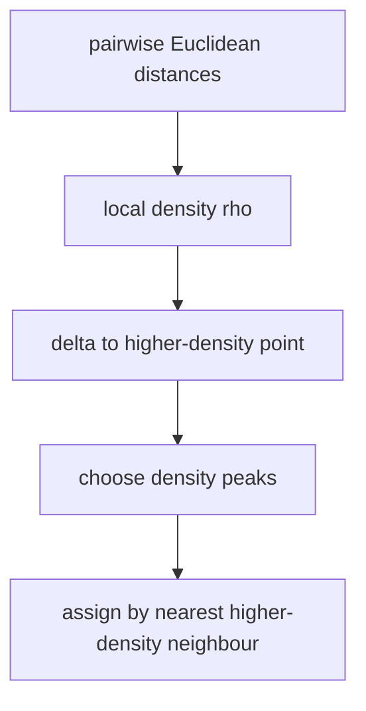

# Density Peak Clustering

## Definition

Density peak clustering treats points with high local density `rho` and large distance `delta` to
any higher-density point as cluster centres. Other points inherit the cluster of their nearest
higher-density neighbour (gik_6, pp. 29-31).

## Why it matters

The final unit applies algorithmic thinking beyond strings: clustering gene-expression profiles
means partitioning `n` points in `m`-dimensional expression space into biologically meaningful
groups, choosing the number of clusters from the data (gik_6, p. 29).

## Construction / Mechanism



The notes first define a cutoff density using a distance threshold `d_c`, then replace the hard
threshold by a Gaussian kernel `q(d)=exp(-(d/d_c)^2)` (gik_6, pp. 29-30).

## Pseudocode

```text
ALGORITHM DensityPeakClustering(P, dc, threshold)
  for each pair (alpha, beta):
    D[alpha,beta] <- EuclideanDistance(alpha, beta)
  for each point alpha:
    rho[alpha] <- sum over beta in P of exp(-(D[alpha,beta] / dc)^2)
  for each point alpha:
    if rho[alpha] is maximum over P:
      delta[alpha] <- maximum distance from alpha to any point
    else:
      delta[alpha] <- minimum D[alpha,beta] over beta with rho[beta] > rho[alpha]
  choose centres with large rho and large delta according to threshold
  process points in decreasing rho:
    if alpha is not a centre:
      assign alpha to the cluster of its nearest higher-density neighbour
  return clusters
```

## Invariant / correctness argument

When points are processed in decreasing `rho`, every non-centre point's nearest higher-density
neighbour has already been assigned. Therefore cluster membership propagates from chosen density
peaks down the density order (gik_6, p. 31).

## Complexity

| Operation | Time | Space |
|---|---:|---:|
| Pairwise Euclidean distances | `O(n^2 m)` | `O(n^2)` |
| Compute densities | `O(n^2)` after distances | `O(n)` |
| Compute `delta` values | `O(n^2)` | `O(n)` |
| Sort/process density order | `O(n log n)` | `O(n)` |

## Worked example

For three one-dimensional points `0, 1, 10` and `d_c=2`, points `0` and `1` have high mutual
Gaussian contribution, while `10` is far from them. The decision graph has one dense centre near
`0/1` and a possible singleton outlier at `10` if its `delta` is large but `rho` is low.

## Variants

The hard cutoff version uses `rho(alpha)=# { beta : d(alpha,beta) < d_c }`; the Gaussian version
uses `rho_g(alpha)=sum_beta q(d(alpha,beta))` with `q(d)=exp(-(d/d_c)^2)` (gik_6, pp. 29-30).

## Pitfalls & exam traps

> [!warning]
> - High `rho` alone is not enough; centres need both high density and large `delta`.
> - The threshold may refer to number of clusters or a minimum `rho*delta` value (gik_6, p. 31).
> - Singleton/outlier points can have large `delta` but low `rho`; do not automatically call them
>   main clusters.

## Related

- [[probabilistic-model]] — earlier units model data distributions; this unit clusters expression
  points by geometry rather than likelihood.
- [[operational-taxonomic-unit]] — another clustering-like biological grouping, but by sequence
  identity thresholds.
- [[sheet-06]] — exercises the density and assignment procedure.

## Sources

- gik_6, pp. 29-31
