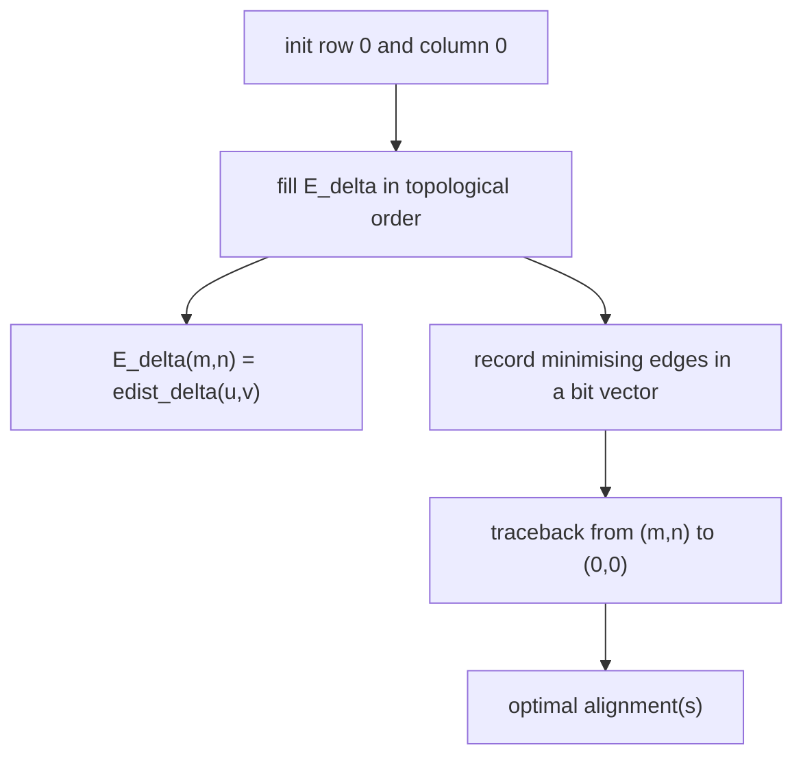

# Edit Distance DP

## Definition

The edit-distance dynamic program computes the `(m+1) × (n+1)` matrix `E_δ` where
(fsa_part1, p. 10)

```
E_δ(i, j) = Δ( (0,0) , (i,j) )
```

is the weight of a shortest path in the [[edit-graph]] `G(u,v)` from `(0,0)` to `(i,j)`,
equivalently the cost of an **optimal [[alignment]] of `u[1..i]` and `v[1..j]`**. Hence

```
E_δ(m, n) = edist_δ(u, v)
```

## Why it matters

It solves the [[cost-function|edit distance problem]] in `O(mn)` instead of enumerating the
exponentially many alignments counted by [[counting-alignments]]. It is the template every other
pairwise-comparison table on these pages is a variation of ([[smith-waterman]],
[[approximate-string-matching]], [[overlap-alignment]], [[gotoh-affine-gap-alignment]]).

## Construction / Mechanism

Specialising the DAG shortest-path formula `Δ(s,x) = min{ Δ(s,y) + w(y→x) }` to the three incoming
edges of `(i,j)` (fsa_part1, pp. 8, 10):

```
E_δ(i, j) =
  0                                                     , i = 0 , j = 0
  E_δ(0, j-1) + δ(ε -> v[j])                            , i = 0 , j > 0
  E_δ(i-1, 0) + δ(u[i] -> ε)                            , i > 0 , j = 0
  min { E_δ(i-1, j)   + δ(u[i] -> ε)   ,
        E_δ(i,   j-1) + δ(ε    -> v[j]),                 , i > 0 , j > 0
        E_δ(i-1, j-1) + δ(u[i] -> v[j]) }
```

Algorithm: initialise row 0 and column 0, then apply the recurrence in any topological order —
**columnwise or rowwise** (fsa_part1, pp. 9–10).



## Pseudocode

```text
ALGORITHM EditDistance(u[1..m], v[1..n], δ)
  E[0][0] <- 0
  for j = 1 to n:  E[0][j] <- E[0][j-1] + δ(ε -> v[j])
  for i = 1 to m:  E[i][0] <- E[i-1][0] + δ(u[i] -> ε)
  for i = 1 to m:
    for j = 1 to n:
      E[i][j] <- min( E[i-1][j]   + δ(u[i] -> ε),
                      E[i][j-1]   + δ(ε    -> v[j]),
                      E[i-1][j-1] + δ(u[i] -> v[j]) )
  return E[m][n]
```

**Distance only, `O(m)` space** — keep two columns (or one column plus two scalars)
(fsa_part1, p. 11):

```text
ALGORITHM EditDistanceLinearSpace(u[1..m], v[1..n], δ)
  for i = 0 to m:  prev[i] <- E[i][0]          // column 0 as above
  for j = 1 to n:
    cur[0] <- prev[0] + δ(ε -> v[j])
    for i = 1 to m:
      cur[i] <- min( cur[i-1]  + δ(u[i] -> ε),
                     prev[i]   + δ(ε    -> v[j]),
                     prev[i-1] + δ(u[i] -> v[j]) )
    prev <- cur
  return prev[m]
```

**Traceback** (fsa_part1, p. 11): from `E_δ(m,n)` go to an entry of its three-way minimum that
produced it, and so on down to `E_δ(0,0)`. An edge is a **minimising edge** iff
(fsa_part1, p. 11)

```
E_δ(i,j) = E_δ(i',j') + δ(α -> β)   for the edge (i',j') --[α -> β]--> (i,j)
```

so store the minimising edges in a bit vector while filling `E_δ`.

```text
ALGORITHM Traceback(E, u, v, δ)
  (i, j) <- (m, n) ;  A <- empty sequence
  while (i, j) != (0, 0):
    if i > 0 and j > 0 and E[i][j] = E[i-1][j-1] + δ(u[i] -> v[j]):
      prepend (u[i] -> v[j]) to A ;  (i, j) <- (i-1, j-1)
    else if i > 0 and E[i][j] = E[i-1][j] + δ(u[i] -> ε):
      prepend (u[i] -> ε) to A ;     i <- i - 1
    else:
      prepend (ε -> v[j]) to A ;     j <- j - 1
  return A
```

Enumerating **all** optimal alignments: branch on every minimising edge instead of taking the
first.

## Invariant / correctness argument

`E_δ(i,j) = Δ((0,0),(i,j))` holds for every node by induction over a topological order of the DAG
`G(u,v)`. The base `E_δ(0,0) = 0` is the empty path. For `(i,j) ≠ (0,0)` every path to `(i,j)`
has a last edge from some predecessor `(i',j')`; by the optimal-substructure theorem
(fsa_part1, p. 7) its prefix is a shortest path to `(i',j')`, i.e. has weight `E_δ(i',j')` by the
induction hypothesis. Minimising over the at most three predecessors therefore gives
`Δ((0,0),(i,j))`. Since path ≙ alignment (fsa_part1, p. 9), `E_δ(m,n) = edist_δ(u,v)`.

## Variants

- **Distance only**: two columns, `O(m)` space (fsa_part1, p. 11).
- **Full table + traceback**: `O(mn)` space, needed for the alignment (fsa_part1, p. 11).
- **Divide and conquer** (the distance-only algorithm used recursively, Hirschberg-style): each
  optimal alignment in `O(min{m,n})` space and `O(mn)` time (fsa_part1, p. 12).
- **All alignments**: `O(mn + z)` time, `z` = total length of all alignments output
  (fsa_part1, p. 12).
- Free start/end variations: [[approximate-string-matching]], [[overlap-alignment]],
  [[smith-waterman]].
- Gap models: [[gotoh-affine-gap-alignment]].

## Complexity

| Operation | Time | Space |
|---|---:|---:|
| Fill `E_δ` (each entry in constant time, `(m+1)(n+1)` entries) | `O(mn)` | `O(mn)` |
| Distance only (two columns) | `O(mn)` | `O(m)` |
| One traceback, table available | `O(|A|)` | `O(mn)` |
| Edit distance problem (distance + **all** optimal alignments) | `O(mn + z)` | `O(mn)` |
| Divide and conquer, one optimal alignment | `O(mn)` | `O(min{m,n})` |

(fsa_part1, pp. 11–12; `|A|` = alignment length, `z` = total length of all alignments.)

## Worked example

`u = ACGT` (`m = 4`), `v = AGT` (`n = 3`), **unit cost**.

`E_δ`, rows `i = 0..4` (`u`), columns `j = 0..3` (`v`):

| `i \ j` | **0** | **1** `A` | **2** `G` | **3** `T` |
|---|---:|---:|---:|---:|
| **0** | 0 | 1 | 2 | 3 |
| **1** `A` | 1 | **0** | 1 | 2 |
| **2** `C` | 2 | 1 | **1** | 2 |
| **3** `G` | 3 | 2 | **1** | 2 |
| **4** `T` | 4 | 3 | 2 | **1** |

Sample cell: `E(2,2)` with `u[2] = C`, `v[2] = G` (mismatch, cost 1):
`min( E(1,2)+1 , E(2,1)+1 , E(1,1)+1 ) = min(1+1, 1+1, 0+1) = 1`.

`edist_δ(ACGT, AGT) = E(4,3) = 1`.

Traceback from `(4,3)`: `E(4,3) = E(3,2) + δ(T→T) = 1 + 0` → diagonal;
`E(3,2) = E(2,1) + δ(G→G) = 1 + 0` → diagonal;
`E(2,1) = E(1,1) + δ(C→ε) = 0 + 1` → deletion;
`E(1,1) = E(0,0) + δ(A→A) = 0` → diagonal. Resulting alignment:

```
A C G T
A - G T
```

cost 1 ✓.

## Pitfalls & exam traps

> [!warning]
> - The table is `(m+1) × (n+1)`: row/column 0 are the **empty prefixes**, not the first
>   characters. `u[i]` sits in row `i`, so there is a constant off-by-one between index and row.
> - Row 0 of `E_δ` is **cumulative** (`E_δ(0,j) = E_δ(0,j-1) + δ(ε→v[j])`), not 0. Zero row 0 is
>   the *approximate matching* table `D_δ` (see [[approximate-string-matching]]).
> - Traceback needs the full `O(mn)` table *or* the divide-and-conquer trick; the two-column
>   version throws the path away.
> - "`O(mn)` traceback space" is about storage, not time: one traceback is `O(|A|)` time.
> - Multiple minimising edges = multiple optimal alignments; the edit distance problem asks for
>   **all** of them (fsa_part1, p. 6).

## Related

- [[edit-graph]] — `E_δ(i,j)` is the shortest-path distance `Δ((0,0),(i,j))` in it.
- [[cost-function]] — `δ` and what `edist_δ` means.
- [[alignment]] — what the traceback produces.
- [[counting-alignments]] — why DP rather than enumeration.
- [[unit-edit-distance]] — the unit-cost instance as covered in the GIK module.
- [[smith-waterman]] — the same table with an extra `0` and a max.
- [[approximate-string-matching]] — the same table with a free start row.
- [[overlap-alignment]] — the same table with a free start row *and* column.
- [[gotoh-affine-gap-alignment]] — the same table in three layers.

- [[fsa_part1]] ? source page for this part of the module.

## Sources

- fsa_part1, pp. 7–12 (`raw/foundations_sequence_analysis_part1.pdf`)
