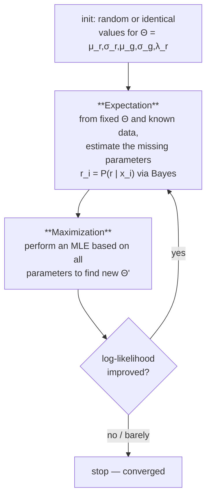

# Expectation Maximization (EM) Algorithm

## Definition

**Expectation Maximization is a very general iterative method for estimating parameters of
models from data** (gik_1_2, p. 7), specifically when some variables are hidden.

It can be used (gik_1_2, p. 11):
- for a single model with hidden variables;
- for more than two models;
- in higher dimensions.

## Why it matters

[[maximum-likelihood-estimation|MLE]] has a closed form only when you can count everything. In
a [[mixture-model]] without colouring you cannot: to estimate `μ_r` you need to know which
points are red, and to know which points are red you need `μ_r`. EM breaks this circularity by
alternating between the two.

## Mechanism — the two steps



- **Expectation**: from fixed model parameters `Θ` and known data, estimate the missing
  parameters (gik_1_2, p. 8).
- **Maximization**: perform an MLE based on all parameters to find new parameters `Θ'`
  (gik_1_2, p. 8).

Suppose there are guessed parameters `μ_r, σ_r, μ_g, σ_g` and `λ_r` — these are the fixed model
parameters. EM estimates the hidden parameter `P(r | x_i)`, with
`P(g | x_i) = 1 − P(r | x_i)`. To get there it first computes `P(x_i | r)`, which depends only
on the red normal, whereas `P(r | x_i)` depends on both normals (gik_1_2, p. 8).

## Pseudocode

```text
ALGORITHM EM-MixtureOfTwoNormals(x[1..n])
  In:  observations x[1..n]
  Out: parameters μ_r, σ_r, μ_g, σ_g, λ_r

  1) start with random values for μ_r, σ_r, μ_g, σ_g and λ_r

  repeat
    2) // E-step: compute P(r | x_i) according to Bayes' theorem, based on
       //         P(x_i|r), P(x_i|g), P(r) and the current parameters
       for i = 1 to n:
         r[i] <- P(r | x[i])
         g[i] <- 1 - r[i]

    3) // M-step for the red component
       μ_r' <- SUM(i: r[i] * x[i]) / SUM(i: r[i])
       σ_r' <- sqrt( SUM(i: r[i] * (x[i] - μ_r')^2) / SUM(i: r[i]) )
       λ_r' <- (1/n) * SUM(i: r[i])

    4) // M-step for the green component, computed analogously with g[i]
       μ_g' <- SUM(i: g[i] * x[i]) / SUM(i: g[i])
       σ_g' <- sqrt( SUM(i: g[i] * (x[i] - μ_g')^2) / SUM(i: g[i]) )

    5) ll <- ln L(Θ | x[1..n])          // log-likelihood, see below
       Θ  <- (μ_r', σ_r', μ_g', σ_g', λ_r')
  until ll barely differs from the previous step   // no improvement

  return Θ
```

Log-likelihood of the points with respect to `Θ` (gik_1_2, p. 10):

```
ln L(Θ | x₁,…,x_n) = ln Σ ( P(x_i | r) + P(x_i | g) )
```

If `ln L(Θ | x₁,…,x_n)` barely differs from the previous step, stop; else next iteration
(gik_1_2, p. 10).

## Implementation — the most time-consuming step

The E-step requires (gik_1_2, p. 11):

```
P(x_i | r) = ∫(x_i − ε to x_i + ε) φ(μ_r, σ_r, x) dx
```

This integral is **the most time-consuming step** and is evaluated numerically — see
[[numerical-integration-midpoint]]. With `m = 1` subinterval the approximation collapses to
`P(x_i | r) ≈ 2ε · φ(μ_r, σ_r, x_i)`, and then the `2ε` factors cancel in the Bayes quotient:

```
                    φ(μ_r, σ_r, x_i) P(r)
P(r | x_i) = ────────────────────────────────────────────
             φ(μ_r, σ_r, x_i) P(r) + φ(μ_g, σ_g, x_i) P(g)
```

ε is no longer used, which speeds up the computation considerably (gik_1_2, p. 11).

## Invariant / correctness argument

Each iteration never decreases the log-likelihood, so the sequence of likelihoods is monotone
and the parameters converge. But convergence is only **to a local maximum** — restart with
different initial values to improve the result (gik_1_2, p. 8).

## Complexity

| Step | Cost per iteration |
|---|---|
| E-step (naive, `m` subintervals) | `O(n · m)` |
| E-step (`m = 1` shortcut) | `O(n)` |
| M-step | `O(n)` |
| Total | `O(n)` per iteration × number of iterations |

## Pitfalls & exam traps

> [!warning]
> - EM finds a **local** maximum. The result depends on the initialisation; several restarts are
>   required to reach the global maximum.
> - It is noted as "bad for many points" (gik_1_2, p. 7) — the naive integral-based E-step is
>   the reason, which is why the `m = 1` shortcut matters.
> - The stopping criterion is on the **log-likelihood**, not on the parameters.

## Variants

The same E/M skeleton is used for [[hidden-markov-model|HMMs]] in unit 2, where it is called the
[[baum-welch-algorithm|Baum–Welch algorithm]]: the E-step computes expected transition and
emission counts with [[forward-algorithm|Forward]]/[[backward-algorithm|Backward]] instead of
responsibilities.

## Related

- [[mixture-model]] — the model EM is applied to in unit 1.
- [[baum-welch-algorithm]] — EM for HMMs.
- [[prior-posterior-probability]] — the E-step is one application of Bayes' theorem.
- [[numerical-integration-midpoint]] — the E-step integral.

## Sources

- gik_1_2, pp. 7–11 (unit 1).
