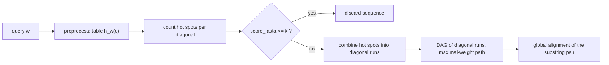
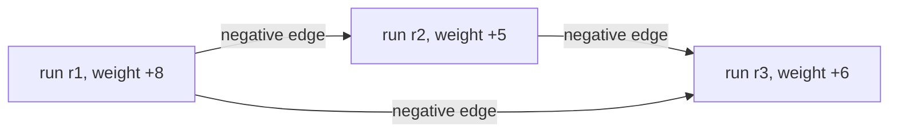

# FASTA Database Search

## Definition

**FASTA** is a heuristic database-search method. Given a **query sequence** `w` and a **set of
sequences** `S` (the database), find all sequences in `S` that have **local similarities** with `w`,
and display those similarities as alignments together with their positions in the sequence
(fsa_part2, p. 17).

**Idea:** eliminate many sequences cheaply and process only a few with the Smith–Waterman
algorithm (fsa_part2, p. 17).

Symbols: `w` — query, `n = |w|`; `u ∈ S` — a database sequence, `m = |u|`; `q` — q-gram length
(`q = 6` for DNA, `q = 2` for proteins); `r = |A|` — alphabet size; `d` — a diagonal; `k` — the
discard threshold.

## Why it matters

Exhaustive [[smith-waterman]] against a whole database is `O(m·n)` per sequence. FASTA replaces
that with a cascade of ever-finer filters, so the expensive DP runs only on the few surviving
candidates.

A usable **filter (similarity criterion)** must satisfy three conditions (fsa_part2, p. 17):

1. one must be able to decide quickly whether a database sequence satisfies the criterion;
2. the number of sequences satisfying it must be very small;
3. sequences **not** satisfying it must not have high local similarities.

## Construction / Mechanism



### Hot spots

Fix `u ∈ S` and a constant `q`. For each diagonal, count the number of common q-grams of `u` and
`w` — these are the **hot spots** (fsa_part2, p. 17). For `d` with `-m <= d <= n`:

```
hotsp(u, w, d) = | { (i, j) | 1 <= i <= m-q+1,  1 <= j <= n-q+1,
                             j - i = d,  u[i..i+q-1] = w[j..j+q-1] } |
score_fasta(u, w) = max { hotsp(u, w, d) | -m <= d <= n }
```

`hotsp(u, w, d)` is the number of matching q-grams whose start-position pair `(i, j)` lies on
diagonal `d`. The number of hot spots on a diagonal is the score of that diagonal.

> [!warning]
> **Difference to the q-gram distance model:** here the start positions of matching q-grams must
> have the **same distance** in both sequences (same diagonal). In [[q-gram-distance]] the order and
> position of q-grams is irrelevant (fsa_part2, p. 18).

### Query preprocessing — the table `h_w(c)`

Every q-gram is encoded as an integer `c` with `0 <= c <= r^q - 1` (see [[q-gram]]). The query is
preprocessed into a table such that for all `c` (fsa_part2, p. 18):

```
h_w(c) = { i | 1 <= i <= |w| - q + 1,  c = code(w[i..i+q-1]) }
```

— the positions in `w` where the q-gram with code `c` occurs. Space and time: `O(n + r^q)`. Each
list `h_w(c)` is produced in sorted (semi-ordered) order in `O(|h_w(c)|)` time.

The table is built by a **two-scan bucket construction** (fsa_part2, p. 19):

1. **First scan:** compute every `|h_w(c)|` and the prefix sums
   `P(c) = Σ_{c' < c} |h_w(c')|` — the start offset of bucket `c`.
2. Allocate `H` with `|H| = P(r^q - 1) + |h_w(r^q - 1)|` — all positions.
3. **Second scan:** for each window, write `H(P(c)) <- i` and increment `P(c)`.

## Pseudocode

```text
ALGORITHM PreprocessQuery(w[1..n], q, r)        // two-scan bucket construction
  for c = 0 to r^q - 1:  cnt[c] <- 0
  for i = 1 to n - q + 1:                        // first scan: bucket sizes
    cnt[ code(w[i..i+q-1]) ] <- cnt[ code(w[i..i+q-1]) ] + 1
  sum <- 0
  for c = 0 to r^q - 1:                          // prefix sums P(c)
    P[c] <- sum
    sum  <- sum + cnt[c]
  allocate H[0 .. sum-1]                         // |H| = P(r^q-1) + cnt[r^q-1]
  for i = 1 to n - q + 1:                        // second scan: fill buckets
    c      <- code(w[i..i+q-1])
    H[P[c]] <- i
    P[c]    <- P[c] + 1
  return H, P                                    // h_w(c) = H[ P[c]-cnt[c] .. P[c]-1 ]
```

```text
ALGORITHM FastaScoreDatabase(S, w[1..n], q, r)
  (H, P) <- PreprocessQuery(w, q, r)             // once, O(n + r^q)
  for each u in S:
    m <- |u|
    for d = -m to n:                             // initialize all diagonals
      hotsp[d] <- 0
    for j = 1 to m - q + 1:
      c <- code(u[j .. j+q-1])                   // code of the current q-gram of u
      for each i in h_w(c):
        hotsp[j - i] <- hotsp[j - i] + 1
    score_fasta(u, w) <- max{ hotsp[d] | -m <= d <= n }
  return the scores
```

> [!note] Inference
> The handwritten loop on p. 18 mixes the roles of `u` and `w` (`j` runs over `u`, `i` over
> positions in `w`, diagonal `j - i`, while the definition on p. 17 uses `j - i` with `i` in `u`).
> The code above is transcribed as written on p. 18; the sign convention of `d` must simply be used
> consistently.

### Diagonal runs and the DAG

If `score_fasta(u, w) <= k` the sequence is **discarded** (fsa_part2, p. 20). Otherwise:

- Look for **diagonal runs** in the edit-distance matrix: hot spots on the same diagonal separated
  by small gaps. A diagonal can contain **more than one** diagonal run.
- Score a run: `+` for hot spots, `−` for gaps.
- Build a **DAG** whose nodes are the diagonal runs with their weights. A run `r` has upper-left
  corner `(l_1(r), l_2(r))` and lower-right corner `(h_1(r), h_2(r))`. Nodes `r` and `r'` are
  connected iff

```
h_1(r) < l_1(r')  and  h_2(r) < l_2(r')
```

- Edges carry **negative** weight (the cost of jumping between diagonals). Compute paths of
  **maximal weight**.
- The upper-left corner of the first node and the lower-right corner of the last node of a path
  define a **pair of substrings** of `w` and `u`, which are aligned by **global alignment**. If the
  score of the optimal global alignment is `<= k`, reject (fsa_part2, p. 20).



## Invariant / correctness argument

Each matching q-gram pair `(i, j)` contributes to exactly one diagonal `d = j - i`, so the inner
loop increments exactly `|h_w(c)|` counters per window of `u` and `Σ_d hotsp(u,w,d)` counters in
total — the counts are exact, not approximate.

The bucket construction is correct because `P(c)` is the running write pointer of bucket `c`: after
the second scan each `P(c)` has advanced by exactly `|h_w(c)|`, so buckets neither overlap nor leave
gaps, and positions enter each bucket in increasing `i`, which is why `h_w(c)` comes out sorted.

FASTA is a **heuristic**: the filter is not a provable lower bound like
[[maximal-matches-distance]]. Condition 3 of the filter criterion (fsa_part2, p. 17) is an assumption
about real data, so false negatives are possible — a true local similarity with few exact q-gram
matches on one diagonal is lost.

## Variants

- `q = 6` for DNA, `q = 2` for proteins (fsa_part2, p. 17) — smaller `q` for the larger alphabet.
- Stop after stage 1 (`score_fasta` only) for a crude but very fast prefilter.
- Full pipeline with diagonal runs + DAG + global alignment for the survivors
  (fsa_part2, p. 20).

## Complexity

| Step | Time | Space |
|---|---:|---:|
| Preprocess query `w` into `h_w` | `O(n + r^q)` | `O(n + r^q)` |
| Produce one list `h_w(c)`, sorted | `O(\|h_w(c)\|)` | — |
| Process one database sequence `u` | `O( r^q + m + n + Σ_{d=-m}^{n} hotsp(u,w,d) )` | `O(m + n)` |
| Discarded sequences | no further cost | — |
| Survivors: global alignment of the substring pair | `O(m·n)` | `O(m·n)` |

The more common q-grams `u` and `w` share, the longer the computation; no time is wasted on
filtered-out sequences (fsa_part2, p. 19).

## Worked example — the `P(c)` / `H` bucket trace (p. 19)

`A = {a, c}`, `r = 2`, `q = 2`. Prefix-sum table after the first scan:

| q-gram | `aa` | `ac` | `ca` | `cc` |
|---|---:|---:|---:|---:|
| `P(c)` | 0 | 5 | 8 | 13 |

So bucket `aa` occupies `H[0..4]` (5 positions), `ac` occupies `H[5..7]` (3), `ca` occupies
`H[8..12]` (5), `cc` starts at `H[13]`. `H` has indices `0 … 13`.

Second scan (the boxed q-gram is the window currently scanned; `H(·)` is the slot written,
`P(·)++` the pointer increment), initial array shown as `[0 0 0]`:

| scanned window | action | `H` slot \| value |
|---|---|---|
| `[aa] a c c a` | `H(P(aa)) = 1` and `P(aa)++` | 0 \| 1 |
| `a [aa] c c a` | `H(P(aa)) = 2` and `P(aa)++` | 1 \| 2 |
| `a a [ac] c a` | `H(P(ac)) = 3` and `P(ac)++` | 3 \| 3 |

Result quoted on the page: `H[8 .. 12]` contains `{5, 7, 9, 11, 14}` — the five positions where
`ca` occurs in `w` (fsa_part2, p. 19).

> [!question]
> Row 3 of the trace is internally inconsistent: with `P(ac) = 5` the write should go to slot **5**,
> not slot 3. Either the handwritten `P(c)` row or the slot column of that row is in error. The
> *mechanism* — write at `P(c)`, then increment `P(c)` — is unambiguous and is what the exam will
> test; reproduce the mechanism, not this row's numbers.

## Pitfalls & exam traps

> [!warning]
> - Diagonals range over `-m <= d <= n`, so there are `m + n + 1` of them — the initialisation loop
>   is `O(m + n)` per database sequence and is easy to forget in a complexity argument.
> - The `r^q` term is paid **per database sequence** in the stated bound (fsa_part2, p. 19), because
>   the diagonal array and the code space are set up each time; only `h_w` is built once.
> - `score_fasta` is a **max over diagonals**, not a sum — one strong diagonal beats many weak ones.
> - Hot spots require **exact** q-gram equality. Non-exact seeds are BLAST's innovation
>   ([[blast]], `Env_k(w)`).
> - A single diagonal can hold several diagonal runs; do not collapse a diagonal to one node of the
>   DAG.
> - DAG edges have **negative** weights, yet a path of **maximal** weight is sought — a longest-path
>   problem, which is well-defined only because the graph is acyclic.
> - The final verification uses **global** alignment of the selected substring pair, even though the
>   overall task is *local* similarity.
> - FASTA has no proven bound relating its score to the true local-alignment score; it is a
>   heuristic filter.

## Related

- [[q-gram]] — q-gram coding, the basis of `h_w(c)` and of the hot-spot definition.
- [[q-gram-distance]] — the order-free comparison model FASTA explicitly departs from.
- [[blast]] — the successor method: non-exact seeds, diagonal hit pairs, ungapped/gapped extension.
- [[smith-waterman]] — the exact local aligner FASTA avoids running on every database sequence.
- [[alignment]] — the output form of the reported similarities.
- [[match-chaining-algorithm]] — the DAG of diagonal runs is a chaining problem of the same shape.
- [[alignment-significance]] — judging whether a surviving alignment is meaningful.
- [[fsa_part2]] — source page for this unit.

## Sources

- fsa_part2, pp. 17–20 (raw file `raw/foundations_seqzence_analysis_part2.pdf`)
