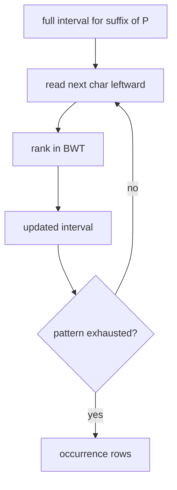

# FM-index Backward Search

## Definition

Backward search computes the suffix-array interval for a pattern `P` by reading `P` from right to
left and updating the interval with `count` and rank queries on `bwt` (gik_6, p. 13).

## Why it matters

It gives exact matching in time linear in pattern length while storing compressed BWT-derived data
rather than all suffix strings (gik_6, pp. 13-15).

## Construction / Mechanism



## Pseudocode

```text
ALGORITHM BackwardSearch(P[0..m-1], count, rank)
  l <- 0
  r <- n
  for i = m - 1 downto 0:
    a <- P[i]
    l <- count[a] + rank(a, l - 1)
    r <- count[a] + rank(a, r) - 1
    if l > r:
      return empty interval
  return [l, r]
```

## Invariant / correctness argument

After processing suffix `P[i+1..m-1]`, `[l,r]` contains exactly suffix-array rows prefixed by that
processed string. Prepending `a=P[i]` maps rows through LF to the rows prefixed by `aP[i+1..]`,
using first-column counts and BWT ranks (gik_6, p. 13).

## Complexity

| Operation | Time | Space |
|---|---:|---:|
| Search with constant-time rank | `O(m)` | `O(1)` extra |
| Search with sampled rank | `O(m * rankCost)` | `O(1)` extra |
| Locate all `z` positions | `O(z*d)` with sampling period `d` | `O(n/d)` samples |

## Worked example

For `bwt=annb$aa`, searching `ana` first restricts to rows beginning with `a`, then prepends `n`,
then prepends `a` again. The final interval has two rows, matching the two occurrences of `ana` in
`banana$`.

## Variants

The notes state the same interval can also be found by suffix-array binary search, but backward
search avoids repeated text comparisons and is faster in practice (gik_6, pp. 14-15).

## Pitfalls & exam traps

> [!warning]
> - Process the pattern right-to-left; left-to-right updates do not match LF.
> - Use `rank(a,l-1)` for the new left boundary and `rank(a,r)` for the right boundary.
> - `l>r` means absent, not an empty but valid interval.

## Related

- [[fm-index]] — stores the tables used here.
- [[burrows-wheeler-transform]] — supplies LF/rank semantics.
- [[suffix-array-pattern-matching]] — interval goal without compression.

## Sources

- gik_6, pp. 13-15
