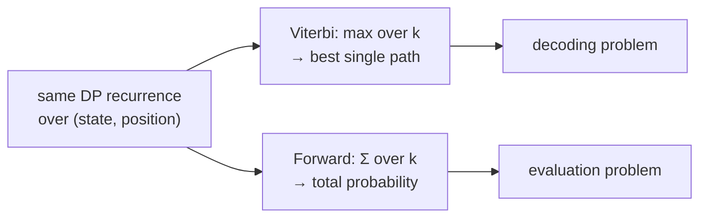

# Forward Algorithm

## Definition

Dynamic programming solution to the **evaluation problem**: compute `P(x | M)`, the probability
that `x` was generated by the HMM `M` (gik_1_2, p. 18).

```
P(x | M) = Σ(over all paths π) P(x, π | M)
```

We sum up the probabilities over all possible paths through `M`. Enumerating them is
exponential; the forward table makes it polynomial.

**Forward table:**

```
F_x(q, i) = P(x[1..i], π_i = q)
```

the probability that the model generates the prefix `x[1..i]` **and** reaches state `π_i = q`.

## Pseudocode

```text
ALGORITHM Forward(M, x[1..ℓ])
  In:  HMM M and sequence x[1..ℓ]
  Out: P(x | M)

  Init:
    for each q in Q:
      F_x(q, 0) <- 1  if q = 0
                   0  otherwise

  Iteration:
    for i = 1 to ℓ:
      for each q in Q:
        F_x(q, i) <- e_q(x[i]) * SUM{ F_x(k, i-1) * a_{k,q} | k in Q }

  Termination:
    return SUM{ F_x(k, ℓ) * a_{k,0} | k in Q }
```

## Relationship to Viterbi



The only change is `max` → `Σ`. Everything else, including the `e_q(x[i])` factor and the final
`a_{k,0}` transition, is identical.

## Complexity

| Resource | Bound |
|---|---|
| Time | `O(\|Q\|² · ℓ)` |
| Space | `O(\|Q\| · ℓ)`, or `O(\|Q\|)` if only `P(x \| M)` is needed |

> [!note] Inference
> The complexity is not stated separately for Forward in the notes, but the recurrence is
> structurally identical to [[viterbi-algorithm|Viterbi]], for which `O(|Q|² · ℓ)` is given
> explicitly (gik_1_2, p. 17).

## Invariant / correctness argument

After processing column `i`, `F_x(q, i)` holds the exact sum of `P(x[1..i], π)` over **all**
paths `π` that end in state `q` at position `i`. The recurrence is correct because every such
path decomposes uniquely into a path ending in some `k` at position `i−1`, the transition
`a_{k,q}`, and the emission `e_q(x[i])`; the sum over `k` therefore partitions the path set
without overlap or omission. Summing the last column against `a_{k,0}` closes every path at the
end state, so no path is counted twice and none is lost.

## Variants

| Variant | Change | Why |
|---|---|---|
| Scaled Forward | divide each column by its own sum, carry the scale factors | avoids underflow while keeping sums exact up to a known factor |
| Log-space Forward | store `log F`, combine with log-sum-exp | same goal; see [[log-space-computation]] |
| Linear-space Forward | keep only columns `i−1` and `i` | enough when only `P(x \| M)` is wanted, not posterior decoding |
| `max` instead of `Σ` | becomes [[viterbi-algorithm\|Viterbi]] | answers decoding instead of evaluation |

## Pitfalls & exam traps

> [!warning]
> - `F_x(q, i)` is a **joint** probability `P(x[1..i], π_i = q)`, not a conditional one. This
>   matters when combining it with the backward table in [[posterior-decoding]].
> - Summing probabilities underflows just as products do; scaling or
>   [[log-space-computation|log-space]] arithmetic is needed, though summing in log space
>   requires the log-sum-exp trick rather than plain addition.
> - The full `O(|Q|·ℓ)` table must be retained if the values are to be reused for posterior
>   decoding or [[baum-welch-algorithm|Baum–Welch]].

## Related

- [[backward-algorithm]] — the complementary table over suffixes.
- [[viterbi-algorithm]] — same recurrence with `max`.
- [[posterior-decoding]] — combines Forward and Backward.
- [[hmm-three-problems]] — where evaluation sits among the three tasks.
- [[hmm-tables-comparison]] — the three DP tables side by side.

## Sources

- gik_1_2, p. 18 (unit 2).
