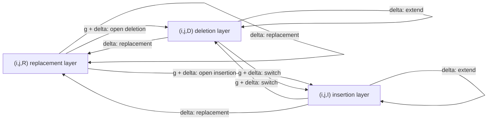

# Gotoh Affine Gap Alignment

## Definition

The affine-gap-cost DP computes an `(m+1) × (n+1) × {R, D, I}` table `A_afn` giving the minimum
cost of an [[alignment]] of `u[1..i]` and `v[1..j]` that **ends** with an edit operation of kind
`Y ∈ {R, D, I}`, under the affine [[gap-cost-model]]

```
δ_affine(w -> ε) = g + Σ_{i=1}^{|w|} δ(w[i] -> ε)
δ_affine(ε -> w) = g + Σ_{i=1}^{|w|} δ(ε -> w[i])
```

where `g` (written `q` on p. 26) is the **gap initiation cost** (fsa_part1, pp. 26, 29).

## Why it matters

Arbitrary gap-cost functions `g*` cost `O(mn(m+n))` because the extended edit graph has that many
edges (fsa_part1, pp. 25–26). The affine special case recovers `O(mn)` by replacing long jump
edges with a **three-layer graph** in which a gap is remembered by the *layer* rather than by its
length. Affine costs also give an incentive to keep gaps together rather than scattering many
small gaps (fsa_part1, p. 27) — which matches the biology of segment-level indel events.

## Construction / Mechanism

Three nodes per grid position: `(i,j,R)`, `(i,j,D)`, `(i,j,I)` (fsa_part1, p. 27). Intra-layer
edges in `D`/`I` extend a gap and pay only `δ`; edges entering `D` or `I` from another layer
**start** a gap and pay `g + δ`; replacement edges enter `R` from any layer and pay `δ`
(fsa_part1, p. 28). The full edge/cost table is on [[gap-cost-model]].



**Path/alignment correspondence** (fsa_part1, p. 28): a path `(i',j',X) → … → (i,j,Y)` corresponds
to an alignment of `u[i'+1..i]` and `v[j'+1..j]` ending with edit operation `Y`.
Start entries: `(0,0,R)`, `(0,0,D)`, `(0,0,I)`. Final entries: `(m,n,R)`, `(m,n,D)`, `(m,n,I)`.

## Recurrences

Base case `i = j = 0` (fsa_part1, p. 29):

```
A_afn(0, 0, R) = 0        and        A_afn(0, 0, Y) <= g   for Y ∈ {D, I}
```

Case `i > 0` or `j > 0`:

```
A_afn(i, j, R) = | ∞                                                            , if i = 0 or j = 0
                 | min{ A_afn(i-1, j-1, Y) + δ(u[i] -> v[j]) | Y ∈ {R, D, I} }  , else

A_afn(i, j, D) = | ∞                                                            , if i = 0
                 | min( { A_afn(i-1, j, D) + δ(u[i] -> ε) }
                        ∪ { A_afn(i-1, j, X) + g + δ(u[i] -> ε) | X ∈ {R, I} } ), else

A_afn(i, j, I) = | ∞                                                            , if j = 0
                 | min( { A_afn(i, j-1, I) + δ(ε -> v[j]) }
                        ∪ { A_afn(i, j-1, X) + g + δ(ε -> v[j]) | X ∈ {R, D} } ), else
```

Cost of an optimal affine-gap-cost alignment:

```
min { A_afn(m, n, X) | X ∈ {R, D, I} }
```

## Pseudocode

```text
ALGORITHM AffineGapAlignment(u[1..m], v[1..n], δ, g)
  A[0][0][R] <- 0 ;  A[0][0][D] <- g ;  A[0][0][I] <- g
  for i = 1 to m:
    A[i][0][R] <- ∞ ;  A[i][0][I] <- ∞
    A[i][0][D] <- min( A[i-1][0][D],
                       A[i-1][0][R] + g,
                       A[i-1][0][I] + g ) + δ(u[i] -> ε)
  for j = 1 to n:
    A[0][j][R] <- ∞ ;  A[0][j][D] <- ∞
    A[0][j][I] <- min( A[0][j-1][I],
                       A[0][j-1][R] + g,
                       A[0][j-1][D] + g ) + δ(ε -> v[j])
  for i = 1 to m:
    for j = 1 to n:
      A[i][j][R] <- min( A[i-1][j-1][R],
                         A[i-1][j-1][D],
                         A[i-1][j-1][I] ) + δ(u[i] -> v[j])
      A[i][j][D] <- min( A[i-1][j][D],
                         A[i-1][j][R] + g,
                         A[i-1][j][I] + g ) + δ(u[i] -> ε)
      A[i][j][I] <- min( A[i][j-1][I],
                         A[i][j-1][R] + g,
                         A[i][j-1][D] + g ) + δ(ε -> v[j])
  return min( A[m][n][R], A[m][n][D], A[m][n][I] )
```

Traceback: start in the layer attaining the final minimum and follow minimising edges, recording
the layer each step was taken in; a layer change into `D` or `I` is a gap start.

## Invariant / correctness argument

`A_afn(i,j,Y)` is the shortest-path weight from the start node set `{(0,0,X)}` to `(i,j,Y)` in the
three-layer graph. The graph is still a DAG (every edge increases `i`, `j` or both), so induction
over a topological order applies exactly as in [[edit-distance-dp]], using the
optimal-substructure theorem (fsa_part1, p. 7).

The layer is the only state needed because the affine cost of a gap decomposes as
`g + Σ δ`: the `g` is paid once, at the edge that *enters* the gap layer from outside, and every
subsequent character of the same gap is charged only `δ` on an intra-layer edge. Hence the length
of the current gap never has to be remembered — which is precisely what fails for a general `g*`
and forces `O(mn(m+n))` there (fsa_part1, pp. 26, 28).

## Variants

- **Linear gap costs** (`g = 0`): the three layers collapse into [[edit-distance-dp]].
- **General gap costs** `g*`: the `GGC_{δ,g*}` table, `O(m+n)` per entry, `O(mn(m+n))` total —
  labelled "Needleman–Wunsch algorithm" on the page (fsa_part1, p. 26).
- **Maximising version**: replace `min` by `max`, `δ` by a [[score-function]] `σ` and subtract
  the gap-open penalty; combines with BLOSUM62 for proteins.
- **Local affine alignment**: add the `0` of [[smith-waterman]] to the `R` layer.

## Complexity

| Operation | Time | Space |
|---|---:|---:|
| Affine gap costs (`A_afn`, three layers) | `O(mn)` | `O(mn)` |
| — constant factor | ×3 vs. plain edit distance (fsa_part1, p. 29) | ×3 |
| General gap costs (`GGC_{δ,g*}`) | `O(mn(m+n))` | `O(mn)` |
| Edges of the extended (jump-edge) edit graph | `O(mn(m+n))` | — |
| Plain edit distance, for comparison | `O(mn)` | `O(mn)` |

## Worked example

`u = ACCCGT` (`m = 6`), `v = AGT` (`n = 3`); `δ(a→a) = 0`, `δ(a→b) = 1` for `a ≠ b`,
`δ(a→ε) = δ(ε→a) = 1`, gap initiation `g = 3`.

Two candidate alignments:

**(a) one block gap of length 3**

```
A C C C G T
A - - - G T
```

Cost: `δ(A→A) = 0`, gap `CCC→ε` = `g + 3·1 = 6`, `δ(G→G) = 0`, `δ(T→T) = 0` → **6**.
This is the path `R → D → D → D → R → R`: one layer entry (paying `g`), two extensions.

**(b) three scattered gaps of length 1**

```
A C C C G T
A - G - T -
```

Cost: `0` + `(3+1)` + `δ(C→G)=1` + `(3+1)` + `δ(G→T)=1` + `(3+1)` = **14**.
Three layer entries → `g` paid three times.

Under **linear** costs (`g = 0`) alignment (a) costs 3 and (b) costs 5 — still (a), but the gap
between them is far smaller. Affine costs amplify the preference for contiguous gaps
(fsa_part1, p. 27).

Layer trace for (a), reading `A_afn` along the optimal path:

| step | node | layer edge kind | cost added | running total |
|---|---|---|---:|---:|
| 0 | `(0,0,R)` | — | 0 | 0 |
| 1 | `(1,1,R)` | replacement `A→A` | 0 | 0 |
| 2 | `(2,1,D)` | **gap start** `C→ε` | `g + 1 = 4` | 4 |
| 3 | `(3,1,D)` | gap extension `C→ε` | 1 | 5 |
| 4 | `(4,1,D)` | gap extension `C→ε` | 1 | 6 |
| 5 | `(5,2,R)` | replacement `G→G` | 0 | 6 |
| 6 | `(6,3,R)` | replacement `T→T` | 0 | 6 |

`min{ A_afn(6,3,X) } = 6` ✓.

## Pitfalls & exam traps

> [!warning]
> - `∞` entries are essential: `A_afn(i,j,R) = ∞` when `i = 0` or `j = 0` (no replacement can end
>   an alignment against an empty prefix), `A_afn(i,j,D) = ∞` when `i = 0`, `A_afn(i,j,I) = ∞`
>   when `j = 0`. Forgetting them lets illegal paths through.
> - The answer is `min` over the **three** final nodes, not `A_afn(m,n,R)`.
> - `D → I` and `I → D` are **gap starts** and pay `g` — switching gap direction opens a new gap.
> - The `R` layer is entered from any layer at cost `δ` only; there is no "replacement opening"
>   penalty.
> - The initiation constant is `q` on p. 26 and `g` on pp. 28–29 — same thing.
> - `O(mn)` time *and* space, but "3×" (fsa_part1, p. 29): three tables are maintained.
> - The base case on p. 29 is written as an **inequality** `A_afn(0,0,Y) <= g` for `Y ∈ {D,I}`;
>   setting them to exactly `g` is the usual concrete choice.

## Related

- [[gap-cost-model]] — defines affine and general gap costs and the layered graph's edge table.
- [[edit-distance-dp]] — the single-layer `g = 0` case.
- [[edit-graph]] — the base graph the three layers are copies of.
- [[cost-function]] — supplies the per-character `δ`.
- [[score-function]] — the maximising counterpart, e.g. BLOSUM62 plus affine gap penalties.
- [[alignment]] — what the traceback reconstructs.

- [[fsa_part1]] ? source page for this part of the module.

## Sources

- fsa_part1, pp. 25–29 (`raw/foundations_sequence_analysis_part1.pdf`)
