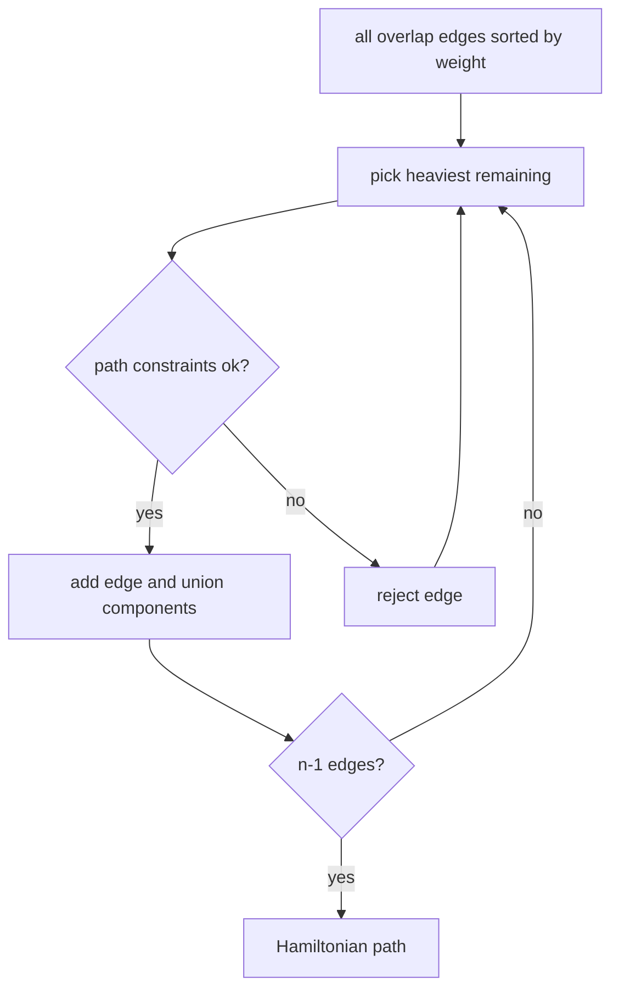

# Greedy Fragment Assembly

## Definition

The greedy assembly algorithm repeatedly selects the remaining overlap edge of maximum weight that
can still be part of a Hamiltonian path, using union-find and in/out-degree tests to reject edges
that would violate path structure (gik_6, pp. 23-26).

## Why it matters

It is the unit's concrete heuristic for the [[shortest-common-superstring]] formulation of
assembly. It is fast, but the notes give a counterexample where greedy is not optimal (gik_6,
p. 26).

## Construction / Mechanism



## Pseudocode

```text
ALGORITHM GreedyAssembly(OG(F))
  create union-find with one set for each fragment
  for each fragment f:
    indegreeChosen[f] <- false
    outdegreeChosen[f] <- false
  selected <- empty set
  sort edges by decreasing overlap length
  while |selected| < |F| - 1:
    choose next unused edge e = f -> g of maximum weight
    if indegreeChosen[g] = false and outdegreeChosen[f] = false and
       findSet(f) != findSet(g):
      add e to selected
      indegreeChosen[g] <- true
      outdegreeChosen[f] <- true
      union(findSet(f), findSet(g))
  return selected
```

## Invariant / correctness argument

The selected edges always form vertex-disjoint directed paths: each node has chosen indegree at
most one, chosen outdegree at most one, and union-find prevents cycles. After `|F|-1` accepted
edges, those paths have merged into one Hamiltonian path (gik_6, pp. 23-25).

## Complexity

| Operation | Time | Space |
|---|---:|---:|
| Sort overlap edges by counting sort | `O(ell + n^2)` in notes | `O(n^2)` |
| Constraint checks | `O(n^2)` total, `O(1)` each plus union-find | `O(n)` |
| Total after graph construction | `O(ell + n^2)` | `O(n^2)` |

## Worked example

The notes' counterexample has greedy choose a path spelling `ATGCATGCC` of length `9`, while an
optimal ordering spells `TGCATGCC` of length `8` (gik_6, p. 26). The local best overlap blocks a
shorter global superstring.

## Variants

Sorting can exploit the fact that overlap lengths lie in `0..ell-1`, enabling counting sort rather
than comparison sort (gik_6, p. 26).

## Pitfalls & exam traps

> [!warning]
> - Greedy chooses an edge, not a fragment pair after recomputing merged strings.
> - Cycle prevention is necessary; degree checks alone can create directed cycles.
> - Greedy is a heuristic, not an exact SCS algorithm.

## Related

- [[overlap-graph]] — input graph.
- [[shortest-common-superstring]] — objective being approximated.
- [[fragment-assembly]] — biological interpretation of the path.

## Sources

- gik_6, pp. 23-26
