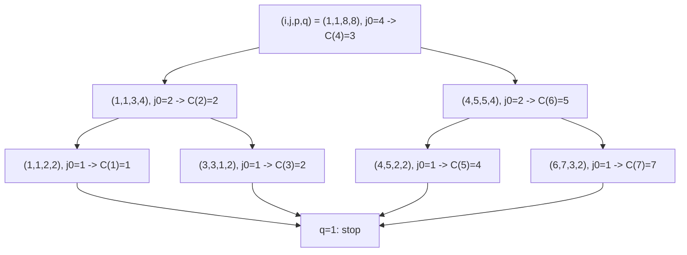

# Hirschberg Linear Space Alignment

## Definition

The **linear space alignment algorithm** computes **one optimal
[[alignment]]** of `u` (`|u| = m`) and `v` (`|v| = n`) in `O(m + n)` space instead of the `O(mn)`
space that [[edit-distance-dp]] needs for its traceback, while keeping `O(mn)` time
(fsa_part3, pp. 10, 14). It combines a two-column sweep of the edit table with a
divide-and-conquer recursion on the **middle column** `j_0 = ⌊n/2⌋`.

Symbols: `E_δ(i,j) = edist_δ(u[1..i], v[1..j])`; `E^j_col = E_δ(0,j), …, E_δ(m,j)` — the `j`-th
**distance column**; `j_0` — middle column; `(i_0, j_0)` — **crosspoint**; `R_{j_0}` — row index
table; `C` — crosspoint table; `δ` — [[cost-function]].

## Why it matters

For two 100 kb sequences the full table has `10^10` cells — infeasible. The distance alone is
already obtainable in two columns, but throwing the table away destroys the traceback
(fsa_part3, p. 11). Hirschberg's idea is to keep *just enough history* — one row index per column —
to reconstruct an optimal path.

## Construction / Mechanism

### Step 1 — the two-column sweep

Only `E^{j−1}_col` and `E^j_col` are ever stored (fsa_part3, p. 10):

```text
firstEDtabcolumn(E, u):
  E(0) <- 0
  for i = 1 upto |u| do  E(i) <- E(i-1) + δ(u[i] -> ε)

nextEDtabcolumn(E, E', u, b):
  E'(0) <- E(0) + δ(ε -> b)
  for i = 1 upto |u| do
    E'(i) <- min( E'(i-1) + δ(u[i] -> ε),
                  E(i)    + δ(ε -> b),
                  E(i-1)  + δ(u[i] -> b) )

evaluateEDtabcolumn(E, u, v):
  firstEDtabcolumn(E, u);  allocate E' of size |u| + 1
  for j <- 1 upto |v| do  nextEDtabcolumn(E, E', u, v[j]); E <- E'
```

This gives `edist_δ(u,v) = E^n_col(m)` in `O(m)` space — improvable further to one vector and two
scalars (fsa_part3, p. 11).

### Step 2 — crosspoints

An optimal alignment ≙ a path in the [[edit-graph]] `G_δ(u,v)` from `(0,0)` to `(m,n)`. A node is
"in the middle" iff it has the form `(−, j_0)` with `j_0 = ⌊n/2⌋` (fsa_part3, p. 12). Find the row
`i_0` such that `(i_0, j_0)` lies on a minimum path and recurse on `(0,0) → (i_0,j_0)` and
`(i_0,j_0) → (m,n)`. Each recursion step delivers one **crosspoint**; at recursion level `k` there
are `cps(k) = 2^k − 1` crosspoints and `k ≤ log₂ n`, so `cps(log₂ n) = n − 1`
(fsa_part3, p. 11).

### Step 3 — the row index table `R_{j_0}`

`R_{j_0}` is an `(m+1) × (n+1)` table of **row indices** whose columns are computed alongside
`E^j_col` (fsa_part3, p. 12). Invariantly, `R_{j_0}(i,j) = i_0` means: there is a minimum path from
`(i_0, j_0)` to `(i,j)`. Hence `R_{j_0}(m,n) = i_0` identifies the crosspoint.

```text
R_{j_0}(i,j) =
  undefined                 if 0 <= j <= j_0 - 1
  i                         else if j = j_0
  R_{j_0}(i, j-1)           else if E^j_col(i)   = E^{j-1}_col(i)   + δ(ε -> v[j])
  R_{j_0}(i-1, j-1)         else if E^j_col(i)   = E^{j-1}_col(i-1) + δ(u[i] -> v[j])
  R_{j_0}(i-1, j)           else   [ E^j_col(i)  = E^j_col(i-1)     + δ(u[i] -> ε) ]
```

Only two `R` columns are needed at a time, so this stays in `O(min{m,n})` space
(fsa_part3, p. 12).

### Step 4 — the crosspoint table `C`

`C` has `|C| = n` entries; `C(j_0) = i_0` records the crosspoint found for middle column `j_0`,
with `C(0) = 0` and `C(n) = m`. `C` **encodes an optimal alignment** (fsa_part3, p. 13): reading
`C(j−1) → C(j)` for `j = 1..n` gives, per column of `v`, how many characters of `u` are consumed.


### Representing the result — multi-eops lists

An alignment is stored compactly as a **multi-eops list** (Multi-Eops Liste)
`[X_1 Y_1 … X_k Y_k]` with `X_i ∈ {R, D, I}` and `Y_i > 0` — a run-length encoding — equivalently
as two equal-length lists `[X_1 … X_k]` and `[Y_1 … Y_k]`. Together with `u` and `v` the lists
determine the alignment (fsa_part3, p. 5).

## Pseudocode

```text
ALGORITHM evaluatecrosspoints(C, i, j, p, q)            # 1-based; E, R are global vectors
  if q >= 2:
    j_0 <- floor(q / 2)
    evaluateallcolumns(E, R, j_0, u[i .. i+p-1], v[j .. j+q-1])
    i_0 <- R[p]                                         # = R^q_{j_0}(p)
    C(j - 1 + j_0) <- i - 1 + i_0                       # crosspoint in global coordinates
    evaluatecrosspoints(C, i,       j,       i_0,     j_0)
    evaluatecrosspoints(C, i + i_0, j + j_0, p - i_0, q - j_0)

# top-level call
C(0) <- 0 ;  C(n) <- m
evaluatecrosspoints(C, 1, 1, m, n)
```

```text
ALGORITHM evaluateallcolumns(E, R, j_0, u[1..p], v[1..q])
  firstEDtabcolumn(E, u)
  for j = 1 to q:
    if j < j_0:
      nextEDtabcolumn(E, E', u, v[j])                   # E only
    else:
      nextEDtabRtabcolumn(E, E', R, R', v[j], j_0)      # E and R together
    E <- E' ;  R <- R'
```

```text
ALGORITHM nextEDtabRtabcolumn(E, E', R, R', b, j_0, j)
  E'(0) <- E(0) + δ(ε -> b)
  R'(0) <- (0 if j = j_0 else R(0))
  for i = 1 upto |u| do
    E'(i) <- min( E'(i-1) + δ(u[i] -> ε),
                  E(i)    + δ(ε -> b),
                  E(i-1)  + δ(u[i] -> b) )
    if j = j_0:                      R'(i) <- i
    else if E'(i) = E(i)   + δ(ε -> b):      R'(i) <- R(i)        # from (i, j-1)
    else if E'(i) = E(i-1) + δ(u[i] -> b):   R'(i) <- R(i-1)      # from (i-1, j-1)
    else:                                    R'(i) <- R'(i-1)     # from (i-1, j)
```

## Invariant / correctness argument

- **Two-column sweep.** `nextEDtabcolumn` is the [[edit-distance-dp]] recurrence restricted to one
  column: cell `(i,j)` depends only on `(i−1,j)`, `(i,j−1)`, `(i−1,j−1)`, all available in `E'` (so
  far) and `E` (previous column). The sweep therefore computes the same values as the full table.
- **`R` invariant.** For `j ≥ j_0`, `R_{j_0}(i,j) = i_0` holds iff some minimum path reaching
  `(i,j)` passes through `(i_0, j_0)`. Base case `j = j_0`: the path through `(i, j_0)` is trivially
  through row `i`. Inductive step: the recurrence copies `R` from exactly the predecessor that
  realised the minimum in `E^j_col(i)`, and by optimal substructure the prefix of that path is a
  minimum path to the predecessor, which by induction crosses column `j_0` at the recorded row.
- **Crosspoint correctness.** Applying the invariant at `(m,n)`: `i_0 = R_{j_0}(m,n)` lies on a
  minimum path `(0,0) → (m,n)`, hence `Δ((0,0),(m,n)) = Δ((0,0),(i_0,j_0)) + Δ((i_0,j_0),(m,n))`,
  which is exactly what licenses the two independent recursive calls (fsa_part3, p. 12).
- **Time.** The recursion halves `q` at each level; the two subproblems at a level together cover
  at most the full `m` rows and exactly `n` columns, so the work per level is `O(mn)`,
  `O(mn/2)`, `O(mn/4)`, … summing to `O(mn)` — the same bound as the full DP.
- **Space.** Two `E` columns + two `R` columns + the recursion stack of depth `≤ log₂ n` + the
  table `C` of size `n`: `O(m + n + log n) = O(m + n)` (fsa_part3, p. 14).

## Variants

- **Distance only** — `evaluateEDtabcolumn` alone, no `R`, no recursion: `O(m)` space
  (fsa_part3, p. 10).
- **One vector + two scalars** — the explicit further space reduction of the sweep
  (fsa_part3, p. 11).
- **`O(min{m,n})` space** — sweep along the shorter dimension by swapping `u` and `v`
  (fsa_part3, p. 14).
- **Full-table traceback** — [[edit-distance-dp]]: faster in practice, `O(mn)` space, and the only
  variant that can enumerate *all* optimal alignments.
- **Divide-and-conquer MSA** — the same cut-in-the-middle idea applied to `k` sequences at once,
  see [[progressive-alignment]] (fsa_part3, p. 24).

## Complexity

| Operation | Time | Space |
|---|---:|---:|
| One column (`nextEDtabcolumn`) | `O(m)` | `O(m)` |
| Distance only (`evaluateEDtabcolumn`) | `O(mn)` | `O(m)` |
| `E` + `R` sweep for one middle column | `O(mn)` | `O(m)` |
| `evaluatecrosspoints`, whole recursion | `O(mn)` | `O(m + n + log n) = O(m + n)` |
| Recursion depth / crosspoints at level `k` | `k ≤ log₂ n` / `cps(k) = 2^k − 1` | `O(n)` for `C` |
| Full-table DP, for comparison | `O(mn)` | `O(mn)` |

(fsa_part3, pp. 10–14)

## Worked example

> [!question]
> Pages 10–14 of fsa_part3 contain only schematic drawings (highlighted column pairs, a path
> through the middle column) and **no numeric trace**. The following trace on
> `u = acactcag` / `actacacg` is computed from the lecture's own recurrences and is reproduced here
> because the method is unlearnable without one.

> [!note] Inference
> Everything in this section below the input strings is derived, not transcribed. Unit cost `δ`:
> `δ(a→a) = 0`, every other operation `1`.

`u = a c a c t c a g` (`m = 8`), `v = a c t a c a c g` (`n = 8`).

### The full `E_δ` table (for checking; the algorithm never stores it)

| `i \ j` | 0 | 1 `a` | 2 `c` | 3 `t` | 4 `a` | 5 `c` | 6 `a` | 7 `c` | 8 `g` |
|---|---:|---:|---:|---:|---:|---:|---:|---:|---:|
| **0** | 0 | 1 | 2 | 3 | 4 | 5 | 6 | 7 | 8 |
| **1** `a` | 1 | 0 | 1 | 2 | 3 | 4 | 5 | 6 | 7 |
| **2** `c` | 2 | 1 | 0 | 1 | 2 | 3 | 4 | 5 | 6 |
| **3** `a` | 3 | 2 | 1 | 1 | **1** | 2 | 3 | 4 | 5 |
| **4** `c` | 4 | 3 | 2 | 2 | 2 | 1 | 2 | 3 | 4 |
| **5** `t` | 5 | 4 | 3 | 2 | 3 | 2 | 2 | 3 | 4 |
| **6** `c` | 6 | 5 | 4 | 3 | 3 | 3 | 3 | 2 | 3 |
| **7** `a` | 7 | 6 | 5 | 4 | 3 | 4 | 3 | 3 | 3 |
| **8** `g` | 8 | 7 | 6 | 5 | 4 | 4 | 4 | 4 | **3** |

`edist_δ(u,v) = E_δ(8,8) = 3`.

### Top-level call: `j_0 = ⌊8/2⌋ = 4`

`R_4`, columns `4..8` (columns `0..3` are **undefined**). Column 4 is the identity `R_4(i,4) = i`;
later columns propagate backwards along the minimising edge:

| `i` | `j=4` | `j=5` | `j=6` | `j=7` | `j=8` |
|---:|---:|---:|---:|---:|---:|
| 0 | 0 | 0 | 0 | 0 | 0 |
| 1 | 1 | 1 | 1 | 1 | 1 |
| 2 | 2 | 2 | 2 | 2 | 2 |
| 3 | 3 | 3 | 3 | 3 | **3** |
| 4 | 4 | 3 | 3 | 3 | 3 |
| 5 | 5 | 3 | 3 | 3 | 3 |
| 6 | 6 | 5 | 3 | 3 | 3 |
| 7 | 7 | 7 | 5 | 3 | 3 |
| 8 | 8 | 7 | 5 | 5 | **3** |

Sample cell `R_4(4,5)`: `E^5(4) = 1` and `E^4(3) + δ(u[4]→v[5]) = 1 + δ(c→c) = 1` ✓ — the diagonal
edge wins, so `R_4(4,5) ← R_4(3,4) = 3`.

`i_0 = R_4(8,8) = 3` ⇒ the crosspoint is **`(3, 4)`**, and `C(4) ← 3`.
Sanity check: `E_δ(3,4) = 1` and the sub-distance from `(3,4)` to `(8,8)` is `3 − 1 = 2` ✓.

### Recursion



Each call `(i,j,p,q)` solves the subproblem `u[i..i+p−1]` vs `v[j..j+q−1]`; the local crosspoint
`i_0` is mapped back by `C(j−1+j_0) ← i−1+i_0`. Recursion stops at `q = 1`.

### The crosspoint table `C`

| `j` | 0 | 1 | 2 | 3 | 4 | 5 | 6 | 7 | 8 |
|---|---:|---:|---:|---:|---:|---:|---:|---:|---:|
| `C(j)` | **0** | 1 | 2 | 2 | **3** | 4 | 5 | 7 | **8** |

`C(0) = 0` and `C(8) = 8 = m` as required.

### Decoding `C` into the alignment

Read the increments `C(j) − C(j−1)`:

| `j` | `v[j]` | `C(j−1) → C(j)` | increment | operation(s) |
|---:|---|---|---:|---|
| 1 | `a` | `0 → 1` | 1 | `a → a` match |
| 2 | `c` | `1 → 2` | 1 | `c → c` match |
| 3 | `t` | `2 → 2` | 0 | **insertion** `ε → t` |
| 4 | `a` | `2 → 3` | 1 | `a → a` match |
| 5 | `c` | `3 → 4` | 1 | `c → c` match |
| 6 | `a` | `4 → 5` | 1 | `t → a` **mismatch** |
| 7 | `c` | `5 → 7` | 2 | `c → c` match **+ deletion** `a → ε` |
| 8 | `g` | `7 → 8` | 1 | `g → g` match |

```
u:  a c - a c t c a g
v:  a c t a c a c - g
```

Cost `= 1` (insert `t`) `+ 1` (mismatch `t`/`a`) `+ 1` (delete `a`) `= 3 = edist_δ(u,v)` ✓.
As a multi-eops list: `[R 2, I 1, R 4, D 1, R 1]`.

## Pitfalls & exam traps

> [!warning]
> - `R_{j_0}` is **undefined for `j < j_0`** — the sweep runs `E` only up to `j_0−1` and starts
>   `R` exactly at `j_0`.
> - `R` stores a **row index**, not a distance. Mixing up `E` and `R` entries is the standard error.
> - The crosspoint is read off at `(m,n)`, i.e. `i_0 = R^n_{j_0}(m)` — not at column `j_0`.
> - `|C| = n` with `C(0) = 0` and `C(n) = m`: it is indexed by **columns of `v`**, storing rows of
>   `u`. One increment per column; an increment of `2` or more means deletions inside that column.
> - `C` entries are **non-decreasing**; a decrease means a bug.
> - The recursion halves the **column** range `q`, not `p`. Depth is `log₂ n`, not `log₂ m` —
>   put the shorter sequence in the column role to get `O(min{m,n})`.
> - Time is still `O(mn)`, only the constant doubles (the geometric series `1 + ½ + ¼ + …`). It is
>   *not* `O(mn log n)`.
> - The algorithm returns **one** optimal alignment. Enumerating all of them needs the full table.
> - `j_0 = ⌊q/2⌋` is computed on the **local** subproblem length `q`, then mapped to global
>   coordinates by `j − 1 + j_0`.

## Related

- [[edit-distance-dp]] — the `O(mn)`-space baseline, whose `O(m)`-space variant is step 1 here.
- [[edit-graph]] — the DAG in which crosspoints are nodes on a minimum path.
- [[alignment]] — the object `C` encodes.
- [[cost-function]] — supplies `δ` to every recurrence on this page.
- [[gotoh-affine-gap-alignment]] — three-layer table; the same linear-space trick applies per layer.
- [[smith-waterman]] — local alignment; linear space needs an extra pass to locate the maximum cell.
- [[progressive-alignment]] — divide-and-conquer alignment lifts this cut-in-the-middle idea to `k`
  sequences.
- [[fsa_part3]] — source page for this unit.

## Sources

- fsa_part3, pp. 5, 10–14 (`raw/foundations_sequence_analysis_part3.pdf`)
