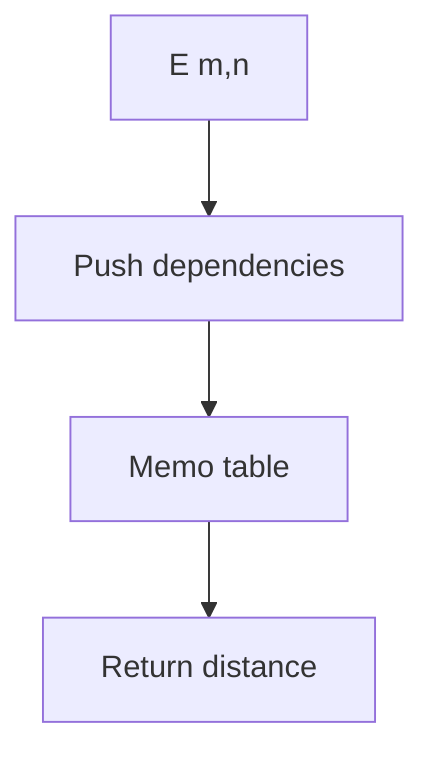

# Lazy Edit Distance

## Definition

Lazy edit distance evaluates only the unit-edit DP cells required to answer `E(m,n)`, memoising values and using a stack of pending cells (gik_3_4, pp. 14-15).

## Why it matters

When the true distance is small, the requested cells remain near the main diagonal, so the algorithm can be faster than full-table DP (gik_3_4, p. 14).

## Construction / Mechanism



## Pseudocode

```text
ALGORITHM LazyEditDistance(w[1..m], v[1..n])
  memo <- empty map
  stack <- [(m,n)]
  while stack is not empty:
    (i,j) <- pop stack
    if (i,j) is in memo: continue
    if i = 0: memo[i,j] <- j
    else if j = 0: memo[i,j] <- i
    else if (i-1,j-1) is not in memo:
      push (i,j); push (i-1,j-1)
    else if w[i] = v[j]:
      memo[i,j] <- memo[i-1,j-1]
    else if some required neighbour is missing:
      push (i,j)
      push each missing required neighbour
    else:
      memo[i,j] <- 1 + min(memo[i-1,j], memo[i,j-1], memo[i-1,j-1])
  return memo[m,n]
```

## Invariant / correctness argument

A cell is written only after every cell needed by the [[unit-edit-distance]] recurrence is already memoised; therefore the lazy value equals the full DP value. Only the evaluation order changes (gik_3_4, pp. 14-15).

## Variants

- Full table DP is simpler and has predictable `O(mn)` work.
- [[output-sensitive-edit-distance]] gives an explicit answer-dependent bound.

## Complexity

| Case | Time | Space |
|---|---:|---:|
| Small-distance band | proportional to evaluated cells | proportional to evaluated cells |
| Worst case | `O(mn)` | `O(mn)` |

## Worked example

For `w=v=ACGT`, the stack follows `(4,4),(3,3),(2,2),(1,1),(0,0)` and then copies 0 back through matches; no off-diagonal cells are needed (gik_3_4, p. 14).

## Pitfalls & exam traps

> [!warning]
> - Memoisation is essential; otherwise dependencies repeat.
> - The current cell must be pushed back before missing dependencies.
> - Lazy does not improve the worst-case bound.

## Related

- [[unit-edit-distance]] — recurrence being lazily evaluated.
- [[output-sensitive-edit-distance]] — front-based alternative.
- [[sheet-03]] — proves the local DP properties.

## Sources

- gik_3_4, pp. 13-15
