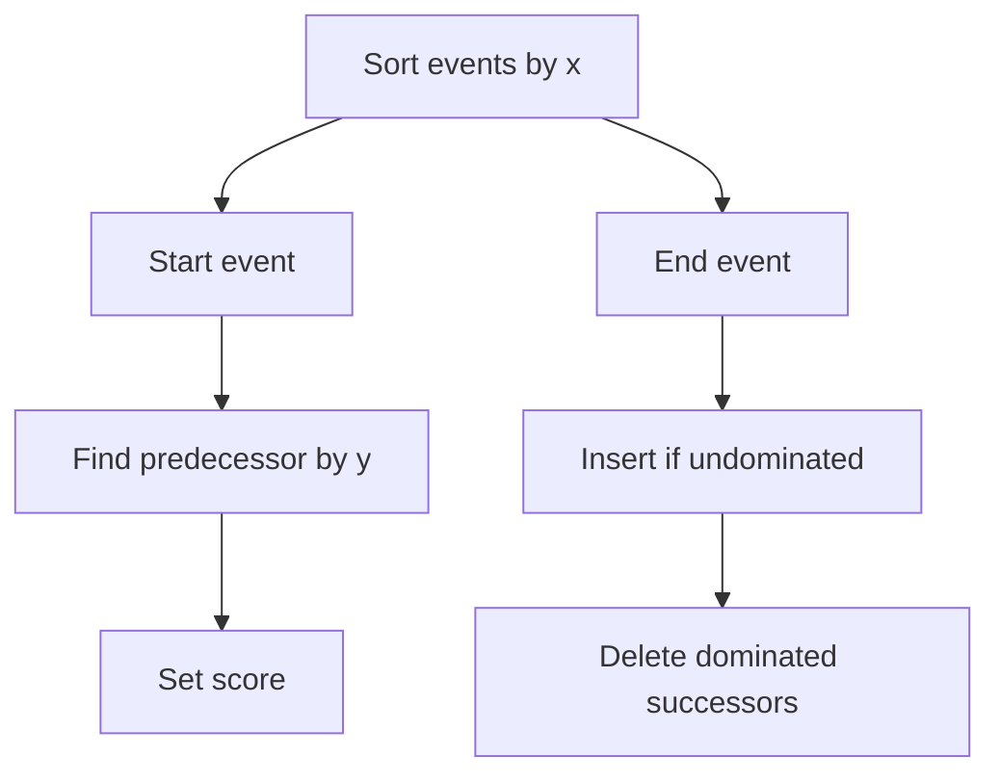

# Match Chaining Algorithm

## Definition

Match chaining algorithms compute a maximum-score chain of collinear non-overlapping matches. The notes give a simple `O(b^2)` DP and an efficient `O(b log b)` dictionary sweep (gik_3_4, pp. 29-34).

## Why it matters

The algorithm is phase 2 of [[anchor-based-sequence-comparison]]. Large match sets make the quadratic predecessor scan expensive (gik_3_4, pp. 26, 31-34).

## Construction / Mechanism



## Pseudocode

```text
ALGORITHM SimpleMatchChaining(M[1..b])
  sort M by end x-coordinate
  overall <- 0
  bestmatch <- nil
  for j = 1 to b:
    score[j] <- weight(M[j])
    predecessor[j] <- nil
    for i = 1 to j - 1:
      if M[i] << M[j] and score[j] < score[i] + weight(M[j]):
        score[j] <- score[i] + weight(M[j])
        predecessor[j] <- i
    if overall < score[j]:
      overall <- score[j]
      bestmatch <- j
  return overall, bestmatch, predecessor
```

```text
ALGORITHM EfficientMatchChaining(M)
  events <- starts and ends of all matches, sorted by x-coordinate
  D <- empty dictionary ordered by y-coordinate
  for each event (f, kind) in events:
    if kind = start:
      p <- predecessor in D with y < StartY(f)
      if p = nil:
        score[f] <- weight(f)
        pred[f] <- nil
      else:
        score[f] <- weight(f) + score[p]
        pred[f] <- p
    else:
      p <- predecessor in D with y < EndY(f)
      if p = nil or score[p] < score[f]:
        insert f into D at key EndY(f)
        q <- successor of f in D
        while q != nil and score[q] <= score[f]:
          delete q from D
          q <- successor of f in D
  return best score and predecessor links
```

## Invariant / correctness argument

In the simple DP, when match `j` is processed all possible predecessors have already been considered, so `score[j]` is the best chain ending at `j` (gik_3_4, pp. 29-31). In the sweep, dictionary `D` stores only undominated processed matches; a match ending no lower in `y` with no better score can never help a future start (gik_3_4, pp. 32-34).

## Variants

- Global chaining maximises sum of match weights.
- Local chaining subtracts gap penalties; see [[sheet-04]] (gik_3_4, pp. 35-36).

## Complexity

| Algorithm | Time | Space |
|---|---:|---:|
| Simple DP over `b` matches | `O(b^2)` | `O(b)` |
| Efficient dictionary sweep | `O(b log b)` | `O(b)` |
| Local chaining with `p` predecessors | `O(p·b)` | `O(b)` |

## Worked example

For `f1<<f2<<f3` with weights 2, 5, 4, the DP gives scores 2, 7, and 11. A dominated candidate ending later in `y` with score ≤7 is deleted by the efficient sweep (gik_3_4, pp. 31-34).

## Pitfalls & exam traps

> [!warning]
> - The efficient algorithm processes each match twice: start and end.
> - Events are sorted by `x`; dictionary operations are by `y`.
> - Deleting dominated successors is part of the proof and the runtime.

## Related

- [[match-chaining]] — formal predecessor relation.
- [[anchor-based-sequence-comparison]] — application context.
- [[sheet-04]] — local gap-penalised variant.

## Sources

- gik_3_4, pp. 29-36
