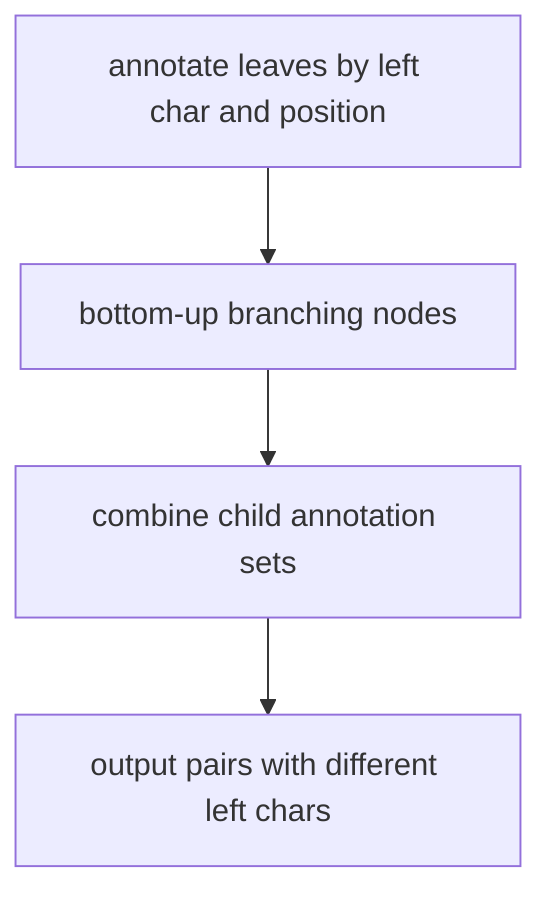

# Maximal Repeat Enumeration

## Definition

A repeat is a pair of equal substrings at two positions. It is maximal if it is both left-maximal
(the preceding characters differ or a boundary is hit) and right-maximal (the following
characters differ or a boundary is hit) (gik_5, p. 33).

## Why it matters

Maximal repeats summarise all exact repeats: non-maximal repeats are contained in maximal ones,
so they are the compact object to enumerate (gik_5, p. 33).
Unit 6 refines this hierarchy with [[supermaximal-repeat|supermaximal repeats]], which are maximal
repeats not contained in any other maximal repeat (gik_6, p. 1).

## Construction / Mechanism

Leaves are annotated by `(a,i)`, where `i` is the suffix start and `a` is the preceding character.
A bottom-up traversal combines annotations from child subtrees; pairs with different preceding
characters yield left-maximal repeats, and branching gives right-maximality (gik_5, pp. 34-35).



## Pseudocode

```text
ALGORITHM MaximalRepeats(T)
  for each leaf for suffix S[i..n]:
    if i = 1:
      annotate leaf with (boundary, i)
    else:
      annotate leaf with (S[i-1], i)
  for each branching node v in bottom-up order:
    A(v) <- empty family of sets grouped by left character
    for each edge v -> w:
      for each annotation (c, i) in A(w):
        for each annotation (d, j) already in A(v) with d != c:
          output ((i, i + depth(v) - 1), (j, j + depth(v) - 1))
        insert (c, i) into A(v)
```

## Invariant / correctness argument

A branching node of depth `q` represents substrings with at least two different right contexts,
so any pair output at that node is right-maximal. Requiring different left characters from the
annotation sets enforces left-maximality. Since annotations are merged bottom-up, every pair of
occurrences below the node is considered once (gik_5, pp. 33-36).

## Complexity

| Operation | Time | Space |
|---|---:|---:|
| Build suffix tree | `O(n)` | `O(n)` |
| Enumerate maximal repeats | `O(n + z)` | `O(n)` |
| Total | `O(n + z)` | `O(n)` |

## Worked example

For `S=ababa`, the substring `aba` occurs at positions `1` and `3`. It is right-maximal because
the second occurrence hits the boundary while the first is followed by `b`; it is left-maximal
because the first occurrence hits the boundary and the second is preceded by `b`.

## Variants

The same annotation idea can be adapted to report only repeats above a length threshold `ell` by
ignoring branching nodes with `depth(v) < ell`.

## Pitfalls & exam traps

> [!warning]
> - A branching node alone proves right-maximality, not left-maximality.
> - Leaves from the root would produce length-zero repeats; ignore those (gik_5, p. 34).
> - Runtime must include output size `z`; there can be many maximal repeat pairs.

## Related

- [[suffix-tree]] — supplies branching nodes and leaf annotations.
- [[supermaximal-repeat]] — stricter unit-6 subclass obtained from LCP local maxima.
- [[enhanced-suffix-array]] — array representation used for the unit-6 local-maximum test.
- [[minimal-unique-substring]] — uniqueness is the complement of repeated-prefix behaviour.
- [[sheet-05]] — exercises use suffix-tree annotations and intervals.
- [[sheet-06]] — revisits repeat classes with suffix arrays and LCP intervals.

## Sources

- gik_5, pp. 33-36
- gik_6, pp. 1-2
