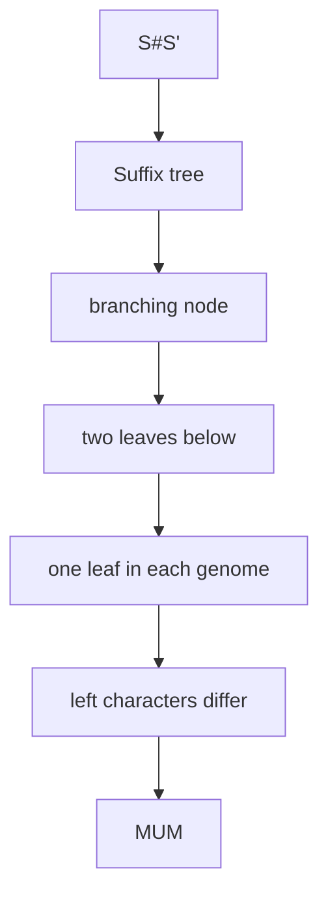

# Maximal Unique Match

## Definition

A maximal unique match (MUM) between genomes `S` and `S'` is a string `u` of length at least
`ell` that occurs exactly once in each genome and cannot be extended left or right while still
occurring in both (gik_5, p. 22).

## Why it matters

MUMs are high-confidence exact anchors. The notes explicitly connect them to chaining: find MUMs,
chain them, and align the remaining gaps with traditional DP methods (gik_5, p. 22).

## Construction / Mechanism

Build `ST(X)` for `X = S#S'$`, using separators not in either genome. A MUM occurs exactly twice
in `X`, once on each side of `#`, and must correspond to a branching node for right-maximality
(gik_5, p. 23).



## Pseudocode

```text
ALGORITHM MaximalUniqueMatches(S, Sprime, ell)
  X <- S # Sprime $
  T <- SuffixTree(X)
  for each branching node v in T:
    leaves <- leaves below v
    if size(leaves) = 2 and one leaf starts in S and one leaf starts in Sprime:
      i <- start position of the S leaf
      j <- start position of the Sprime leaf
      if depth(v) >= ell and (i = 1 or j = 1 or X[i-1] != X[j-1]):
        output (i, j, depth(v))
```

## Invariant / correctness argument

Exactly two leaves below `v` ensure uniqueness in `X`; one leaf on each side of `#` ensures one
occurrence in each genome. A branching node supplies two different right contexts, so `u` is
right-maximal. Distinct preceding characters, or a boundary, give left-maximality (gik_5,
pp. 23-24).

## Complexity

| Operation | Time | Space |
|---|---:|---:|
| Build `ST(S#S'$)` | `O(|S|+|S'|)` | `O(|S|+|S'|)` |
| Check all branching nodes | `O(|S|+|S'|)` | `O(1)` extra plus output |
| Total | `O(n)` | `O(n)` |

## Worked example

The notes' example has `S=ccttcgt`, `S'=ctgtcgt`, `ell=2`, with MUMs including `ct` and `tcgt`
(gik_5, p. 22). `ct` is unique in both strings and cannot be extended left in both because its
left contexts differ or hit a boundary.

## Variants

- Minimum length `ell` filters short exact matches before chaining.
- Non-unique maximal exact matches can also be anchors but need additional filtering.

## Pitfalls & exam traps

> [!warning]
> - A MUM must be unique in **both** genomes, not only in the concatenation.
> - Right-maximality and left-maximality are separate tests.
> - Use two separators (`#`, `$`) outside the alphabets; otherwise matches may cross genomes.

## Related

- [[anchor-based-sequence-comparison]] — consumes MUMs as anchors.
- [[match-chaining]] — chains MUM anchors in collinear order.
- [[suffix-tree]] — makes the uniqueness and maximality tests linear.

## Sources

- gik_5, pp. 22-24
