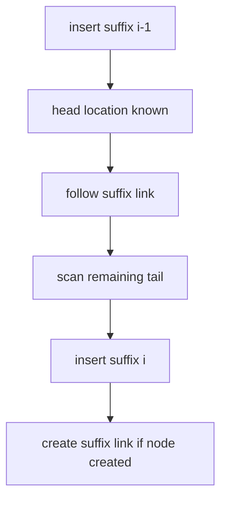

# McCreight Suffix Tree Construction

## Definition

McCreight's algorithm constructs `ST(S$)` by inserting suffixes from longest to shortest while
using suffix links to avoid restarting every search at the root (gik_5, pp. 10-15).

## Why it matters

The naive top-down suffix-tree construction can take `O(n^2)` time on `a^n$`; McCreight reduces
construction to `O(n)` and also returns suffix links for branching nodes (gik_5, pp. 5, 15).

## Construction / Mechanism



The lecture defines `head_i` as the longest prefix of suffix `x_i=S$[i..n+1]` whose path reaches
a branching node, and `tail_i` as the remaining suffix (gik_5, p. 10).

## Pseudocode

```text
ALGORITHM McCreight(S[1..n])
  T <- tree with one edge root -> leaf labeled S$
  loc <- root
  for i = 2 to n + 1:
    if i = 2:
      loc <- root
      tail <- S[i..n+1]
    else:
      loc <- LinkLoc(loc)
      (loc, tail) <- ScanPrefix(T, loc, S[i..n+1])
    (T, newNode) <- InsertSuffixAt(T, loc, tail)
    if previous insertion created a branching node u and loc is a node:
      suffixLink(u) <- loc
    else if previous insertion created a branching node u and newNode exists:
      suffixLink(u) <- newNode
  return T and suffix links
```

## Invariant / correctness argument

Before iteration `i`, `T` is `ST_i`: the compact tree of suffixes `x_1..x_{i-1}`. The next suffix
shares all but its first character with the previous suffix, so `LinkLoc` gives the deepest known
location for that shared part, and `ScanPrefix` only scans the still-unknown tail. Inserting at
that location yields exactly `ST_{i+1}` (gik_5, pp. 10-14).

## Complexity

| Operation | Time | Space |
|---|---:|---:|
| `ScanPrefix` calls over whole run | `O(n)` | `O(1)` extra |
| `LinkLoc` calls over whole run | `O(n)` | `O(1)` extra |
| Full construction | `O(n)` | `O(n)` |

## Worked example

For `S=aba`, start with edge `aba$`. Inserting `ba$` adds a root edge `ba$`. Inserting `a$` splits
inside the `aba$` edge after `a`, creating a branching node for `a` with children `ba$` and `$`.
The suffix link of that `a` node points to the root because dropping the first character leaves
the empty string (gik_5, pp. 9-14).

## Variants

- The WOTD/simple top-down construction recursively groups remaining suffixes by next character;
  it is easy to parallelise and cache-friendly but has worse worst-case time (gik_5, pp. 6-7).
- Lazy construction builds subtrees only when a search first needs them (gik_5, p. 7).

## Pitfalls & exam traps

> [!warning]
> - The first suffix starts as a single edge; do not first materialise all substrings.
> - Suffix links are for branching nodes, not arbitrary edge positions (gik_5, p. 9).
> - The linear proof charges each edge traversal or scanned character only constantly often;
>   restarting from the root would lose this proof (gik_5, p. 15).

## Related

- [[suffix-tree]] — data structure produced by the algorithm.
- [[suffix-tree-exact-matching]] — uses the constructed index.
- [[enhanced-suffix-array]] — can be derived from a suffix-tree traversal.

## Sources

- gik_5, pp. 5-15
