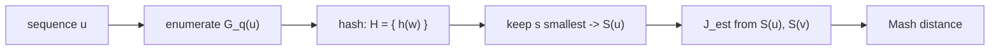

# MinHash Sketch

## Definition

A **sketch** (Skizze) is a constant-size reduced representation of the q-gram set of a sequence.
The **Mash sketch** of `u` is the set of the `s` **smallest** hash values among the hashes of all
q-grams of `u` (fsa_part2, p. 11):

```
G_q(u)        = set of all q-grams of u
H_{q,h}(u)    = { h(w) | w ∈ G_q(u) }
S_{q,h,s}(u)  = the s smallest values of H_{q,h}(u)          written S(u)
```

Symbols: `q` — q-gram length; `s >= 1` — sketch size; `h : A^q -> N` — a hash function;
`m = |u|`, `n = |v|`.

## Why it matters

Mash does three things (fsa_part2, p. 11):

1. compute a reduced representation of the q-grams of a sequence (**sketch**);
2. estimate the Jaccard index from the sketches;
3. derive a distance measure from the Jaccard estimate (see [[mash-distance]]).

The payoff is **space**, not time: the sketch is `O(s)` regardless of sequence length, which is
what makes all-against-all comparison of large sequence sets tractable
(fsa_part2, pp. 12–13, 16).

## Hash functions

A hash function maps any kind of object to a unique integer; **collisions can occur**
(fsa_part2, p. 11). Hashing stores values associated with keys:

| Approach | Cost |
|---|---|
| Store and search values in a list | `O(n)` |
| Sort keys | `O(n)` space, `O(log n)` search time |
| Hash table access | `O(1)` |

(fsa_part2, p. 11)

### Why plain q-gram coding is biased

The q-gram integer coding of [[q-gram]] has **no collisions** — it is bijective — which looks ideal.
But it is **order-preserving**: `code(aa...a) = 0` is the smallest possible value. Taking the `s`
smallest *codes* therefore always picks poly-A-like q-grams, so the sketch is not a random sample
of the sequence but a systematically biased one (fsa_part2, p. 12).

**MinHash** fixes this: with an appropriate (pseudo-random) hash function `h`, `S(u)` is a
**random sample** of the q-grams of `u`. The same `h` is applied to both sequences, so the same
q-grams map to the same values, and the fraction of items shared between `S(u)` and `S(v)` is
expected to match the fraction shared between `u` and `v` (fsa_part2, p. 12):

```
J_est(U, V) = | S(U) ∩ S(V) | / | S(U) ∪ S(V) |
```

## Construction / Mechanism



## Pseudocode

```text
ALGORITHM MashSketch(u[1..m], q, s, h)
  B <- empty max-heap of capacity s           // holds the s smallest hashes seen
  for i = 1 to m - q + 1:
    w <- u[i .. i+q-1]                        // code rolled in O(1); hashing costs O(q)
    x <- h(w)
    if x is already in B:  continue           // G_q(u) is a set
    if |B| < s:
      insert x into B
    else if x < max(B):
      delete max(B)
      insert x into B
  return B                                    // = S_{q,h,s}(u)
```

```text
ALGORITHM JaccardEstimate(S_u, S_v)
  // both sketches are sorted sets of size <= s
  inter <- |S_u ∩ S_v|                        // O(s) by merging
  union <- |S_u ∪ S_v|                        // O(1) from |S_u| + |S_v| - inter
  return inter / union
```

## Invariant / correctness argument

**Heap invariant.** After processing position `i`, `B` contains exactly the `s` smallest distinct
hash values among `h(u[1..1+q-1]), ..., h(u[i..i+q-1])`. The test `x < max(B)` with an eviction of
the current maximum preserves this, since an element larger than all `s` current members cannot be
among the `s` smallest.

**Estimator argument.** Because `h` behaves like a random function, the `s` smallest hashes form a
uniform random sample of `G_q(u)`. For two sequences, membership of a q-gram in the bottom-`s`
region is determined by its hash value alone, identically for both sequences. Hence the proportion
of shared elements in the sketches is an unbiased estimate of the proportion of shared elements
overall, i.e. `J_est(U, V) ≈ J(U, V)` (fsa_part2, p. 12). Larger `s` reduces the variance.

> [!note] Inference
> The lecture asserts the estimator property ("expected to be similar as in `u` and `v`") without a
> formal proof; the argument above makes the assumption (`h` pseudo-random, same `h` for both
> sequences) explicit.

## Variants

- **Sketch size `s`**: the single accuracy/space knob — `O(s)` space, variance decreasing in `s`.
- **Order-preserving coding instead of hashing** — rejected, because of the poly-A bias above
  (fsa_part2, p. 12).
- **All-against-all**: for a set `T = {t_1, ..., t_k}` of `k` sequences, compare all pairs
  `1 <= i < j <= k` (fsa_part2, p. 13).

## Complexity

Per-sequence sketch (fsa_part2, p. 11):

| Step | Time |
|---|---:|
| Enumerate `G_q(u)` | `O(m)` |
| Compute `H_{q,h}(u)` | `O(m·q)` |
| Keep the `s` smallest | `O(m log s)` |
| **Total** | `O(m(q + log s))` |

Jaccard estimate for one pair (fsa_part2, p. 12):

| Step | Time | Space |
|---|---:|---:|
| `S(U)` for `U = G_q(u)` | `O(m(q + log s))` | `O(s)` |
| `S(V)` for `V = G_q(v)` | `O(n(q + log s))` | `O(s)` |
| `\|S(U) ∩ S(V)\|` | `O(s)` | `O(1)` |
| `\|S(U) ∪ S(V)\|` | `O(1)` | `O(1)` |
| **Total** | `O((m+n)(q + log s) + s)` | `O(s)` |

All-against-all over `k` sequences with `n = Σ_{i=1}^{k} |t_i|` (fsa_part2, p. 13):

| Step | Time |
|---|---:|
| Precompute all sketches | `O(n(q + log s))` |
| Jaccard estimate for all pairs | `O(k^2 · s)` |
| **Total** | `O(n(q + log s) + k^2 s)` |

Only the first term depends on sequence length — this is why the method is fast
(fsa_part2, p. 13).

> [!warning]
> Compared with the q-gram distance's `O(m + n + r^q)`, MinHash does **not** improve the running
> time; it **uses less space** (fsa_part2, p. 12). Claiming a speed-up for a single pair is the
> standard exam error. The speed-up appears only in the all-against-all setting, where sketches are
> computed once and reused.

## Worked example

`A = {a, c}`, `q = 2`, `s = 2`, `u = a a c a`, `v = a c a c`. Suppose the hash function gives:

| q-gram | `aa` | `ac` | `ca` | `cc` |
|---|---:|---:|---:|---:|
| `code` (order-preserving) | 0 | 1 | 2 | 3 |
| `h` (pseudo-random) | 57 | 12 | 31 | 88 |

- `G_2(u) = {aa, ac, ca}` → `H(u) = {57, 12, 31}` → bottom-2: `S(u) = {12, 31}`
- `G_2(v) = {ac, ca, cc}` → `H(v) = {12, 31, 88}` → bottom-2: `S(v) = {12, 31}`

`J_est = |{12,31}| / |{12,31}| = 2/2 = 1.0`, whereas the exact `J(u,v) = 2/4 = 0.5`
(see [[jaccard-index]]) — with `s = 2` the estimate is coarse; this is the variance that larger `s`
removes.

Contrast with the biased plain coding: bottom-2 **codes** would give `S(u) = {0, 1}` (`aa, ac`) and
`S(v) = {1, 2}` (`ac, ca`) — both sketches dominated by the lexicographically smallest q-grams
rather than by a random sample (fsa_part2, p. 12).

## Pitfalls & exam traps

> [!warning]
> - Sketches are built from the q-gram **set**, not the profile — multiplicities are discarded.
> - The **same** hash function must be used for every sequence, otherwise sketch intersection is
>   meaningless.
> - Keep the `s` **smallest** hashes (bottom-`s`), consistently; "largest" works too but only if
>   applied uniformly.
> - `|S(U) ∪ S(V)|` is `O(1)` because both sketch sizes are known — it is `|S(U)| + |S(V)| - inter`,
>   not a second merge.
> - Hash collisions are possible and are accepted as noise; the bijective q-gram code avoids them
>   but is biased, which is worse.
> - Mash models point mutations only; no complex evolutionary processes are captured
>   (fsa_part2, p. 16).

## Related

- [[jaccard-index]] — the exact quantity `J_est` approximates, and the `O(m+n)` exact algorithm.
- [[mash-distance]] — converts `J_est` into a mutation rate via the Poisson model.
- [[q-gram]] — supplies `G_q(u)` and explains why the order-preserving code is biased.
- [[q-gram-distance]] — the `O(r^q)`-space baseline that sketching replaces.
- [[average-nucleotide-identity]] — gold standard used to validate sketch-derived distances.
- [[fragment-assembly]] — identification of overlaps in long reads is a named application
  (fsa_part2, p. 16).
- [[fsa_part2]] — source page for this unit.

## Sources

- fsa_part2, pp. 11–13, 16 (raw file `raw/foundations_seqzence_analysis_part2.pdf`)
