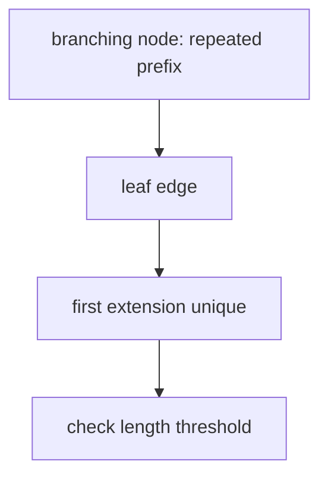

# Minimal Unique Substring

## Definition

A minimal unique substring (MUS) of `S` occurs exactly once in `S`, all its proper prefixes occur
at least twice, and its length is at least a fixed threshold `ell` (gik_5, pp. 20-21).

## Why it matters

The notes give primer design as the application: enumerate candidate substrings that uniquely
address one position while respecting a minimum length (gik_5, p. 20).

## Construction / Mechanism



If a substring occurs at least twice, its path ends at or before a branching node. If it occurs
once, the path ends on a leaf edge. Therefore a MUS crosses from a branching node onto a leaf edge
(gik_5, p. 20).

## Pseudocode

```text
ALGORITHM MinimalUniqueSubstrings(T, ell)
  result <- empty set
  for each branching node v in T:
    for each outgoing edge v -> leaf labeled a w:
      if a != '$' and depth(v) + 1 >= ell:
        output pathLabel(v) concatenated with a
  return result
```

## Invariant / correctness argument

At a branching node, the path label is not unique because at least two suffixes pass through it.
Taking one character onto a leaf edge makes the string unique, and it is minimal because removing
that last character returns to a repeated prefix (gik_5, pp. 20-21).

## Complexity

| Operation | Time | Space |
|---|---:|---:|
| Build suffix tree | `O(n)` with McCreight | `O(n)` |
| Enumerate MUS candidates | `O(n)` plus output | `O(1)` extra |
| Total optimal bound | `O(n + z)` | `O(n)` |

## Worked example

For `S=abab` and `ell=2`, `ab` is not unique, while `aba` occurs once and has repeated prefix
`ab`. Thus `aba` is a minimal unique substring; `bab` is another unique length-3 candidate
(gik_5, pp. 20-21).

## Variants

- If `ell=1`, single characters on leaf edges may be output when they are unique.
- [[shortest-absent-word]] is the opposite style of problem: find a word not occurring at all.

## Pitfalls & exam traps

> [!warning]
> - Minimal means no proper prefix is unique; it does not mean globally shortest unless combined
>   with a length objective.
> - Do not output strings ending in `$`; `$` is an artificial sentinel.
> - The path to a leaf may contain many unique prefixes; the MUS is the first one after the last
>   repeated node.

## Related

- [[suffix-tree]] — source of branching and leaf-edge tests.
- [[maximal-unique-match]] — uniqueness across two genomes rather than one string.
- [[sheet-05]] — exercise sheet also asks shortest absent words and suffix-number intervals.

## Sources

- gik_5, pp. 20-21
