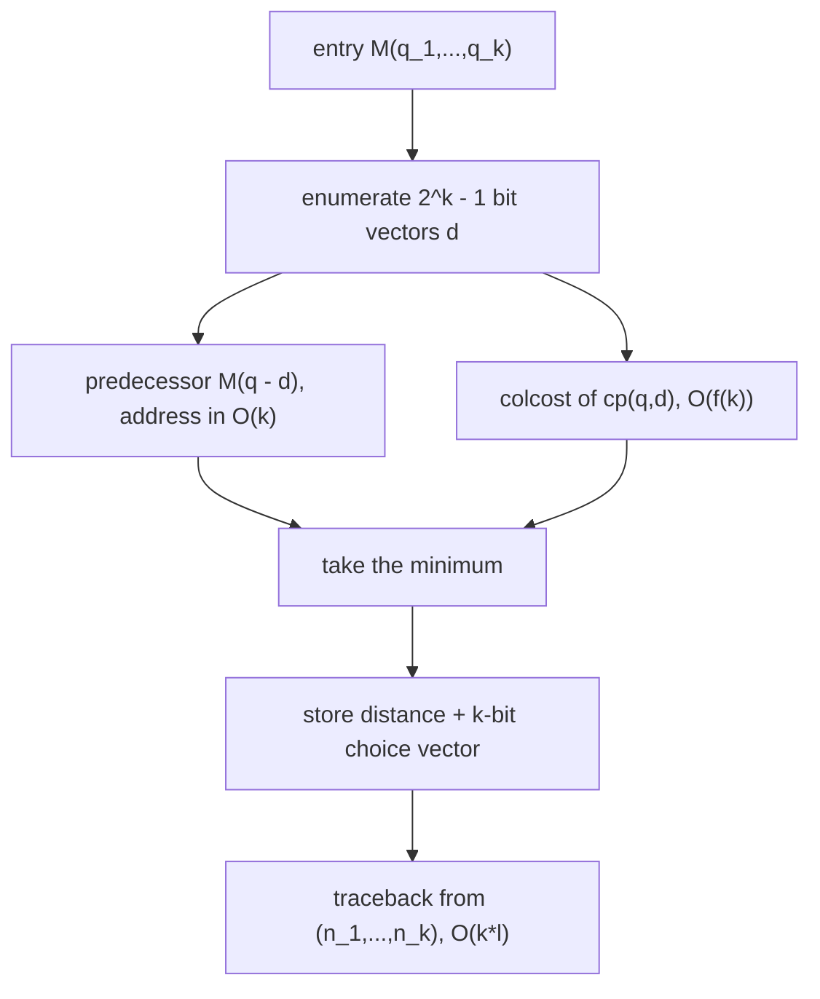

# Multidimensional DP for MSA

## Definition

The exact solution of the [[multiple-sequence-alignment|MSA problem]] generalises the edit
recurrence from 2 to `k` dimensions (fsa_part3, p. 18). Compute the
`(n_1 + 1) × ⋯ × (n_k + 1)` table `M` indexed by
`(q_1, …, q_k) ∈ [0, n_1] × ⋯ × [0, n_k]`, where

```
M(q_1, ..., q_k) = score of the optimal MSA of the prefixes s_1[1..q_1], ..., s_k[1..q_k]
```

Each **column** of the alignment corresponds to a bit vector
`(d_1, …, d_k) ∈ {0,1}^k \ {(0,…,0)}` (fsa_part3, p. 18):

- `d_i = 0` — the `i`-th character of this column is the **gap** symbol `−`;
- `d_i = 1` — it is `s_i[q_i]`.

Recurrence:

```text
M(q_1, ..., q_k) =
  min{  M(q_1 - d_1, ..., q_k - d_k)
        + colcost( cp(q_1, d_1), ..., cp(q_k, d_k) )
        | (d_1, ..., d_k) ∈ {0,1}^k ,
          (d_1, ..., d_k) != (0, ..., 0) ,
          q_1 >= d_1 , ... , q_k >= d_k }

cp(q_i, d_i) = s_i[q_i]   if d_i = 1
             = -          otherwise
```

with `M(0, …, 0) = 0` and `colcost` being either the consensus column cost
`k − count(cons)` or the SP column cost `δ_SP` (fsa_part3, pp. 16–19).

Symbols: `k` — number of sequences; `n_i = |s_i|`; `z = Π_{i=1}^{k} (n_i + 1)` — number of table
entries; `l` — length of the resulting MSA; `f(k)` — column-cost factor.

## Why it matters

It is the only method on these pages that is **exact** for both cost models, and it is the
benchmark that the heuristics [[star-alignment]] and [[progressive-alignment]] are measured
against. Its `O(z·f(k)·2^k)` cost is also the reason those heuristics exist: "since the exact
method is very costly → approximative solutions" (fsa_part3, p. 20).

## Construction / Mechanism

For `k = 2` the recurrence degenerates to the three cases of [[edit-distance-dp]]
(fsa_part3, p. 18) — `q_1 = 0, q_2 ≥ 1`; `q_1 ≥ 1, q_2 = 0`; `q_1 ≥ 1, q_2 ≥ 1` — with the
`2² − 1 = 3` bit vectors:

| `d_1` | `d_2` | char from `s_1` | char from `s_2` | meaning |
|---:|---:|---|---|---|
| 1 | 0 | `s_1[q_1]` | `−` | deletion |
| 0 | 1 | `−` | `s_2[q_2]` | insertion |
| 1 | 1 | `s_1[q_1]` | `s_2[q_2]` | replacement/match |

The lecture's marginal note is the implementation recipe: **"binär hoch zählen!"** — count up in
binary from `1` to `2^k − 1` to enumerate the predecessors (fsa_part3, p. 18).

### Storage layout

`M` is organised as a **one-dimensional array of size `z`** (fsa_part3, p. 19). Each entry holds

- the distance, and
- a **bit vector of `k` bits** recording which choice gave rise to the minimum — the traceback
  information.

The address of `(q_1, …, q_k)` is computed in `O(k)` time by the mixed-radix formula.

> [!note] Inference
> p. 19 states only "compute the address of an entry in `O(k)` time". The formula is the mixed
> radix `addr(q) = ((q_1·(n_2+1) + q_2)·(n_3+1) + q_3)⋯`, which is `k−1` multiply-adds.



## Pseudocode

```text
ALGORITHM MultidimMSA(s_1..s_k, n_1..n_k, colcost)      # 1-based on sequences
  z <- (n_1+1) * ... * (n_k+1)
  allocate M[0 .. z-1] of (distance, choice bitvector)
  M[addr(0,...,0)] <- (0, 0)
  for each (q_1,...,q_k) in [0..n_1] x ... x [0..n_k] in increasing order of q_1+...+q_k:
    if (q_1,...,q_k) = (0,...,0):  continue
    best <- +infinity ;  bestd <- 0
    for b = 1 to 2^k - 1:                               # "count up in binary"
      (d_1,...,d_k) <- binary digits of b
      if q_i < d_i for some i:  continue                # predecessor out of range
      col <- ( cp(q_1,d_1), ..., cp(q_k,d_k) )
      val <- M[ addr(q_1-d_1, ..., q_k-d_k) ].distance + colcost(col)
      if val < best:  best <- val ;  bestd <- b
    M[ addr(q_1,...,q_k) ] <- (best, bestd)
  return M[ addr(n_1,...,n_k) ]

ALGORITHM TracebackMSA(M, s_1..s_k, n_1..n_k)
  (q_1,...,q_k) <- (n_1,...,n_k)
  Al <- empty list of columns
  while (q_1,...,q_k) != (0,...,0):
    (d_1,...,d_k) <- M[ addr(q_1,...,q_k) ].choice
    prepend ( cp(q_1,d_1), ..., cp(q_k,d_k) ) to Al
    for i = 1 to k:  q_i <- q_i - d_i
  return Al                                             # O(k * l) time
```

```text
ALGORITHM colcost(col[1..k], mode)
  if mode = consensus:                                  # O(k)
    best <- 0
    for each a in A:  best <- max(best, |{ i : col[i] = a }|)
    return k - best
  if mode = SP:                                         # O(k^2)
    t <- 0
    for i = 1 to k-1:
      for r = i+1 to k:
        t <- t + δ( col[i] -> col[r] )
    return t
```

## Invariant / correctness argument

- **Invariant.** `M(q_1, …, q_k)` is the minimum cost of an MSA of the prefixes
  `s_1[1..q_1], …, s_k[1..q_k]`, proved by induction on `q_1 + ⋯ + q_k`.
- **Base.** `M(0,…,0) = 0`: the empty alignment.
- **Step.** Any MSA of the prefixes has a **last column**. That column is described by exactly one
  bit vector `(d_1,…,d_k) ≠ (0,…,0)` (nonzero by MSA condition 3: no all-gap column), and it
  consumes `d_i` characters from `s_i`, so `q_i ≥ d_i`. Removing it leaves an MSA of the prefixes
  `(q_1−d_1, …, q_k−d_k)` whose cost is, by induction and because `colcost` is **columnwise
  additive**, at least `M(q_1−d_1,…,q_k−d_k)`. Minimising over all admissible last columns
  therefore yields the optimum.
- **Columnwise additivity is essential.** Both `conscost` and `δ_SP` are defined as sums over
  columns (fsa_part3, pp. 16–17), which is exactly what licenses the decomposition. An
  [[gap-cost-model|affine gap]] cost is *not* columnwise additive and breaks this recurrence.
- **Termination.** `q_1 + ⋯ + q_k` strictly decreases along every predecessor edge.

## Variants

- **Consensus cost** — `f(k) = k`.
- **SP cost** — `f(k) = k²` (fsa_part3, p. 19).
- **`k = 2`** — ordinary [[edit-distance-dp]], `2² − 1 = 3` predecessors.
- **DP pruning with the star bound** (fsa_part3, p. 22): the [[star-alignment]] SP score `δ_SP` is
  an upper bound on `δ_opt-SP` and is cheaply computed from pairwise alignments. Therefore any
  partial entry with `M(q_1,…,q_k) = d > δ_SP` can be **excluded**, since
  `δ_opt-SP ≤ δ_SP < d`. This reduces the search space without losing the optimum.
- **Divide-and-conquer alignment** (fsa_part3, p. 24) — splits the `k` sequences near their
  midpoints to keep each subproblem's `z` small; see [[progressive-alignment]].

## Complexity

| Quantity | Cost |
|---|---:|
| Table entries | `z = Π_{i=1}^{k} (n_i + 1)` |
| Predecessors per entry | `2^k − 1` |
| Column cost, consensus | `O(k)` |
| Column cost, SP | `O(k²)` |
| Address computation | `O(k)` |
| Per entry | `O(f(k) · 2^k)`, `f(k) = k` or `k²` |
| **Total time** | `O(z · f(k) · 2^k)` |
| **Space** | `O(z)` |
| Traceback | `O(k · l)` |

(fsa_part3, p. 19). With all `n_i = n` this is `O(n^k · f(k) · 2^k)` — exponential in `k` in **both**
the base and the factor.

## Worked example

`k = 3`, `s_1 = ac`, `s_2 = ac`, `s_3 = a`, so `n = (2, 2, 1)` and
`z = 3 · 3 · 2 = 18` entries; `2^3 − 1 = 7` predecessors per entry.

Consensus `M` (left number) and SP `M` (right number), unit `δ`:

| `(q_1,q_2,q_3)` | cons | SP | | `(q_1,q_2,q_3)` | cons | SP |
|---|---:|---:|---|---|---:|---:|
| `(0,0,0)` | 0 | 0 | | `(1,1,1)` | 0 | 0 |
| `(0,0,1)` | 2 | 2 | | `(1,2,0)` | 3 | 4 |
| `(0,1,0)` | 2 | 2 | | `(1,2,1)` | 2 | 2 |
| `(0,1,1)` | 1 | 2 | | `(2,0,0)` | 4 | 4 |
| `(0,2,0)` | 4 | 4 | | `(2,0,1)` | 3 | 4 |
| `(0,2,1)` | 3 | 4 | | `(2,1,0)` | 3 | 4 |
| `(1,0,0)` | 2 | 2 | | `(2,1,1)` | 2 | 2 |
| `(1,0,1)` | 1 | 2 | | `(2,2,0)` | 2 | 4 |
| `(1,1,0)` | 1 | 2 | | **`(2,2,1)`** | **1** | **2** |

### The 7 predecessors of the final entry `(2,2,1)`

Characters at the current positions: `s_1[2] = c`, `s_2[2] = c`, `s_3[1] = a`.

| `(d_1,d_2,d_3)` | column `cp` | predecessor `q − d` | `M_cons(q−d)` | `colcost_cons` | sum | `M_SP(q−d)` | `colcost_SP` | sum |
|---|---|---|---:|---:|---:|---:|---:|---:|
| `(0,0,1)` | `− − a` | `(2,2,0)` | 2 | 2 | 4 | 4 | 2 | 6 |
| `(0,1,0)` | `− c −` | `(2,1,1)` | 2 | 2 | 4 | 2 | 2 | 4 |
| `(0,1,1)` | `− c a` | `(2,1,0)` | 3 | 2 | 5 | 4 | 3 | 7 |
| `(1,0,0)` | `c − −` | `(1,2,1)` | 2 | 2 | 4 | 2 | 2 | 4 |
| `(1,0,1)` | `c − a` | `(1,2,0)` | 3 | 2 | 5 | 4 | 3 | 7 |
| **`(1,1,0)`** | **`c c −`** | **`(1,1,1)`** | **0** | **1** | **1** | **0** | **2** | **2** |
| `(1,1,1)` | `c c a` | `(1,1,0)` | 1 | 1 | 2 | 2 | 2 | 4 |

Minimum in both models: `(d) = (1,1,0)`, giving `M_cons(2,2,1) = 1` and `M_SP(2,2,1) = 2`.

Column cost check for `c c −`: consensus is `c` with `count = 2`, so `k − count = 3 − 2 = 1`; SP
pairs are `(c,c) = 0`, `(c,−) = 1`, `(c,−) = 1`, so `δ_SP = 2` ✓.

### Traceback

`(2,2,1) --(1,1,0)--> (1,1,1) --(1,1,1)--> (0,0,0)`, giving `l = 2` columns:

| row | 1 | 2 |
|---|---|---|
| `s'_1` | a | c |
| `s'_2` | a | c |
| `s'_3` | a | − |

`conscost = 0 + 1 = 1` ✓, `δ_SP = 0 + 2 = 2` ✓. Note `max n_i = 2 ≤ l = 2 ≤ Σ n_i = 5` ✓.

### Scale check

For `k = 10` sequences of length `n = 100`: `z = 101^10 ≈ 1.1·10^20`, times `2^10 = 1024`, times
`f(k) = 100` — astronomically infeasible. Hence the heuristics.

## Pitfalls & exam traps

> [!warning]
> - `(0,…,0)` is **excluded** — it would correspond to an all-gap column, forbidden by MSA
>   condition 3, and would make the recursion non-terminating.
> - The predecessor constraint is `q_i ≥ d_i`; on the boundary faces of the hypercube fewer than
>   `2^k − 1` bit vectors are admissible.
> - `d_i = 1` means "consume a character"; `d_i = 0` means "emit a gap". It is easy to invert this.
> - `z` is a **product**, `Π(n_i + 1)`, not a sum — the `+1` per dimension matters.
> - `f(k)·2^k` multiplies `z`; the total is not `O(z + 2^k)`.
> - Traceback is `O(k·l)`, not `O(z)` — it follows the stored `k`-bit choice vectors.
> - The pruning bound of p. 22 is an **upper** bound from the star alignment; discarding entries
>   `> δ_SP` is safe only because `δ_opt-SP ≤ δ_SP`.
> - The recurrence needs columnwise additive costs; affine gaps do not qualify.

## Related

- [[multiple-sequence-alignment]] — the problem, both cost models, and the compatibility notion.
- [[edit-distance-dp]] — the `k = 2` instance of this exact recurrence.
- [[star-alignment]] — supplies both a fast approximation and the pruning bound `δ_SP`.
- [[progressive-alignment]] — the practical heuristic replacing this DP.
- [[cost-function]] — the pairwise `δ` entering `colcost`.
- [[gap-cost-model]] — the cost model this recurrence cannot express.
- [[fsa_part3]] — source page for this unit.

## Sources

- fsa_part3, pp. 18–19, 22 (`raw/foundations_sequence_analysis_part3.pdf`)
