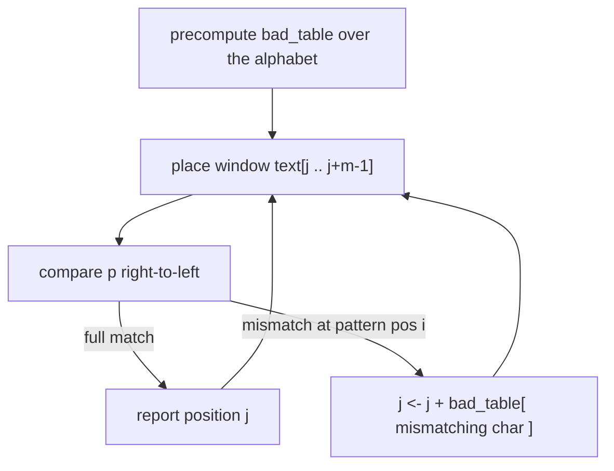

# Naive Exact Matching and the Bad-Character Rule

## Definition

**Exact string matching** (Exaktes String Matching): find all positions in a text `t` (length `n`)
where a pattern `p` (length `m`) occurs. The **naive algorithm** slides `p` over `t` one position
at a time and compares characters; worst case `O(nm)` (fsa_part1, p. 19).

Worst-case instance given in the script: `t = A…A` (`n` times) and `p = A…AX` (`m` symbols). Every
alignment of `p` matches `m−1` characters before failing on the last one (fsa_part1, p. 19).

The **bad-character rule** improves this: on a mismatch at pattern position `i`, look the
mismatching text character up in a precomputed **bad character table** and increment `j` by that
value instead of by 1 (fsa_part1, p. 19).

## Why it matters

Exact matching is the `k = 0` case of [[approximate-string-matching]], and running the `O(mn)`
DP for it is wasteful. The bad-character shift lets whole blocks of text be skipped without
examining them.

## Construction / Mechanism

The table stores, for each character `c` of the alphabet, how far the **rightmost occurrence** of
`c` in `p` is from the end of `p` (fsa_part1, p. 19):

```
bad_table[c] = len(p) - i - 1     for the rightmost i with p[i] = c   (0-based i)
bad_table[c] = len(p)             if c does not occur in p
```

The annotation on the page reads: *"wie weit der Character `p[m-1]` vom aktuellen Char entfernt
ist"* — how far the character `p[m-1]` is from the current character — with the window written as
`text[j .. j+m-1]`, and the shift clamped by `max(1, length − index − 1)` so that the window always
advances (fsa_part1, p. 19).



## Pseudocode

**The script's version** (fsa_part1, p. 19) — note it is written with **0-based** pattern indices:

```text
compute(p, t):                                   // 0-based indices into p
  for all c ∈ A:
    for i in 0 .. len(p) - 1:
      if p[i] = c:
        bad_table[c] <- len(p) - i - 1
    if c not in bad_table:
      bad_table[c] <- len(p)
```

Because the inner loop runs left to right and overwrites, the surviving value is the one from the
**rightmost** occurrence — which is exactly the intent noted on the page ("save the rightmost
occurrence").

**Naive search, for comparison** (1-based):

```text
ALGORITHM NaiveMatch(p[1..m], t[1..n])
  Occ <- empty list
  for j = 1 to n - m + 1:
    i <- 1
    while i <= m and p[i] = t[j + i - 1]:
      i <- i + 1
    if i = m + 1:
      append j to Occ
  return Occ
```

**Search with the bad-character shift** (0-based window start `j`, as in the script):

```text
ALGORITHM BadCharacterMatch(p[0..m-1], t[0..n-1])
  bad_table <- compute(p, t)
  Occ <- empty list ;  j <- 0
  while j <= n - m:
    i <- m - 1
    while i >= 0 and p[i] = t[j + i]:
      i <- i - 1
    if i < 0:
      append j to Occ ;  j <- j + 1
    else:
      j <- j + max(1, bad_table[ t[j + i] ])
  return Occ
```

## Invariant / correctness argument

A shift is safe if no occurrence of `p` is skipped. If the window `t[j .. j+m-1]` mismatches at
pattern position `i` with text character `c = t[j+i]`, then any occurrence starting at
`j' > j` must align some occurrence of `c` in `p` with text position `j+i` (or move `p` past it
entirely). `bad_table[c]` is the distance from the rightmost occurrence of `c` to the pattern
end, so shifting by it places the nearest candidate occurrence of `c` under the mismatching text
character; smaller shifts cannot produce a match. The `max(1, …)` clamp guarantees progress and
hence termination.

> [!note] Inference
> The script states the rule and the table computation but not this safety argument
> (fsa_part1, p. 19); the argument above is the standard justification.

## Variants

- **Naive**: shift always 1, `O(nm)`.
- **Bad character only** (the version in the script): no good-suffix rule, so the worst case is
  still `O(nm)`, but typical DNA/protein text is scanned far faster.
- **Approximate**: allow `k` errors — [[approximate-string-matching]].

## Complexity

| Operation | Time | Space |
|---|---:|---:|
| Naive search | `O(nm)` worst case | `O(1)` |
| `compute(p,t)` as written (loop over `A` × loop over `p`) | `O(|A| · m)` | `O(|A|)` |
| Bad-character search | `O(nm)` worst case, sublinear in practice | `O(|A|)` |

## Worked example

`p = TATGTG` (`m = 6`), 0-based. Building `bad_table`:

| 0-based `i` | 0 | 1 | 2 | 3 | 4 | 5 |
|---|---|---|---|---|---|---|
| `p[i]` | T | A | T | G | T | G |
| `len(p) − i − 1` | 5 | 4 | 3 | 2 | 1 | 0 |

Rightmost occurrence wins:

| `c` | A | C | G | T |
|---|---:|---:|---:|---:|
| `bad_table[c]` | 4 | 6 | 0 | 1 |

`C` does not occur in `p`, so it gets `len(p) = 6` — a full-length jump.

Searching in `t = GCAATGCTATGTG…` with the window at `j = 0`: `t[0..5] = GCAATG` against
`TATGTG`. Comparing right to left, `p[5] = G` vs `t[5] = G` matches; `p[4] = T` vs `t[4] = T`
matches; `p[3] = G` vs `t[3] = A` **mismatches**. The bad character is `A`, so
`j ← j + bad_table[A] = 0 + 4 = 4`. Four positions skipped at the cost of three comparisons.

> [!warning]
> The script's example strings are sketched as `G C A A T G C …` over `T A T G T G`
> (fsa_part1, p. 19); the handwritten text is partly ambiguous, so the exact text used above is a
> reconstruction consistent with the drawn shift arrow.

## Pitfalls & exam traps

> [!warning]
> - `compute` is written **0-based** — `len(p) − i − 1` is the distance to the pattern end, and
>   the rightmost occurrence of the last character `p[m-1]` would get shift 0, which is why the
>   `max(1, …)` clamp is needed.
> - Characters absent from `p` get `len(p)`, the maximal safe jump.
> - Comparison runs **right to left** within the window; the shift runs left to right over `t`.
> - The bad-character rule alone does not fix the `O(nm)` worst case; the pathological
>   `t = A…A`, `p = A…AX` example still costs `O(nm)`.
> - This is exact matching only. One error and you are back to the DP of
>   [[approximate-string-matching]].

## Related

- [[approximate-string-matching]] — the error-tolerant generalisation; this is its `k = 0` case.
- [[cost-function]] — exact matching corresponds to allowing distance 0 only.
- [[edit-graph]] — the DP view that the shift heuristic deliberately avoids.

- [[fsa_part1]] ? source page for this part of the module.

## Sources

- fsa_part1, p. 19 (`raw/foundations_sequence_analysis_part1.pdf`)
