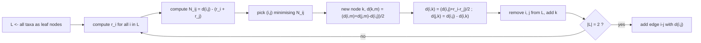
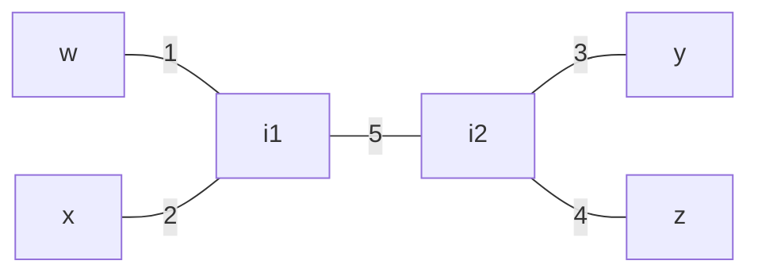

# Neighbor Joining

## Definition

**Neighbor Joining** (NJ) is "the most widely used method" for phylogeny reconstruction from
distances (fsa_part3, p. 30). Given an **additive** `d` it produces an **unrooted** tree `T`. It is
used when the **rate of evolution of the separate subtrees under consideration varies** — exactly
the situation in which [[upgma]]'s molecular-clock assumption fails.

The selection criterion is **not** the raw distance but the corrected quantity

```
N_ij = d(i, j) − ( r_i + r_j )          with      r_i = ( 1 / (n−2) ) · Σ_{x ∈ L} d(i, x)
```

where `L` is the **current** set of nodes in the tree and `n = |L|` (fsa_part3, p. 30).

**Key property** (fsa_part3, p. 30): *if `d` is additive with respect to `T`, then the two leaves
`i` and `j` for which `N_ij` is minimal are **neighbors** in `T`.*

Symbols: `L` — current node set; `n = |L|`; `r_i` — the average divergence of `i` from everything
else (scaled by `1/(n−2)`); `k`, `m` — new and remaining nodes.

## Why it matters

Picking the pair with smallest `d(i,j)` — what UPGMA does — is wrong when one lineage evolves
fast: two slowly evolving but distantly related taxa can be closer than two true neighbours. The
`−(r_i + r_j)` correction subtracts each node's overall divergence, so only the *relative*
closeness remains. NJ is described as **fast, useful and robust** (fsa_part3, p. 30).

## Construction / Mechanism



**Initialization** (fsa_part3, p. 30): let `T` consist of leaf nodes, one per taxon; `L ← T`.

**Iteration**: compute `N`; pick `i, j ∈ L` minimising `N_ij`; define a new node `k` with

```
d(k, m) = ½ ( d(i,m) + d(j,m) − d(i,j) )       for all m ∈ L \ {i, j}
d(i, k) = ½ ( d(i,j) + r_i − r_j )
d(j, k) = d(i,j) − d(i,k)
```

add `k` to `T` and construct the edges; then remove `i` and `j` from `L` and add `k` to `L`.

**Termination**: when `L` has only two nodes, add the edge `i, j` with length `d(i,j)`.

## Pseudocode

```text
ALGORITHM NeighborJoining(X[1..N], d)
  L <- { leaf node for each taxon in X }
  T <- L                                              # no edges yet
  while |L| > 2:
    n <- |L|
    for each i in L:
      r[i] <- ( 1 / (n - 2) ) * sum over x in L of d(i, x)
    (i, j) <- the pair in L minimising  d(i,j) - ( r[i] + r[j] )
    create new node k
    for each m in L \ {i, j}:
      d(k, m) <- ( d(i,m) + d(j,m) - d(i,j) ) / 2
      d(m, k) <- d(k, m)
    d(i, k) <- ( d(i,j) + r[i] - r[j] ) / 2
    d(j, k) <- d(i,j) - d(i,k)
    add edges (i,k) of length d(i,k) and (j,k) of length d(j,k) to T
    L <- ( L \ {i, j} ) ∪ { k }
  (i, j) <- the two remaining nodes of L
  add edge (i,j) of length d(i,j) to T
  return T
```

## Invariant / correctness argument

- **Invariant (neighbour identification).** If `d` is additive w.r.t. `T`, the pair minimising
  `N_ij` is a pair of **neighbours** in `T`, i.e. two leaves attached to the same internal node
  (fsa_part3, p. 30). This is what makes the greedy choice safe — picking the minimal `d(i,j)`
  instead would not be.
- **Invariant (additivity is preserved).** The reduction formula
  `d(k,m) = ½(d(i,m) + d(j,m) − d(i,j))` is exactly the length of the path from the new internal
  node `k` to `m`: adding the two paths `i→m` and `j→m` double-counts the path `k→m` and adds the
  pendant edges `i→k`, `j→k`, which `−d(i,j) = −(d(i,k)+d(j,k))` removes; halving gives `d(k,m)`.
  Hence the reduced matrix on `L ∖ {i,j} ∪ {k}` is again additive, and the invariant holds
  inductively.
- **Edge-length split.** `d(i,k) = ½(d(i,j) + r_i − r_j)` distributes `d(i,j)` between the two
  pendant edges according to the difference in overall divergence, which is what allows unequal
  rates; `d(j,k) = d(i,j) − d(i,k)` then holds by construction, so
  `d(i,k) + d(j,k) = d(i,j)` ✓.
- **Termination.** Each iteration removes two nodes and adds one, so `|L|` decreases by 1; starting
  from `N` taxa there are `N − 2` iterations before `|L| = 2`.
- **Exactness.** For additive `d` the reconstruction is exact — see the worked example, where every
  edge of the generating tree is recovered to the unit.

> [!note] Inference
> p. 30 states the neighbour property without proof and gives no correctness argument for the
> reduction formula; the path-length derivation above is the standard verification and is checked
> numerically in the worked example.

## Variants

- **[[upgma]]** — rooted, average linkage, `O(n²)`, requires the molecular clock
  ([[ultrametric]] `d`).
- **Rooting NJ** — the output is unrooted; an outgroup or midpoint rooting is needed if a root is
  wanted. Not covered in fsa_part3.
- **As a guide tree** for [[progressive-alignment]] when rates vary across the family.

## Complexity

| Operation | Time | Space |
|---|---:|---:|
| `r_i` for all `i` in one iteration | `O(n²)` | `O(n)` |
| `N_ij` for all pairs, pick the minimum | `O(n²)` | `O(n²)` |
| Reduction `d(k,m)` for all `m` | `O(n)` | — |
| Number of iterations | `n − 2` | — |
| **Total** | `O(n³)` | `O(n²)` |

> [!note] Inference
> p. 30 gives no running time, only the qualitative "fast, useful and robust". `O(n³)` is the
> direct count: `n−2` iterations, each dominated by the `O(n²)` scan of `N`.

## Worked example

> [!note] Inference
> p. 30 contains no numeric example. The run below uses the additive quartet from
> [[phylogenetic-tree]], so the reconstruction can be checked edge by edge against the generating
> tree.

**Generating tree** (unrooted): `w, x` on one side, `y, z` on the other; pendant edges
`w:1`, `x:2`, `y:3`, `z:4`; internal edge `5`.



Additive distance matrix (sums of edge lengths along leaf paths):

| `d` | `w` | `x` | `y` | `z` |
|---|---:|---:|---:|---:|
| `w` | 0 | 3 | 9 | 10 |
| `x` | 3 | 0 | 10 | 11 |
| `y` | 9 | 10 | 0 | 7 |
| `z` | 10 | 11 | 7 | 0 |

### Iteration 1 — `L = {w, x, y, z}`, `n = 4`, so `r_i = ½ Σ_x d(i,x)`

| `i` | row sum | `r_i` |
|---|---:|---:|
| `w` | `0+3+9+10 = 22` | **11** |
| `x` | `3+0+10+11 = 24` | **12** |
| `y` | `9+10+0+7 = 26` | **13** |
| `z` | `10+11+7+0 = 28` | **14** |

| pair | `d(i,j)` | `r_i + r_j` | `N_ij` |
|---|---:|---:|---:|
| `(w,x)` | 3 | 23 | **−20** |
| `(w,y)` | 9 | 24 | −15 |
| `(w,z)` | 10 | 25 | −15 |
| `(x,y)` | 10 | 25 | −15 |
| `(x,z)` | 11 | 26 | −15 |
| `(y,z)` | 7 | 27 | **−20** |

Minimum `−20`, attained by `(w,x)` **and** `(y,z)` — both are genuine neighbour pairs in the tree,
so either choice is correct. Take `(w, x)` and create node `k`:

```
d(k,y) = ½( d(w,y) + d(x,y) − d(w,x) ) = ½(9 + 10 − 3) = 8
d(k,z) = ½( d(w,z) + d(x,z) − d(w,x) ) = ½(10 + 11 − 3) = 9
d(w,k) = ½( d(w,x) + r_w − r_x ) = ½(3 + 11 − 12) = 1      ✓ true pendant length 1
d(x,k) = d(w,x) − d(w,k) = 3 − 1 = 2                        ✓ true pendant length 2
```

`d(k,y) = 8 = 5 + 3` and `d(k,z) = 9 = 5 + 4` ✓ — `k` is the internal node `i1`.

Note that raw-distance greedy clustering would have picked `(w,x)` here too, but **`N` and `d`
rank differently**: `d(y,z) = 7 < d(w,y) = 9`, yet `N` correctly ties `(y,z)` with `(w,x)` instead
of preferring the smaller raw value `d(w,x) = 3` alone.

### Iteration 2 — `L = {k, y, z}`, `n = 3`, so `r_i = Σ_x d(i,x)`

| `i` | `r_i` |
|---|---:|
| `k` | `8 + 9 = 17` |
| `y` | `8 + 7 = 15` |
| `z` | `9 + 7 = 16` |

| pair | `d(i,j)` | `r_i + r_j` | `N_ij` |
|---|---:|---:|---:|
| `(k,y)` | 8 | 32 | **−24** |
| `(k,z)` | 9 | 33 | −24 |
| `(y,z)` | 7 | 31 | −24 |

All three tie at `−24` (with only three nodes left every pair is a neighbour pair). Take `(k, y)`
and create node `m`:

```
d(m,z) = ½( d(k,z) + d(y,z) − d(k,y) ) = ½(9 + 7 − 8) = 4      ✓ true pendant length 4
d(k,m) = ½( d(k,y) + r_k − r_y ) = ½(8 + 17 − 15) = 5          ✓ true internal edge 5
d(y,m) = d(k,y) − d(k,m) = 8 − 5 = 3                            ✓ true pendant length 3
```

`m` is the internal node `i2`.

### Termination — `L = {m, z}`

Add the edge `m–z` with `d(m,z) = 4` ✓.

**Reconstructed edges**: `w–k:1`, `x–k:2`, `k–m:5`, `y–m:3`, `m–z:4` — the generating tree is
recovered **exactly**, as guaranteed for additive `d`.

## Pitfalls & exam traps

> [!warning]
> - The scaling is `1/(n−2)`, **not** `1/n` or `1/(n−1)`. With `n = 3` it is `1/1`; `n = 2` is the
>   termination case precisely because `n−2 = 0`.
> - `n = |L|` is the **current** node count and shrinks by one each iteration — recompute `r_i`
>   every round.
> - The sum in `r_i` runs over **all** `x ∈ L` including `x = i` (contributing `d(i,i) = 0`).
> - Minimise `N_ij`, not `d(i,j)`. `N_ij` is typically **negative**; "minimal" means most negative.
> - `d(i,k)` and `d(j,k)` are generally **unequal** — that is the whole point of NJ versus UPGMA,
>   whose two child edges from a node are equal by construction.
> - NJ gives an **unrooted** tree with **no node heights**. Do not report divergence times from it.
> - Nodes `i` and `j` are *removed* from `L` when `k` is added; they stay in `T` as leaves/internal
>   nodes but take no further part in the selection.
> - Ties are normal and harmless on additive data (see iteration 1).

## Related

- [[upgma]] — the rooted, clock-assuming alternative; contrast the selection criterion.
- [[ultrametric]] — the assumption NJ does *not* need.
- [[phylogenetic-tree]] — additivity and the four point condition; supplies this page's example
  tree.
- [[progressive-alignment]] — can use an NJ tree as its guide tree.
- [[mash-distance]] — an alignment-free way to obtain the input distances.
- [[operational-taxonomic-unit]] — the taxa typically placed in such trees.
- [[fsa_part3]] — source page for this unit.

## Sources

- fsa_part3, p. 30 (`raw/foundations_sequence_analysis_part3.pdf`)
