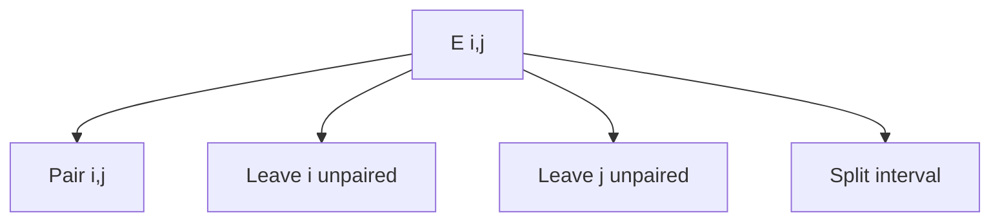

# Nussinov Algorithm

## Definition

The Nussinov algorithm is the interval DP used in the notes to find a minimum-free-energy RNA secondary structure under independent base-pair contributions (gik_3_4, pp. 4-7).

## Why it matters

It is the first RNA-folding algorithm in the unit and shows why non-crossing [[rna-secondary-structure]] definitions lead to diagonal table filling and traceback.

## Construction / Mechanism



`E(i,j)` is the minimum energy for `w[i..j]`; all dependencies are shorter intervals, so entries are evaluated by increasing interval length (gik_3_4, p. 6).

## Pseudocode

```text
ALGORITHM NussinovMFE(w[1..n], alpha, l_min)
  for i = 1 to n:
    E[i][i] <- 0
  for len = 2 to n:
    for i = 1 to n - len + 1:
      j <- i + len - 1
      if j - i - 1 < l_min:
        E[i][j] <- 0
      else:
        best <- min(E[i+1][j], E[i][j-1])
        if AllowedPair(w[i], w[j]):
          best <- min(best, E[i+1][j-1] + alpha(w[i], w[j]))
        for k = i + 2 to j - 1:
          best <- min(best, E[i][k-1] + E[k][j])
        E[i][j] <- best
  return E[1][n]
```

```text
ALGORITHM TracebackNussinov(i, j, E)
  if i >= j: return empty set
  if E[i][j] came from pairing i and j:
    return {(i,j)} union TracebackNussinov(i+1, j-1, E)
  if E[i][j] came from E[i+1][j]:
    return TracebackNussinov(i+1, j, E)
  if E[i][j] came from E[i][j-1]:
    return TracebackNussinov(i, j-1, E)
  choose k that realises a split
  return TracebackNussinov(i, k-1, E) union TracebackNussinov(k, j, E)
```

## Invariant / correctness argument

After finishing interval length `len`, every interval of length at most `len` is optimal. Any legal structure on `w[i..j]` either pairs the ends, leaves an end unpaired, or splits into two non-crossing substructures; the recurrence enumerates those cases (gik_3_4, pp. 5-6).

## Variants

- Maximise base-pair count by assigning each legal pair the same negative score.
- Use [[rna-loop-energy-dp]] when loop types and adjacent base pairs matter.

## Complexity

| Operation | Time | Space |
|---|---:|---:|
| Fill table | `O(n^3)` | `O(n^2)` |
| Trace back one optimum | `O(n^2)` worst case | `O(n)` recursion |

## Worked example

For `w=A G C U`, `l_min=1`, and `α(A,U)=-2`, `(2,3)` is too tight while `(1,4)` is allowed, so `E(1,4)=-2` and traceback returns `{(1,4)}` (gik_3_4, pp. 5-7).

## Pitfalls & exam traps

> [!warning]
> - Fill by diagonal/length, not arbitrary row-major order.
> - Do not allow `(i,j)` when `j-i-1<l_min`.
> - Ties mean multiple optimal structures; traceback prints only one.

## Related

- [[rna-free-energy-model]] — supplies `α`.
- [[rna-loop-energy-dp]] — loop-aware successor.
- [[rna-secondary-structure-representation]] — encodes traceback output.

## Sources

- gik_3_4, pp. 4-7
