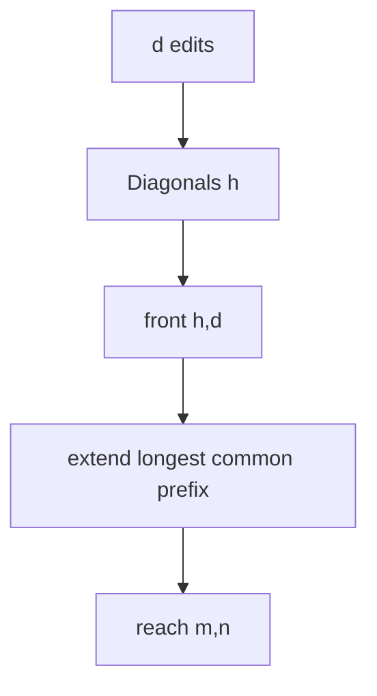

# Output-Sensitive Edit Distance

## Definition

The output-sensitive edit-distance algorithm computes unit edit distance in `O(m+n+e^2)` time, where `e=edist(w,v)`, by maintaining farthest-reaching fronts on diagonals (gik_3_4, pp. 17-20).

## Why it matters

It is faster than full `O(mn)` DP when the two strings are similar, and it supports threshold tests for [[operational-taxonomic-unit]] clustering (gik_3_4, pp. 20, 25).

## Construction / Mechanism



## Pseudocode

```text
ALGORITHM OutputSensitiveEditDistance(w[1..m], v[1..n])
  for d = 0 to max(m,n):
    for h = -d to d step 2:
      row <- max(front[h-1,d-1],
                 front[h+1,d-1] + 1,
                 front[h,d-1] + 1)
      col <- row + h
      while row < m and col < n and w[row+1] = v[col+1]:
        row <- row + 1
        col <- col + 1
      front[h,d] <- row
      if h = n - m and row = m:
        return d
```

## Invariant / correctness argument

After generation `d`, `front(h,d)` is the farthest row reachable on diagonal `h=j-i` using at most `d` edits followed by all possible free matches. The first generation reaching the target is minimal (gik_3_4, pp. 18-20).

## Variants

- Distance only stores two generations: `O(e)` space (gik_3_4, p. 20).
- Traceback stores all generations and predecessor bits: `O(e^2)` space (gik_3_4, p. 20).
- Regional-quality and front-head trimming discard fronts for thresholded similarity search (gik_3_4, pp. 21-24).

## Complexity

| Operation | Time | Space |
|---|---:|---:|
| Distance only | `O(m+n+e^2)` | `O(e)` |
| With traceback | `O(m+n+e^2)` | `O(e^2)` |
| Threshold up to `d_max` | `O(m+n+d_max^2)` | `O(d_max)` |

## Worked example

For `ACGT` vs `ACCT`, `d=0` extends through `AC` and stops at `G/C`. At `d=1`, one substitution crosses the mismatch and the match extension reaches the end, so the distance is 1 (gik_3_4, pp. 18-20).

## Pitfalls & exam traps

> [!warning]
> - The diagonal is `h=j-i`; the stop diagonal is `n-m`.
> - Only diagonals `-d,-d+2,...,d` exist at generation `d`.
> - `front` stores a row endpoint, not a cost.

## Related

- [[unit-edit-distance]] — objective being computed.
- [[lazy-edit-distance]] — demand-driven DP alternative.
- [[operational-taxonomic-unit]] — thresholded application.

## Sources

- gik_3_4, pp. 17-25
