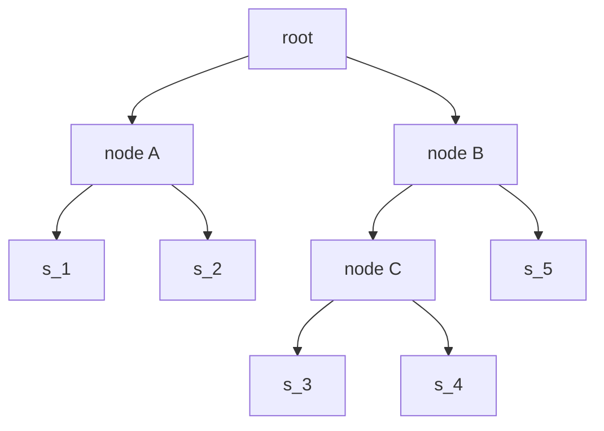
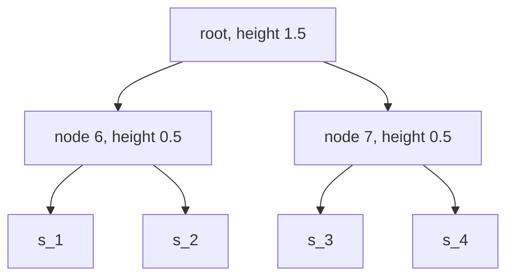

# Progressive Alignment

## Definition

**Iterative / progressive multiple alignment** (iteratives multiples Alignment) builds an
[[multiple-sequence-alignment|MSA]] by combining alignments along the paths of a **rooted tree**
whose leaves are the sequences `s_1, …, s_k` (fsa_part3, p. 23). Three phases:

| Phase | Action |
|---|---|
| **I** | For all pairs of sequences compute the optimal pairwise alignment and the corresponding edit distance `d(s_i, s_j)` |
| **II** | Compute a tree from the distance matrix `d` |
| **III** | Combine pairwise alignments into larger alignments, **guided by the branching order of the tree** |

The tree used in phase III is the **guide tree** (Guide-Tree, Leitbaum).

Symbols: `k` — number of sequences; `d(s_i, s_j)` — a distance between each pair; `l` — length of
the growing MSA.

## Why it matters

[[star-alignment]] forces every sequence to be aligned to one center, which is poor when the family
contains closely related subfamilies. A guide tree aligns the **most similar sequences first**, so
the conservation inside a subfamily is established before distant sequences can disturb it — this
is what makes the method both fast and, in practice, accurate (fsa_part3, p. 23).

## Construction / Mechanism


A guide tree over `s_1 … s_5` whose branching order drives the merges:



Merge order for this tree: `(s_1,s_2)`, then `(s_3,s_4)`, then `((s_3,s_4), s_5)`, finally
`((s_1,s_2), ((s_3,s_4), s_5))`. Each merge aligns two *alignments* (profiles), inserting gap
columns into whole blocks — the same "once a gap always a gap" rule as in [[star-alignment]]
(fsa_part3, pp. 21, 23).

The tree of phase II is produced by a distance method from the phylogenetics block — [[upgma]] or
[[neighbor-joining]] applied to the matrix `d`.

> [!note] Inference
> p. 23 says only "compute a tree". The distance methods of pp. 27–30 are the lecture's own tools
> for exactly this input, so they are the intended constructions.

## Pseudocode

```text
ALGORITHM ProgressiveAlignment(s_1, ..., s_k)
  # phase I
  for i = 1 to k-1:
    for j = i+1 to k:
      compute an optimal pairwise alignment of s_i and s_j
      d[i][j] <- edit distance of that alignment
      d[j][i] <- d[i][j]

  # phase II
  T <- guide tree built from d                       # e.g. UPGMA or Neighbor Joining

  # phase III
  for each internal node x of T in postorder:
    (left, right) <- children of x
    A_left  <- alignment stored at left   (a single sequence if left is a leaf)
    A_right <- alignment stored at right
    A_x <- AlignProfiles(A_left, A_right)            # once a gap always a gap
    store A_x at x
  return alignment stored at the root
```

```text
ALGORITHM DivideAndConquerAlignment(s_1, ..., s_k)   # fsa_part3, p. 24
  if every s_i is short enough:
    return exact or progressive alignment of s_1, ..., s_k
  for i = 1 to k:
    choose a cut position p_i close to the midpoint of s_i
    pre_i <- s_i[1 .. p_i]
    suf_i <- s_i[p_i+1 .. n_i]
  A_pre <- DivideAndConquerAlignment(pre_1, ..., pre_k)
  A_suf <- DivideAndConquerAlignment(suf_1, ..., suf_k)
  return concatenation of A_pre and A_suf
```

## Invariant / correctness argument

Progressive alignment is a **heuristic**: it optimises nothing globally. The only invariant that
holds is structural:

- **Invariant.** The alignment stored at a node `x` is an MSA of exactly the leaves below `x`, and
  it is **compatible** (in the sense of [[multiple-sequence-alignment]]) with the alignments stored
  at both children — merging only inserts gap columns, which projection removes again.

Consequently the final alignment is compatible with every subtree alignment, but it need not
minimise `δ_SP` or `conscost`. The lecture is explicit: there is **"no well-defined objective
function that must be optimized during the iterative alignment method"** (fsa_part3, p. 23).
Contrast [[star-alignment]], which *does* carry the provable `(2 − 2/k)` bound.

For **divide-and-conquer alignment** the correctness claim is weaker still: the concatenation of an
optimal prefix-family alignment and an optimal suffix-family alignment is optimal only if the cut
positions happen to lie on an optimal alignment path; otherwise the cut is a heuristic
(fsa_part3, p. 24).

## Variants

- **Star alignment** — the degenerate guide tree: a star around one center, with a guarantee
  (fsa_part3, pp. 20–22).
- **Divide and conquer alignment** (fsa_part3, p. 24): each sequence is cut in two at a suitable
  position near its midpoint, so aligning one family of sequences becomes two problems of aligning
  families of **shorter** sequences — prefixes and suffixes — whose results are concatenated. This
  is the `k`-sequence analogue of [[hirschberg-linear-space-alignment]]'s middle-column cut.
- **Guide tree construction**: [[upgma]] (rooted, assumes a molecular clock) or
  [[neighbor-joining]] (unrooted, tolerates varying rates).
- **Exact** — [[multidimensional-dp-msa]].

## Complexity

| Step | Time | Space |
|---|---:|---:|
| Phase I: `C(k,2)` pairwise alignments of length `≤ n` | `O(k²·n²)` | `O(n)` per alignment with linear space |
| Phase II: UPGMA guide tree | `O(k²)` | `O(k²)` |
| Phase II: Neighbor Joining guide tree | `O(k³)` | `O(k²)` |
| Phase III: `k−1` profile merges | `O(k·l)` each, `O(k²·l)` total | `O(k·l)` |
| **Total (UPGMA guide tree)** | `O(k²·n²)` | `O(k·l + k²)` |
| Divide and conquer, per cut level | halves the sequence lengths | — |

> [!note] Inference
> p. 23 gives no running times, only the qualitative claim "leads to fast algorithms". The table
> composes the costs of the three phases from the complexities stated elsewhere in part 3
> (pp. 28, 30 for the tree methods).

## Worked example

> [!note] Inference
> p. 23 shows only a small sketch of a rooted tree with no data. This example instantiates the
> three phases on the lecture's own machinery; unit cost `δ`.

`k = 4`: `s_1 = ACGT`, `s_2 = ACG`, `s_3 = TTAC`, `s_4 = TTAG`.

**Phase I** — pairwise unit edit distances:

| `d` | `s_1` | `s_2` | `s_3` | `s_4` |
|---|---:|---:|---:|---:|
| `s_1` | 0 | **1** | 3 | 3 |
| `s_2` | 1 | 0 | 3 | 3 |
| `s_3` | 3 | 3 | 0 | **1** |
| `s_4` | 3 | 3 | 1 | 0 |

**Phase II** — [[upgma]] on `d`: the two smallest entries are `d(s_1,s_2) = 1` and
`d(s_3,s_4) = 1`, giving clusters `{s_1,s_2}` (height `0.5`) and `{s_3,s_4}` (height `0.5`), then
the root at height `3/2 = 1.5`:



**Phase III** — merge in that order.

Merge 1, `(s_1, s_2)`:

```
A C G T
A C G -
```

Merge 2, `(s_3, s_4)`:

```
T T A C
T T A G
```

Merge 3, the two profiles (best column correspondence under unit `δ`):

| row | 1 | 2 | 3 | 4 |
|---|---|---|---|---|
| `s'_1` | A | C | G | T |
| `s'_2` | A | C | G | − |
| `s'_3` | T | T | A | C |
| `s'_4` | T | T | A | G |

SP cost by column (6 pairs each): col 1 `{A,A,T,T}` → 4; col 2 `{C,C,T,T}` → 4; col 3
`{G,G,A,A}` → 4; col 4 `{T,−,C,G}` → 6. Total `δ_SP = 18`.

The subfamily structure `{s_1,s_2}` / `{s_3,s_4}` is established *before* the distant halves meet —
exactly advantage (+2) below. Had the guide tree paired `s_1` with `s_3` first, the gap placed in
that early merge would be frozen into the final alignment.

## Advantages and disadvantages (fsa_part3, p. 23)

| | |
|---|---|
| **(+)** | leads to **fast** algorithms and is applicable to many and long sequences |
| **(+)** | conservations in subfamilies that are aligned before other, less closely related sequences are added lead to **high-quality** MSAs |
| **(−)** | **errors in an early step cannot be eliminated later** — "once a gap always a gap" |
| **(−)** | **no well-defined objective function** that must be optimized during the iterative method |
| **(−)** | the **guide tree remains represented in the alignment** and might bias the result |

## Pitfalls & exam traps

> [!warning]
> - The guide tree is built from pairwise distances **before** any multiple alignment exists; it is
>   not the phylogeny of the family, and using the final MSA to re-estimate it is a different
>   (iterative-refinement) method.
> - Phase III merges **alignments**, not sequences: a gap inserted at a node propagates to every
>   leaf row below it.
> - Unlike [[star-alignment]], progressive alignment has **no approximation guarantee** — do not
>   attach `(2 − 2/k)` to it.
> - "Iterative" here means *iteratively combining along the tree*, not iterative refinement of a
>   finished alignment.
> - Divide-and-conquer alignment cuts **all `k` sequences**, each near its own midpoint; the cut
>   positions are chosen, not fixed at `⌊n_i/2⌋`.
> - A biased guide tree biases the MSA, which — if the MSA is then used to infer a tree — is
>   circular. That is disadvantage three, and it is a favourite exam discussion point.

## Related

- [[multiple-sequence-alignment]] — the object being constructed, and compatibility.
- [[star-alignment]] — the special case with a star-shaped tree and a proven ratio.
- [[multidimensional-dp-msa]] — the exact method these heuristics replace.
- [[upgma]] — builds the rooted guide tree in `O(k²)`.
- [[neighbor-joining]] — builds an unrooted guide tree when rates vary.
- [[phylogenetic-tree]] — the formal tree notion underlying the guide tree.
- [[hirschberg-linear-space-alignment]] — the pairwise divide-and-conquer whose idea p. 24 lifts
  to `k` sequences.
- [[fsa_part3]] — source page for this unit.

## Sources

- fsa_part3, pp. 23–24 (`raw/foundations_sequence_analysis_part3.pdf`)
