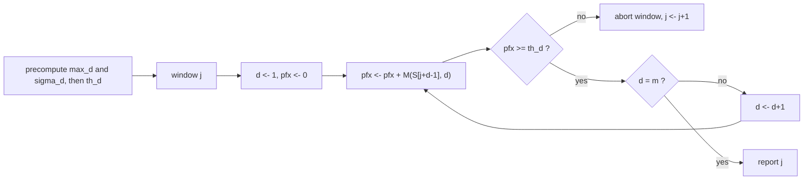

# PSSM Look-Ahead Search

## Definition

**Look-ahead scoring** (Look-ahead-Scoring) solves the
[[position-specific-scoring-matrix|PSSM searching problem]] by **stopping the calculation of
`score(w, M)` as soon as the threshold can no longer be reached** (fsa_part3, p. 2).

Definitions, for a PSSM `M` of length `m` and a word `w ∈ A^m`:

```
pfxscore_d(w, M) = Σ_{h=1}^{d} M( w[h], h )          // prefix score after d positions
max_d            = max{ M(a, d) | a ∈ A }            // best entry in column d
σ_d              = Σ_{h=d+1}^{m} max_h               // best achievable suffix score
th_d             = th − σ_d                          // intermediate threshold
```

The key equivalence (fsa_part3, p. 2):

```
pfxscore_d(w, M) >= th_d  for all 1 <= d <= m   ⟺   score(w, M) >= th
```

## Why it matters

The naive sliding window costs `O(mn)` — every one of the `n−m+1` windows is scored to the last
position even when it is hopeless after one character (fsa_part3, p. 2). Because PSSM columns are
usually sharply peaked (one dominant base), most windows fail at `d = 1` or `d = 2`, so the
expected work per sequence position collapses to a small constant.

## Construction / Mechanism

`σ_d` is the **look-ahead**: the most score the remaining positions `d+1 .. m` could possibly
contribute, over *any* completion of the word. If the prefix is already more than `σ_d` short of
`th`, no completion can rescue it, so the window is abandoned.

Note `σ_m = 0` (empty sum), hence `th_m = th`, and the final test is the original one. `σ_d` is
computed once per PSSM by a right-to-left running sum.



## Pseudocode

```text
ALGORITHM PrecomputeThresholds(M, m, A, th)
  for d = 1 to m:
    max_d[d] <- max{ M[a][d] | a in A }
  sigma[m] <- 0
  for d = m - 1 downto 0:                       // right-to-left running sum
    sigma[d] <- sigma[d+1] + max_d[d+1]
  for d = 1 to m:
    th_d[d] <- th - sigma[d]
  return th_d
```

```text
ALGORITHM LookAheadPSSMSearch(S[1..n], M, m, th)
  th_d <- PrecomputeThresholds(M, m, A, th)
  Hits <- empty list
  for j = 1 to n - m + 1:
    pfx <- 0
    aborted <- false
    for d = 1 to m:
      pfx <- pfx + M[ S[j+d-1] ][ d ]           // pfxscore_d of the window at j
      if pfx < th_d[d]:
        aborted <- true
        break                                   // threshold unreachable
    if aborted = false:                         // pfx = score(S[j..j+m-1], M) >= th
      append j to Hits
  return Hits
```

## Invariant / correctness argument

**Invariant.** After the `d`-th iteration of the inner loop, `pfx = pfxscore_d(w, M)` for
`w = S[j..j+m−1]`.

**Soundness of the abort.** By definition of `max_h`,

```
score(w,M) = pfxscore_d(w,M) + Σ_{h=d+1}^{m} M(w[h],h) <= pfxscore_d(w,M) + σ_d
```

for every `w`. So `pfxscore_d(w,M) < th_d = th − σ_d` implies
`score(w,M) < th − σ_d + σ_d = th`: the window truly cannot reach `th`, and aborting loses no hit.

**Completeness.** Conversely, if `score(w,M) ≥ th` then for every `d`

```
pfxscore_d(w,M) = score(w,M) − Σ_{h=d+1}^{m} M(w[h],h) >= th − σ_d = th_d
```

so no reported window is ever aborted. The two directions together are exactly the equivalence
stated on p. 2, hence the algorithm reports precisely the hits of the naive scan.

## Variants

- **Naive sliding window** — no thresholds, always `O(mn)` (fsa_part3, p. 2).
- **Permuted evaluation order**: evaluate the most discriminative columns (largest spread of
  `M(·,d)`) first, so hopeless windows die earlier. Not in the lecture.
  > [!note] Inference
  > The correctness proof only uses `σ_d` as a bound over the *remaining* positions, so it survives
  > any fixed permutation of the evaluation order as long as `σ` is recomputed for that order.
- **Suffix thresholds**: the symmetric right-to-left scan; same bound by symmetry.

## Complexity

| Operation | Time | Space |
|---|---:|---:|
| Precompute `max_d`, `σ_d`, `th_d` | `O(\|A\|·m)` | `O(m)` |
| One window, best case (abort at `d = 1`) | `O(1)` | `O(1)` |
| One window, worst case | `O(m)` | `O(1)` |
| Whole search, average | `O(kn)`, `k` = avg. number of evaluated PSSM positions per sequence position | `O(\|A\|·m)` |
| Whole search, worst case | `O(mn)` | `O(\|A\|·m)` |

(fsa_part3, p. 2)

## Worked example

PSSM from (fsa_part3, p. 1) — see [[position-specific-scoring-matrix]]:

| base | 1 | 2 | 3 | 4 |
|---|---:|---:|---:|---:|
| A | 0 | 0 | 0.2 | 0.4 |
| C | 0 | 0 | 0.6 | 0 |
| G | 0.8 | 0.2 | 0 | 0.4 |
| T | 0.2 | 0.8 | 0.2 | 0.2 |

Precomputation with `th = 2.0`:

| `d` | `max_d` | `σ_d = Σ_{h>d} max_h` | `th_d = th − σ_d` |
|---:|---:|---:|---:|
| 1 | 0.8 | `0.8+0.6+0.4 = 1.8` | **0.2** |
| 2 | 0.8 | `0.6+0.4 = 1.0` | **1.0** |
| 3 | 0.6 | `0.4` | **1.6** |
| 4 | 0.4 | `0` | **2.0** |

Maximum achievable score is `σ_0 = 2.6` (the word `GTCA`).

Search in `S = G T C A A G G C G` (`n = 9`, `m = 4`, so 6 windows):

| `j` | window | `pfx_1` vs `0.2` | `pfx_2` vs `1.0` | `pfx_3` vs `1.6` | `pfx_4` vs `2.0` | evaluated | outcome |
|---:|---|---|---|---|---|---:|---|
| 1 | `GTCA` | `0.8` ✓ | `1.6` ✓ | `2.2` ✓ | `2.6` ✓ | 4 | **hit** |
| 2 | `TCAA` | `0.2` ✓ | `0.2` ✗ | — | — | 2 | abort |
| 3 | `CAAG` | `0.0` ✗ | — | — | — | 1 | abort |
| 4 | `AAGG` | `0.0` ✗ | — | — | — | 1 | abort |
| 5 | `AGGC` | `0.0` ✗ | — | — | — | 1 | abort |
| 6 | `GGCG` | `0.8` ✓ | `1.0` ✓ | `1.6` ✓ | `2.0` ✓ | 4 | **hit** |

Total entry evaluations: `4+2+1+1+1+4 = 13`, versus `6 · 4 = 24` for the naive scan — so here
`k = 13/6 ≈ 2.17` instead of `m = 4`. Reported positions: `{1, 6}`.

Note window 6 passes `pfx_2 = 1.0` and `pfx_4 = 2.0` by **equality** — the test is `≥`, so it must
not be aborted.

## Pitfalls & exam traps

> [!warning]
> - `σ_d` sums `max_h` for `h = d+1 .. m` — it **excludes** column `d` itself, which is already in
>   `pfxscore_d`. Including it double-counts and makes the filter unsound.
> - `σ_m = 0`, so `th_m = th`. If your `σ` table ends with a nonzero value you are off by one.
> - `max_d` is a maximum over the **alphabet** within one column, not over columns.
> - All comparisons are `≥`; `>` loses hits that exactly meet the threshold (window 6 above).
> - The thresholds depend only on `M` and `th`, not on `S` — compute them **once**, not per window.
> - The `O(kn)` bound is an *average*; an adversarial `S` (or a flat PSSM) gives `O(mn)`.
> - Raising `th` makes every `th_d` larger and the filter stronger — speed and sensitivity trade off
>   through a single knob.

## Related

- [[position-specific-scoring-matrix]] — the model and the searching problem being solved.
- [[blast]] — same branch-and-bound idea, applied to a trie over `A^q` instead of a window scan.
- [[lazy-edit-distance]] — another "stop as soon as the threshold is unreachable" pruning.
- [[score-function]] — the position-independent scoring this generalises.
- [[fsa_part3]] — source page for this unit.

## Sources

- fsa_part3, pp. 1–2 (`raw/foundations_sequence_analysis_part3.pdf`)
