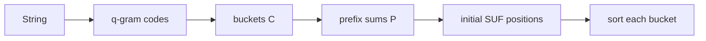

# q-gram Suffix Array Construction

## Definition

The q-gram construction first buckets suffixes by their first `q` symbols, using a code for each
q-gram, then sorts each bucket lexicographically (gik_6, p. 7).

## Why it matters

It explains why fixed-length prefixes can reduce suffix sorting, while also showing the worst-case
failure on strings such as `a^n` where all suffixes fall into one bucket (gik_6, p. 7).

## Construction / Mechanism



## Pseudocode

```text
ALGORITHM QGramSuffixArray(S[1..n], q, alphabetSize r)
  initialise count C[0..r^q-1] to 0
  for i = 1 to n:
    code <- Code(S[i..i+q-1])
    C[code] <- C[code] + 1
  P[0] <- 0
  for code = 1 to r^q - 1:
    P[code] <- P[code-1] + C[code-1]
  for i = 1 to n:
    code <- Code(S[i..i+q-1])
    SUF[P[code]] <- i
    P[code] <- P[code] + 1
  restore bucket boundaries from C by prefix sums
  for each bucket boundary [l,r]:
    sort SUF[l..r] by the full suffixes S[SUF[*]..n]
  return SUF
```

## Invariant / correctness argument

All suffixes with a smaller q-gram code must precede all suffixes with a larger q-gram code. Within
one bucket, the first `q` characters tie, so sorting the full suffixes completes lexicographic
order (gik_6, p. 7).

## Complexity

| Operation | Time | Space |
|---|---:|---:|
| Count q-grams | `O(n)` | `O(r^q)` |
| Prefix sums and placement | `O(n + r^q)` | `O(n + r^q)` |
| Sort all buckets | worst `O(r^q n)` in notes | bucket dependent |
| Worst case `a^n` | `O(r^q n)` | `O(n + r^q)` |

## Worked example

Let `S=banana$`, `q=1`, alphabet order `$<a<b<n`. Buckets are `$:{6}`, `a:{1,3,5}`, `b:{0}`,
`n:{2,4}`. Sorting inside buckets gives `$`, `a$`, `ana$`, `anana$`, `banana$`, `na$`, `nana$`.

## Variants

Choosing a larger `q` usually creates smaller buckets, but increases the `r^q` table cost. The
unit's worst case is `a^n`, where all length-`q` prefixes are equal (gik_6, p. 7).

## Pitfalls & exam traps

> [!warning]
> - Prefix sums `P` are bucket starts before placement but are advanced during placement; keep a
>   copy if the original boundaries are needed.
> - `q` is a construction parameter, not the pattern length.
> - A q-gram bucket is not sorted unless explicitly sorted after placement.

## Related

- [[suffix-array]] — this algorithm constructs it.
- [[enhanced-suffix-array]] — adds `LCP` after `SUF` exists.
- [[sheet-06]] — asks for construction and interval reasoning.

## Sources

- gik_6, p. 7
