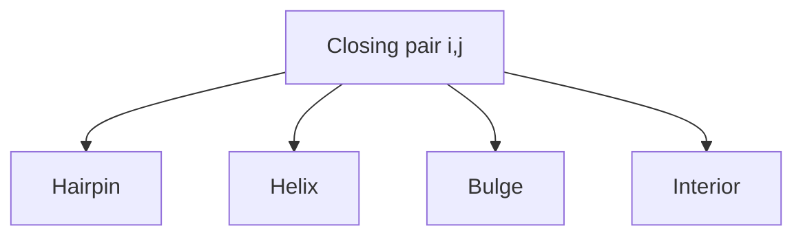

# RNA Loop Energy DP

## Definition

RNA loop energy DP is the loop-aware refinement of [[nussinov-algorithm]], minimising hairpin, helical, bulge, and interior-loop energy terms instead of independent pair sums (gik_3_4, pp. 8-12).

## Why it matters

The notes explicitly improve the independent model because real free energy depends on adjacent base pairs. Helical regions stabilise, while loops of positive size usually destabilise (gik_3_4, pp. 8-12).

## Construction / Mechanism



## Pseudocode

```text
ALGORITHM LoopEnergyDP(w[1..n], loop_energy)
  initialise L for empty and single-base intervals to 0
  for len = 2 to n:
    for i = 1 to n - len + 1:
      j <- i + len - 1
      best <- min(L[i+1][j], L[i][j-1])
      for k = i + 1 to j:
        best <- min(best, L[i][k-1] + L[k][j])
      if AllowedPair(w[i], w[j]):
        best <- min(best, Hairpin(i,j))
        best <- min(best, Helix(i,j) + L[i+1][j-1])
        for each admissible bulge closed by (i,j):
          best <- min(best, Bulge(i,j) + inner_energy)
        for each admissible interior loop closed by (i,j):
          best <- min(best, Interior(i,j) + inner_energy)
      L[i][j] <- best
  return L[1][n]
```

## Invariant / correctness argument

Every loop closed by an accessible base pair is classified as hairpin, helix, bulge, or interior loop in the notes. Once shorter intervals are optimal, taking the minimum over all such closures gives the optimal loop decomposition for the current interval (gik_3_4, pp. 8-12).

## Variants

- Arbitrary interior loops: `O(n^4)` total runtime (gik_3_4, p. 9).
- Bounded maximum loop size: fewer loop candidates; the notes state this reduces runtime toward `O(n^3)` (gik_3_4, p. 9).

## Complexity

| Operation | Time | Space |
|---|---:|---:|
| Hairpin/helical/bulge cases | `O(n^3)` | `O(n^2)` |
| Unrestricted interior loops | `O(n^4)` | `O(n^2)` |
| Bounded loop size | `O(n^3)` | `O(n^2)` |

## Worked example

Nested pairs `(1,6)` and `(2,5)` are treated as a helical stack, not as two independent pair scores. A one-sided gap between closing and inner pair is a bulge; two-sided gaps are an interior loop (gik_3_4, p. 12).

## Pitfalls & exam traps

> [!warning]
> - Loop size counts unpaired bases accessible from the closing pair.
> - Interior-loop enumeration is the source of `O(n^4)`.
> - The notes do not give numerical thermodynamic tables.

## Related

- [[rna-free-energy-model]] — defines the energy terms.
- [[rna-secondary-structure]] — legal non-crossing structures.
- [[nussinov-algorithm]] — independent-pair baseline.

## Sources

- gik_3_4, pp. 8-12
