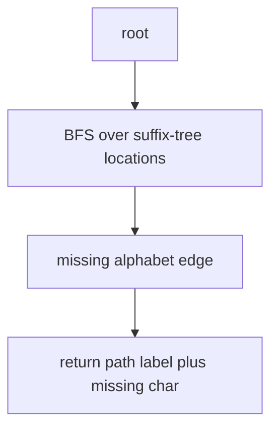

# Shortest Absent Word

## Definition

For alphabet `A` and string `S`, an absent word is a non-empty `w in A+` that is not a substring
of `S`. The shortest absent word length is `mu(A,S)=min{|w| : w is absent}` (gik_5, p. 38).

## Why it matters

The exercise turns suffix-tree completeness into a search problem: the first missing outgoing
character on the shortest path gives a shortest word absent from the text (gik_5, p. 38).

## Construction / Mechanism



## Pseudocode

```text
ALGORITHM ShortestAbsentWord(T, Alphabet)
  queue <- new empty queue
  enqueue(queue, (root(T), empty string))
  while queue is not empty:
    (v, prefix) <- dequeue(queue)
    for each character a in Alphabet:
      if no outgoing edge from v starts with a:
        return prefix concatenated with a
      else:
        u <- child reached by a
        enqueue(queue, (u, prefix concatenated with a))
```

## Invariant / correctness argument

Breadth-first search visits represented prefixes by increasing length. If an outgoing character
`a` is missing from a location for prefix `p`, then `pa` is not a substring. No shorter absent
word exists because all shorter prefixes were tested earlier (gik_5, p. 38).

## Complexity

| Operation | Time | Space |
|---|---:|---:|
| BFS over explicit nodes | `O(|A|·n)` worst case | `O(n)` |
| With constant alphabet | `O(n)` | `O(n)` |
| Output word | `O(mu)` | `O(mu)` |

## Worked example

Let `A={a,b}` and `S=aba`. Single letters `a` and `b` occur. Among length-2 words, `aa` is
missing, while `ab` and `ba` occur. Therefore one shortest absent word is `aa`.

## Variants

The exercise's sketch stores candidates in a queue and updates a current minimum; BFS can return
immediately at the first missing character if the queue is ordered by prefix length (gik_5, p. 38).

## Pitfalls & exam traps

> [!warning]
> - The sentinel `$` is not part of the alphabet `A` for absent-word output.
> - Missing an edge at a deeper node gives an absent word, but not necessarily the shortest one
>   unless traversal is breadth-first.
> - A word can be absent even when all of its proper prefixes occur.

## Related

- [[suffix-tree]] — used to test represented substrings.
- [[minimal-unique-substring]] — finds strings occurring exactly once, not zero times.
- [[sheet-05]] — contains this as exercise 5.1.

## Sources

- gik_5, p. 38
