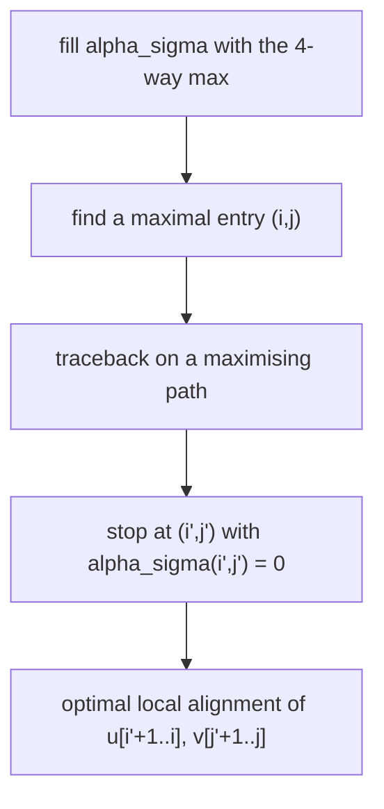

# Smith–Waterman Algorithm

## Definition

The Smith–Waterman algorithm solves the [[local-similarity|local alignment problem]]
(fsa_part1, p. 16):

- **In:** `u = u[1..m]`, `v = v[1..n]`, a [[score-function]] `σ` satisfying (3.3).
- **Out:** `loc_σ(u,v)` and an optimal local alignment of `u` and `v`.

## Why it matters

It finds the best-scoring pair of **substrings** in `O(mn)` instead of the `O(m³n³)` brute force
over all substring pairs (fsa_part1, p. 14) — effectively all pairs of substrings are aligned at
once (fsa_part1, p. 16). This is the right tool when only domains or coding regions are similar
(fsa_part1, p. 13).

## Construction / Mechanism

> **Theorem** (fsa_part1, p. 15). Let `σ` be a score function satisfying
>
> ```
> (3.3)   loc_σ(s, ε) = loc_σ(ε, s) = 0   for all s ∈ A*
> ```
>
> Then `α_σ(i,j) = 0` if `i = 0` and `j = 0`, and otherwise
>
> ```text
> α_σ(i,j) = max { 0,
>                  α_σ(i-1, j)   + σ(u[i] -> ε),
>                  α_σ(i,   j-1) + σ(ε    -> v[j]),
>                  α_σ(i-1, j-1) + σ(u[i] -> v[j]) }
> ```

The `0` suppresses prefixes with negative score; similar substrings show up as **positive
islands** in a matrix dominated by 0-entries (fsa_part1, p. 15). The answer is

```
loc_σ(u, v) = max { α_σ(i, j) | 0 <= i <= m , 0 <= j <= n }
```



## Pseudocode

```text
ALGORITHM SmithWaterman(u[1..m], v[1..n], σ)            // σ must satisfy (3.3)
  for i = 0 to m:  α[i][0] <- 0
  for j = 0 to n:  α[0][j] <- 0
  best <- 0 ;  (bi, bj) <- (0, 0)
  for i = 1 to m:
    for j = 1 to n:
      α[i][j] <- max( 0,
                      α[i-1][j]   + σ(u[i] -> ε),
                      α[i][j-1]   + σ(ε    -> v[j]),
                      α[i-1][j-1] + σ(u[i] -> v[j]) )
      if α[i][j] > best:
        best <- α[i][j] ;  (bi, bj) <- (i, j)
  A <- TracebackLocal(α, bi, bj)
  return (best, A)

TracebackLocal(α, i, j)
  A <- empty sequence
  while α[i][j] > 0:
    if α[i][j] = α[i-1][j-1] + σ(u[i] -> v[j]):
      prepend (u[i] -> v[j]) to A ;  (i, j) <- (i-1, j-1)
    else if α[i][j] = α[i-1][j] + σ(u[i] -> ε):
      prepend (u[i] -> ε) to A ;     i <- i - 1
    else:
      prepend (ε -> v[j]) to A ;     j <- j - 1
  return A
```

The three steps as stated in the script (fsa_part1, p. 16):
1. compute `α_σ` with the recurrence;
2. compute a maximal entry `α_σ(i,j)`;
3. compute optimal local alignments by a traceback from `(i,j)` on a maximising path until some
   entry `(i',j')` with `α_σ(i',j') = 0`.

## Alternative procedure — `calcMO`

The script gives a variant that "computes for every node in the edit graph `G(u,v)` its origin
(Ursprung)" (fsa_part1, p. 16). `MO` = *maximaler Ursprung*, the origin matrix: `MO[i][j]` is the
node where the best local alignment ending at `(i,j)` starts.

```text
for i <- 0 to m:
  for j <- 0 to n:
    MO[i][j] <- calcMO(i, j)
  end
end

calcMO(i, j):
  if loc(i, j) = 0:
    return (i, j)
  end
  max <- max( loc(i-1, j), loc(i, j-1), loc(i-1, j-1) )
  if max = loc(i-1, j):     return calcMO(i-1, j)
  if max = loc(i, j-1):     return calcMO(i, j-1)
  if max = loc(i-1, j-1):   return calcMO(i-1, j-1)
```

> [!question]
> On the page the remaining cases of `calcMO` trail off with "⋮" (fsa_part1, p. 16). The two
> continuation lines above are the obvious analogues of the first case; the script does not write
> them out, and it does not say which case wins on ties. The memoised version (filling `MO` in
> topological order and reading the predecessor's `MO` entry instead of recursing) runs in
> `O(mn)`; the literal recursive version re-walks the path at every cell.

## Invariant / correctness argument

`α_σ(i,j)` is the maximum of `score_σ(x,y)` over all suffixes `x` of `u[1..i]` and `y` of
`v[1..j]` (fsa_part1, p. 15). Induction over a topological order of [[edit-graph|`G(u,v)`]]: the
best such pair either is empty (value 0, the first argument of the max) or its alignment has a
last column, which is one of the three edit operations into `(i,j)`; removing it leaves a best
suffix pair at the predecessor, which is the induction hypothesis. Because every substring is a
**suffix of a prefix** (fsa_part1, p. 14), maximising `α_σ` over all `(i,j)` ranges over all
substring pairs, so the maximum equals `loc_σ(u,v)`.

Condition (3.3) is what makes the `0` option safe: if aligning something against `ε` could score
positively, resetting to 0 would discard score.

## Variants

- **Global, maximising**: drop the `0` — then the table computes `score_σ(u,v)` with both
  endpoints fixed, `O(mn)` (fsa_part1, p. 14).
- **All optimal local alignments**: branch on every maximising edge during traceback and start
  from every maximal entry.
- **Origin matrix `calcMO`**: annotate each node with the start of its best local alignment
  (fsa_part1, p. 16).
- **Distance-based relaxations** of the endpoint constraints:
  [[approximate-string-matching]] (free start row), [[overlap-alignment]] (free start row and
  column) — these *minimise* instead (fsa_part1, p. 24).

## Complexity

| Operation | Time | Space |
|---|---:|---:|
| Fill `α_σ` | `O(mn)` | `O(mn)` |
| Find maximal entry | `O(mn)` | `O(1)` |
| One traceback | `O(|A|)` | table required |
| Brute force over substring pairs (for comparison) | `O(m³n³)` | `O(mn)` |

(fsa_part1, pp. 14, 16.)

## Worked example

`u = TTACG`, `v = GGACG`, with `σ`: match `+2`, mismatch `−1`, indel `−2`.

`α_σ`, rows `i = 0..5` (`u = T T A C G`), columns `j = 0..5` (`v = G G A C G`):

| `i \ j` | **0** | **1** `G` | **2** `G` | **3** `A` | **4** `C` | **5** `G` |
|---|---:|---:|---:|---:|---:|---:|
| **0** | 0 | 0 | 0 | 0 | 0 | 0 |
| **1** `T` | 0 | 0 | 0 | 0 | 0 | 0 |
| **2** `T` | 0 | 0 | 0 | 0 | 0 | 0 |
| **3** `A` | 0 | 0 | 0 | **2** | 0 | 0 |
| **4** `C` | 0 | 0 | 0 | 0 | **4** | 2 |
| **5** `G` | 0 | 2 | 2 | 0 | 2 | **6** |

Sample cell: `α(4,4)`, `u[4] = C`, `v[4] = C` (match `+2`):
`max(0, α(3,4)−2 = −2, α(4,3)−2 = −2, α(3,3)+2 = 4) = 4`.

`loc_σ(u,v) = 6` at `(5,5)`. Traceback: `(5,5) ← (4,4) ← (3,3) ← (2,2)` where `α(2,2) = 0`, stop.
Optimal local alignment, `u' = u[3..5] = ACG`, `v' = v[3..5] = ACG`:

```
A C G
A C G
```

score `2 + 2 + 2 = 6` ✓ — a positive island in a sea of zeros.

## Pitfalls & exam traps

> [!warning]
> - Row 0 and column 0 are **all zero** here, unlike `E_δ` in [[edit-distance-dp]].
> - The traceback stops at the first `0`, **not** at `(0,0)`. Reaching `(0,0)` is a coincidence.
> - `loc_σ` is read off the **maximum over the whole matrix**, not from `α_σ(m,n)`.
> - `α_σ(i,j)` does *not* equal `loc_σ(u[1..i], v[1..j])` — the script crosses that claim out
>   (fsa_part1, p. 15).
> - (3.3) is a precondition. With positive indel scores the recurrence is simply wrong.
> - Local alignment **maximises a score**; global, approximate and overlap alignment **minimise
>   distances** (fsa_part1, p. 24). Do not mix the two in one table.

## Related

- [[local-similarity]] — the problem `loc_σ` that this algorithm solves.
- [[score-function]] — supplies `σ` and condition (3.3).
- [[edit-distance-dp]] — the minimising template; same shape, extra `0` and `max` here.
- [[edit-graph]] — same node set, arbitrary start and end nodes.
- [[overlap-alignment]] — the other endpoint relaxation, distance-based.
- [[approximate-string-matching]] — semi-global sibling.

- [[fsa_part1]] ? source page for this part of the module.

## Sources

- fsa_part1, pp. 13–16, 24 (`raw/foundations_sequence_analysis_part1.pdf`)
