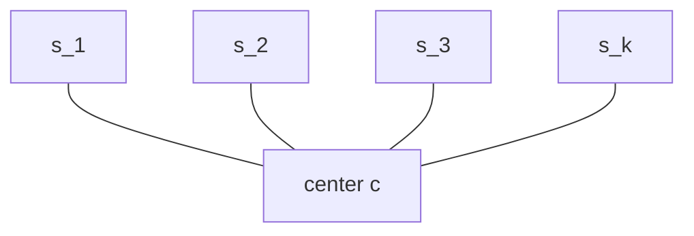

# Star Alignment

## Definition

**Star alignment** (Stern-Alignment) builds an [[multiple-sequence-alignment|MSA]] from **pairwise**
alignments only. The alignment tree is a **star**: one **center sequence** `c` is connected to every
other sequence, and each edge carries an optimal pairwise alignment (fsa_part3, p. 20). The MSA is
assembled so that it is **compatible** with all of these pairwise alignments
(fsa_part3, p. 21).



Two steps (fsa_part3, p. 21):

1. identify the center sequence;
2. construct from the optimal pairwise alignments an MSA compatible with them.

The merging rule is **"Once a gap always a gap!"**: a gap once inserted into the growing alignment
is never removed; new gaps are propagated into all existing rows.

Symbols: `S = {s_1, …, s_k}`; `c` — center; `δ_opt(s,t)` — optimal pairwise distance;
`totalscore(t) = Σ_{s ∈ S∖{t}} δ_opt(s,t)`; `δ_SP` — sum-of-pairs score;
`δ_opt-SP` — the optimal SP score.

## Why it matters

The exact [[multidimensional-dp-msa]] costs `O(z·f(k)·2^k)` and is unusable beyond a handful of
short sequences. Star alignment needs only `C(k,2)` pairwise alignments and comes with a **proven
approximation ratio** `2 − 2/k` for good cost functions — one of the few guarantees in this field
(fsa_part3, p. 22). Its score additionally serves as a **pruning bound** for the exact DP.

## Construction / Mechanism

### Choosing the center

Compute an optimal pairwise alignment for every ordered pair, then

```
totalscore(t) = Σ_{s ∈ S \ {t}} δ_opt(s, t)
```

and pick `c ∈ S` with `totalscore(c) ≤ totalscore(s)` for all `s ∈ S` (fsa_part3, p. 21) — the
sequence closest to all others on average.

### Merging under "once a gap always a gap"

The current MSA `AL` always contains a row for `c`. To add `s'`, take the optimal pairwise
alignment of `c` and `s'`. Its `c`-row may contain gaps that `AL`'s `c`-row does not, and vice
versa. Insert the missing gaps into **whichever side lacks them**, propagating gaps inserted into
`AL`'s `c`-row to **all** rows of `AL`. The result `AL'` is compatible with `AL`
(fsa_part3, p. 21).


## Pseudocode

```text
ALGORITHM StarAlignment(S = {s_1, ..., s_k})
  # --- step 1: compute the center c
  for all s in S do:
    for all t in S \ {s} do:
      compute an optimal alignment of s and t with distance δ_opt(s, t)
  for all t in S do:
    totalscore(t) <- sum over s in S \ {t} of δ_opt(s, t)
  let c in S such that totalscore(c) <= totalscore(s)  for all s in S
  let T be a star alignment tree with c as center

  # --- step 2: compatible MSA
  choose s in S \ {c}
  let AL be an optimal alignment of c and s
  S' <- {c, s}
  while S' != S do:
    choose s' in S \ S'
    S' <- S' ∪ {s'}
    determine an MSA AL' of S' by combining AL with an optimal alignment of c and s',
      applying "once a gap always a gap"          # AL' is compatible with AL
    AL <- AL'
  return AL
```

```text
ALGORITHM MergeOnCenter(AL, s', PA)      # PA = optimal pairwise alignment of c and s'
  i <- 1                                 # column index in AL
  j <- 1                                 # column index in PA
  AL' <- empty
  while i <= cols(AL) or j <= cols(PA):
    if AL.row_c[i] = '-' and PA.row_c[j] != '-':
      emit column: AL[*][i] , and '-' for the new row s'    # keep AL's old gap
      i <- i + 1
    else if AL.row_c[i] != '-' and PA.row_c[j] = '-':
      emit column: '-' for every row of AL , and PA.row_s'[j]   # new gap into all AL rows
      j <- j + 1
    else:
      emit column: AL[*][i] , and PA.row_s'[j]
      i <- i + 1 ;  j <- j + 1
  return AL'
```

## Invariant / correctness argument

**Invariant.** After each merge, `proj(AL, {c, t}) =` the optimal pairwise alignment of `c` and `t`
for every `t` already inserted. The merge only ever *inserts gap columns*; projecting onto
`{c, t}` deletes exactly those inserted all-gap-in-`{c,t}` columns again, recovering the original
pairwise alignment. Hence `AL` is compatible with every edge of the star tree.

### Lemma (fsa_part3, p. 22)

Let `δ` be a **good cost function** (`δ(a,a) = 0` and the triangle inequality, see
[[multiple-sequence-alignment]]), `S = {c, s_1, …, s_k}`, `T` a star tree with center `c`, and
`(c', s'_1, …, s'_k)` an MSA of length `l` compatible with `T`. Then for all `i, j`:

```
δ(s'_i, s'_j)  <=  δ(s'_i, c') + δ(c', s'_j)  =  δ_opt(s_i, c) + δ_opt(c, s_j)
```

The inequality is the triangle inequality applied **column by column**; the equality is
compatibility: the projection onto `{c, s_i}` *is* the optimal pairwise alignment, so its induced
cost equals `δ_opt(s_i, c)`.

### Theorem (fsa_part3, p. 22)

For a good `δ`, `S = {s_1, …, s_k}` and the star alignment `AL = (s'_1, …, s'_k)`:

```
δ_SP(s'_1, ..., s'_k)  <=  ( 2 − 2/k ) · δ_opt-SP(s_1, ..., s_k)
```

**Proof sketch.** Write `d(i,j) = δ(s'_i, s'_j)` for the induced pairwise costs in `AL`, let
`c` be the center and `M = totalscore(c) = Σ_{i ≠ c} δ_opt(s_i, c)`.

1. **Upper bound via the center.** By the lemma, `d(i,j) ≤ d(i,c) + d(c,j)`. Summing over all
   `C(k,2)` pairs and noting that each index `i` occurs in exactly `k−1` pairs:
   ```
   δ_SP(AL) = Σ_{i<j} d(i,j) <= (k−1) · Σ_{i} d(i,c) = (k−1) · M
   ```
   (using `d(c,c) = 0` and `d(i,c) = δ_opt(s_i, c)` by compatibility).
2. **Lower bound on the optimum.** Let `AL*` be an optimal SP alignment with induced costs
   `d*(i,j)`. For every `x ∈ S`, the projection of `AL*` onto `{i, x}` is *some* alignment, so
   `δ_opt(s_i, s_x) ≤ d*(i,x)`, hence `totalscore(x) ≤ Σ_{i≠x} d*(i,x)`. Summing over all `x`
   counts every unordered pair twice:
   ```
   Σ_{x ∈ S} totalscore(x) <= 2 · δ_opt-SP
   ```
3. **Minimality of the center.** `totalscore(c) ≤ totalscore(x)` for all `x`, so
   `k · M ≤ Σ_x totalscore(x) ≤ 2 δ_opt-SP`, i.e. `M ≤ (2/k) · δ_opt-SP`.
4. **Combine.** `δ_SP(AL) ≤ (k−1)·M ≤ (k−1)·(2/k)·δ_opt-SP = (2 − 2/k) · δ_opt-SP`. ∎

> [!note] Inference
> p. 22 states the lemma and the theorem but gives no proof. Steps 1–4 are the standard argument;
> each step uses only facts stated on p. 22 (goodness, compatibility, minimality of `totalscore(c)`).

### Consequence: DP pruning

`δ_SP(AL)` is an easily computed **upper bound** for `δ_opt-SP`. In the exact DP of
[[multidimensional-dp-msa]], if `M(q_1,…,q_k) = d > δ_SP` then this entry can be excluded, since
`δ_opt-SP ≤ δ_SP < d` (fsa_part3, p. 22).

## Variants

- **Center by other criteria** — e.g. the longest sequence or a reference genome; loses the
  `(2 − 2/k)` guarantee, which depends on `totalscore(c)` being minimal.
- **[[progressive-alignment]]** — replaces the star by a **guide tree**; usually better in practice,
  no approximation guarantee (fsa_part3, p. 23).
- **Divide-and-conquer alignment** — cuts all sequences near their midpoints (fsa_part3, p. 24).
- **Exact** — [[multidimensional-dp-msa]].

## Complexity

| Step | Time | Space |
|---|---:|---:|
| All `C(k,2)` optimal pairwise alignments, lengths `≤ n` | `O(k²·n²)` | `O(n)` with [[hirschberg-linear-space-alignment]] |
| `totalscore(t)` for all `t`, center selection | `O(k²)` | `O(k²)` for the distance matrix |
| One merge (`k−1` merges in total) | `O(k·l)` | `O(k·l)` |
| All merges | `O(k²·l)` | `O(k·l)` |
| **Total** | `O(k²·n²)` dominated by the pairwise alignments | `O(k·l + k²)` |
| Approximation ratio | `2 − 2/k` < 2 (fsa_part3, p. 22) | — |

> [!note] Inference
> p. 21 gives the algorithm but no running time; the table is the direct count of its steps with
> `O(n²)` per pairwise alignment and `l ≤ Σ n_i`.

## Worked example 1 — the merge (fsa_part3, p. 21)

Current alignment `AL` of center `c` with `s_1`:

```
c'    = A T G
s'_1  = A - G
```

New optimal pairwise alignment of `c` with `s_2`:

```
c''    = A - T G
s''_2  = A A - -
```

The `c`-row of the new pairwise alignment has a gap after `A` that `AL` lacks. Insert it into
**every** row of `AL` (once a gap always a gap):

```
c'''    = A - T G
s'''_1  = A - - G
s'''_2  = A A - -
```

The resulting MSA is compatible with both pairwise alignments, but **it is not optimal**
(fsa_part3, p. 21) — the price of never revisiting a gap decision.

## Worked example 2 — center selection and the bound

> [!note] Inference
> fsa_part3 gives no numeric center-selection example; this one is constructed from the lecture's
> own definitions with unit cost `δ`.

`S = {s_1, s_2, s_3}` with `s_1 = ATG`, `s_2 = AG`, `s_3 = AAT`. Pairwise unit edit distances:

| `δ_opt` | `s_1` | `s_2` | `s_3` | `totalscore` |
|---|---:|---:|---:|---:|
| `s_1` | — | 1 | 2 | **3** |
| `s_2` | 1 | — | 2 | **3** |
| `s_3` | 2 | 2 | — | 4 |

Minimum `totalscore` = 3, attained by `s_1` (and `s_2`); take `c = s_1`. So `M = 3`.

Pairwise alignments to the center: `ATG`/`AG` → `A T G` over `A - G`; `ATG`/`AAT` →
`A T G` over `A A T` (two replacements). The `c`-row has no gaps in either, so the merge inserts
nothing:

| row | 1 | 2 | 3 |
|---|---|---|---|
| `c = s_1` | A | T | G |
| `s_2` | A | − | G |
| `s_3` | A | A | T |

SP cost per column (unit `δ`, pairs `(1,2),(1,3),(2,3)`):

| `j` | column | `(1,2)` | `(1,3)` | `(2,3)` | `δ_SP` |
|---:|---|---:|---:|---:|---:|
| 1 | A,A,A | 0 | 0 | 0 | 0 |
| 2 | T,−,A | 1 | 1 | 1 | 3 |
| 3 | G,G,T | 0 | 1 | 1 | 2 |

`δ_SP(AL) = 5`.

Checking the theorem with `k = 3`: the bound is `(2 − 2/3)·δ_opt-SP = (4/3)·δ_opt-SP`. The exact
DP gives `δ_opt-SP = 5`, so `5 ≤ 6.67` ✓ — here the star alignment happens to be **optimal**.
Intermediate bounds also hold: `δ_SP ≤ (k−1)·M = 2·3 = 6` ✓ and `M = 3 ≤ (2/3)·5 = 3.33` ✓.

## Pitfalls & exam traps

> [!warning]
> - The center **minimises** `totalscore`; it is not the longest or the "most typical-looking"
>   sequence. Choosing otherwise voids the theorem (step 3 of the proof).
> - `totalscore(t)` excludes `t` itself — `k−1` summands, not `k`.
> - "Once a gap always a gap" propagates a newly inserted gap into **all** existing rows, not only
>   into the center row.
> - The result is compatible with all pairwise alignments but generally **not optimal**
>   (fsa_part3, p. 21).
> - The ratio is `2 − 2/k`, which **grows** with `k` towards 2 — more sequences means a weaker
>   guarantee. For `k = 2` it is `1`, i.e. exact.
> - The theorem needs `δ` **good**; without the triangle inequality the lemma collapses.
> - `δ_SP` is an upper bound on `δ_opt-SP`, so DP entries exceeding it may be pruned — the
>   inequality direction is the whole point.

## Related

- [[multiple-sequence-alignment]] — compatibility, projection, SP scoring, good cost functions.
- [[multidimensional-dp-msa]] — the exact method this approximates, and the consumer of the
  `δ_SP` pruning bound.
- [[progressive-alignment]] — replaces the star by a guide tree.
- [[edit-distance-dp]] — computes the `C(k,2)` pairwise alignments.
- [[hirschberg-linear-space-alignment]] — keeps those pairwise alignments in linear space.
- [[cost-function]] — the `δ` that must be *good*.
- [[fsa_part3]] — source page for this unit.

## Sources

- fsa_part3, pp. 20–22 (`raw/foundations_sequence_analysis_part3.pdf`)
