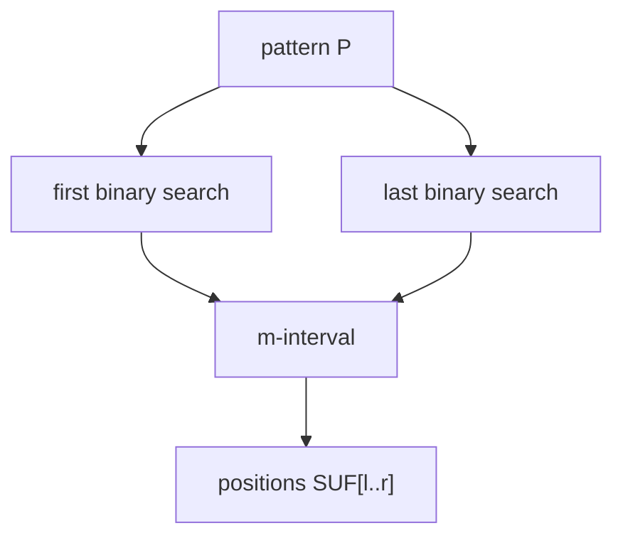

# Suffix Array Pattern Matching

## Definition

Exact pattern matching on a [[suffix-array]] finds the interval `[l,r]` of suffixes prefixed by
`P[0..m-1]`; every occurrence is `SUF[q]` for `q in [l,r]` (gik_6, p. 4).

## Why it matters

It is the array version of [[suffix-tree-exact-matching]] and is the starting point for the
FM-index's backward search (gik_6, pp. 4, 13-15).

## Construction / Mechanism



## Pseudocode

```text
ALGORITHM FirstRank(S, SUF, P[0..m-1])
  l <- 0
  r <- length(SUF) - 1
  answer <- -1
  while l <= r:
    mid <- floor((l + r) / 2)
    a <- S[SUF[mid] .. SUF[mid] + m - 1]
    if a < P:
      l <- mid + 1
    else:
      if a = P:
        answer <- mid
      r <- mid - 1
  return answer

ALGORITHM LastRank(S, SUF, P[0..m-1])
  l <- 0
  r <- length(SUF) - 1
  answer <- -1
  while l <= r:
    mid <- floor((l + r) / 2)
    a <- S[SUF[mid] .. SUF[mid] + m - 1]
    if a > P:
      r <- mid - 1
    else:
      if a = P:
        answer <- mid
      l <- mid + 1
  return answer
```

## Invariant / correctness argument

At every binary-search step, all suffixes left of `l` are too small or already excluded, and all
suffixes right of `r` are too large or already excluded. The two searches return the extreme ranks
whose first `m` symbols equal `P`, hence the complete interval (gik_6, pp. 4-6).

## Complexity

| Operation | Time | Space |
|---|---:|---:|
| One binary search | `O(m log n)` | `O(1)` |
| Full interval | `O(m log n)` | `O(1)` |
| Report occurrences | `O(z)` | `O(1)` plus output |

## Worked example

Using `S=banana$` and `SUF=[6,5,3,1,0,4,2]`, compare `P=ana` against suffixes. The first search
ends at rank `2` (`S[3..]=ana$`), the last at rank `3` (`S[1..]=anana$`). The reported positions
are `3` and `1`.

## Variants

The notes also describe refining an interval character-by-character: after processing
`P[0..c-1]`, restrict the next binary searches to the already found interval (gik_6, pp. 4-6).

## Pitfalls & exam traps

> [!warning]
> - Returning only one binary-search hit loses duplicate occurrences.
> - The substring compared has length `m`; comparing whole suffixes changes constants and can
>   hide the intended `O(m log n)` bound.
> - If `FirstRank` returns `-1`, the pattern is absent and `LastRank` should not be interpreted.

## Related

- [[suffix-array]] — stores the suffix ranks searched here.
- [[fm-index-backward-search]] — replaces repeated text comparisons by rank queries on BWT.
- [[sheet-06]] — includes suffix-array interval exercises.

## Sources

- gik_6, pp. 4-6
