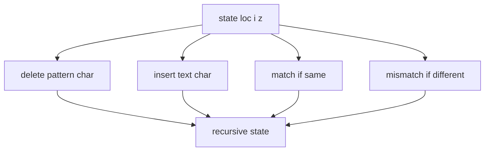

# Suffix Tree Approximate Matching

## Definition

Approximate suffix-tree matching reports positions `j` in `S` such that the unit edit distance
between pattern `P` and a prefix of suffix `S[j..n]` is at most `k` (gik_5, pp. 17-18).

## Why it matters

It combines the unit edit operations from [[unit-edit-distance]] with suffix-tree branching:
small `k` can be explored as a bounded search rather than filling a full DP matrix (gik_5,
pp. 17-19).

## Construction / Mechanism

A recursive state `(loc, i, z)` means: after matching `P[1..i-1]` with `z` differences, the
search is at suffix-tree location `loc`. The recursion tries deletion, insertion, match, and
mismatch while `z <= k` (gik_5, pp. 17-18).



## Pseudocode

```text
ALGORITHM ApproxMatch(T, P[1..m], k, loc, i, z)
  if z > k:
    return empty set
  if i = m + 1:
    return leaf labels below loc
  result <- empty set
  result <- result union ApproxMatch(T, P, k, loc, i + 1, z + 1)
  for each character b in alphabet:
    if Follow(T, loc, b) is defined:
      locb <- Follow(T, loc, b)
      result <- result union ApproxMatch(T, P, k, locb, i, z + 1)
      if b = P[i]:
        result <- result union ApproxMatch(T, P, k, locb, i + 1, z)
      else:
        result <- result union ApproxMatch(T, P, k, locb, i + 1, z + 1)
  return result
```

## Invariant / correctness argument

Every recursive edge corresponds to exactly one edit operation or exact character match. Thus all
paths ending with `i=m+1` describe alignments of `P` to prefixes of suffixes. Pruning `z>k`
removes only alignments already exceeding the allowed distance (gik_5, p. 18).

## Complexity

| Operation | Time | Space |
|---|---:|---:|
| Simple bounded recursion | exponential in `k` | recursion depth `O(|P|+k)` |
| With maximal-match pruning table `mu` | still output/search dependent; prunes states | `O(|S|)` for `mu` |
| Compute `mu` with reverse suffix tree | `O(|S|)` | `O(|S|)` |

## Worked example

Let `S=GGCAC` and `P=GTC` with `k=1`. One branch matches `G`, deletes `T`, then matches `C`,
reporting suffixes that start with `GC` at one edit. A branch spending the edit on a mismatch has
no budget left for later mismatches (gik_5, pp. 17-18).

## Variants

The notes reduce the search space with a table `mu(q)`: the maximal exact match length of
`P[q..m]` against `S`. If the remaining budget `k-z` is smaller than the required minimum number
of future mismatches implied by `mu`, discard the state (gik_5, p. 19).

## Pitfalls & exam traps

> [!warning]
> - The recursion matches `P` against prefixes of suffixes, not necessarily full suffixes.
> - A deletion consumes a pattern character without moving in the tree; an insertion moves in
>   the tree without consuming a pattern character.
> - This is not the same complexity guarantee as [[output-sensitive-edit-distance]].

## Related

- [[suffix-tree]] — search index.
- [[unit-edit-distance]] — defines the edit operations.
- [[suffix-tree-exact-matching]] — the `k=0` special case.

## Sources

- gik_5, pp. 17-19
