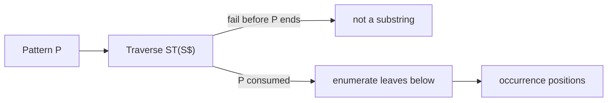

# Suffix Tree Exact Matching

## Definition

Exact suffix-tree matching follows the pattern from the root. If traversal consumes the whole
pattern, the pattern is a substring and every leaf below the reached location gives one occurrence
(gik_5, p. 16).

## Why it matters

Unit 4 used local matches as anchors; this procedure finds exact anchors in time independent of
`|S|` except for reporting the output (gik_5, p. 16; gik_3_4, p. 26).

## Construction / Mechanism



## Pseudocode

```text
ALGORITHM SuffixTreeExactMatch(T, P[1..m])
  loc <- root(T)
  i <- 1
  while i <= m:
    if no outgoing edge from loc starts with P[i]:
      return empty set
    follow that edge character by character while i <= m and labels match
    if a mismatch occurs:
      return empty set
    update loc to the node or edge location reached
  return leaf labels in the subtree below loc
```

## Invariant / correctness argument

After consuming `P[1..i-1]`, `loc` is exactly the suffix-tree location for that prefix. Failure
means no suffix begins with the prefix, hence the prefix is not a substring. If all of `P` is
consumed, every suffix below `loc` begins with `P` and every occurrence of `P` starts one of those
suffixes (gik_5, p. 16).

## Complexity

| Operation | Time | Space |
|---|---:|---:|
| Verify `P` is a substring | `O(|P|)` | `O(1)` |
| Report all occurrences | `O(|P| + z)` | `O(1)` plus output |
| Longest prefix of `P` in `S` | `O(|P|)` | `O(1)` |

## Worked example

In `S=banana`, search `ana`. The traversal follows `a`, then `n`, then `a`. The reached subtree
has leaves for suffixes `anana$` and `ana$`, so the occurrences start at positions `2` and `4`
under 1-based indexing (gik_5, p. 16).

## Variants

- Stop at the first failed character and return the consumed prefix to find the longest prefix of
  `P` that occurs in `S` (gik_5, p. 16).
- Use [[suffix-tree-approximate-matching]] if up to `k` edits are allowed.

## Pitfalls & exam traps

> [!warning]
> - If `P` ends inside an edge, the subtree below the edge endpoint still supplies the
>   occurrences.
> - Runtime for verification is `O(|P|)`, not `O(|S|)`, after construction.
> - Leaf labels are suffix start positions; they are not necessarily in text order.

## Related

- [[suffix-tree]] — index being traversed.
- [[maximal-unique-match]] — exact matches plus uniqueness and maximality tests.
- [[anchor-based-sequence-comparison]] — consumes the reported matches as candidate anchors.

## Sources

- gik_5, p. 16
