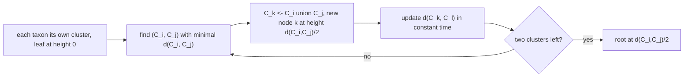
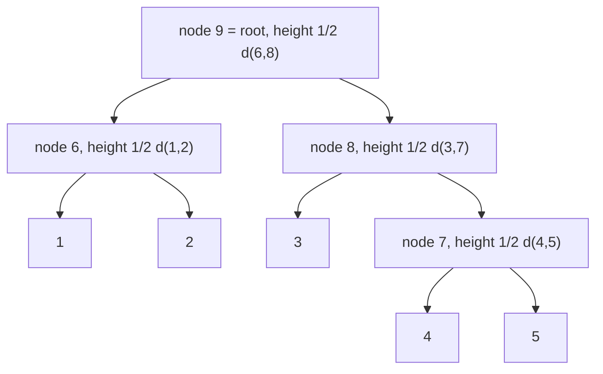

# UPGMA

## Definition

**UPGMA** = **u**nweighted **p**air **g**roup **m**ethod using arithmetic **a**verages. It is an
agglomerative distance method producing a **rooted binary tree** `T_X` by **clustering upwards**:
first cluster a pair of leaves, then repeatedly merge the closest pair of clusters
(fsa_part3, p. 27). **Each node is given a height**, and the **edge lengths are obtained as the
difference of the heights of its two end nodes**.

**Cluster distance** — average linkage over all cross pairs, for disjoint `C_i, C_j ⊆ X`
(fsa_part3, p. 27):

```
d(C_i, C_j) = ( 1 / ( |C_i| · |C_j| ) ) · Σ_{x ∈ C_i} Σ_{y ∈ C_j} d(x, y)
```

**Update rule** after merging `C_k = C_i ∪ C_j` (fsa_part3, p. 27):

```
d(C_k, C_l) = ( d(C_i, C_l)·|C_i| + d(C_j, C_l)·|C_j| ) / ( |C_i| + |C_j| )
```

Symbols: `X` — taxa, `n = |X|`; `C_i` — clusters; `d` — the input distance; heights are measured
upwards from the leaves, which sit at height 0.

## Why it matters

UPGMA is the simplest distance method and the standard way to obtain a **guide tree** for
[[progressive-alignment]] in `O(n²)` (fsa_part3, p. 28). Its node heights are directly
interpretable as divergence times — **but only if the molecular clock holds**, i.e. if `d` is
[[ultrametric]].

## Construction / Mechanism



**Initialization** (fsa_part3, p. 28): each taxon `x_i` is in its own cluster `C_i`; define one
leaf of `T` per taxon, placed at **height zero**.

**Iteration**: determine `(C_i, C_j)` with minimal `d(C_i, C_j)`; set `C_k = C_i ∪ C_j`; compute
`d(C_k, C_l)` in **constant time** for every existing cluster `C_l` via the update rule; create a
new node `k` with children `i` and `j` at height `½ d(C_i, C_j)`.

**Termination**: when two clusters remain, place the **root** at `½ d(C_i, C_j)`.

## Pseudocode

```text
ALGORITHM UPGMA(X[1..n], d)
  # --- initialization
  for i = 1 to n:
    C_i <- { X[i] }
    create leaf node i of T at height 0
    size[i] <- 1
  Active <- { C_1, ..., C_n }
  next <- n + 1

  # --- iteration
  while |Active| > 2:
    (C_i, C_j) <- the pair in Active minimising d(C_i, C_j)
    k <- next ;  next <- next + 1
    height[k] <- d(C_i, C_j) / 2
    create node k with children i and j
    edgelen(k, i) <- height[k] - height[i]
    edgelen(k, j) <- height[k] - height[j]
    C_k <- C_i ∪ C_j ;  size[k] <- size[i] + size[j]
    for each C_l in Active \ {C_i, C_j}:
      d(C_k, C_l) <- ( d(C_i,C_l)*size[i] + d(C_j,C_l)*size[j] ) / ( size[i] + size[j] )
    Active <- ( Active \ {C_i, C_j} ) ∪ { C_k }

  # --- termination
  (C_i, C_j) <- the two remaining clusters
  root <- next
  height[root] <- d(C_i, C_j) / 2
  create node root with children i and j
  edgelen(root, i) <- height[root] - height[i]
  edgelen(root, j) <- height[root] - height[j]
  return T
```

## Invariant / correctness argument

- **Invariant 1 (average linkage is preserved).** If `d(C_i, C_l)` and `d(C_j, C_l)` are the true
  averages over cross pairs, then the weighted mean
  `(d(C_i,C_l)|C_i| + d(C_j,C_l)|C_j|)/(|C_i|+|C_j|)` equals the average over the cross pairs of
  `C_i ∪ C_j` with `C_l`, because the numerator re-expands to
  `Σ_{x∈C_i,y∈C_l} d(x,y) + Σ_{x∈C_j,y∈C_l} d(x,y)` divided by `|C_l|`. Hence the cluster distance
  never has to be recomputed from scratch — this is what makes the update **constant time**.
- **Invariant 2 (heights are non-decreasing).** Under an [[ultrametric]] `d`, the minimum cluster
  distance never decreases across iterations, so heights increase up the tree and every edge length
  `height[parent] − height[child]` is **positive** (fsa_part3, p. 25 requires positive edge
  lengths).
- **Correctness.** If `d` is additive and ultrametric, the merge order recovers the true clustering
  and `½ d(C_i, C_j)` is exactly the height of the last common ancestor, so **every leaf ends at
  the same distance from the root** — the theorem of p. 29 (see [[ultrametric]]). If the clock
  fails, invariant 2 can break (negative edge lengths) and the tree is **biologically incorrect**
  (fsa_part3, p. 28).
- **Validation by simulation** (fsa_part3, p. 28): a known tree `T⁰` generates artificial sequences
  and distances; the reconstructed `T` is then compared against `T⁰`. This is the lecture's answer
  to "how do we know it works" when the true tree is unknowable for real data.

## Variants

- **Neighbor Joining** — [[neighbor-joining]]: unrooted, no clock assumption, `O(n³)`.
- Other linkages (single/complete) are not covered by fsa_part3; "unweighted … arithmetic averages"
  names precisely the *average* linkage used here.
- **As a guide tree** for [[progressive-alignment]] — the usual application in sequence analysis.

## Complexity

| Operation | Time | Space |
|---|---:|---:|
| Find the minimal pair (naive scan) | `O(n²)` per iteration | `O(n²)` |
| One update `d(C_k, C_l)` | `O(1)` (fsa_part3, p. 28) | — |
| All updates in one iteration | `O(n)` | — |
| Number of iterations | `n − 1` | — |
| **Total (as stated)** | **`O(n²)`** (fsa_part3, p. 28) | `O(n²)` |

> [!question]
> p. 28 states `O(n²)`. A naive implementation scanning for the minimum costs `O(n²)` per
> iteration and hence `O(n³)` overall; the `O(n²)` bound requires maintaining per-row minima (or a
> priority queue) so that each iteration is `O(n)`. The lecture does not spell this out.

## Worked example — the lecture's 5-taxon run (fsa_part3, p. 27)

Taxa `1, 2, 3, 4, 5`. The four clustering steps and the resulting node heights, exactly as drawn:

| step | cluster formed | new node | height |
|---:|---|---:|---|
| 1 | `{1, 2}` | **6** | `½ d(1,2)` |
| 2 | `{4, 5}` | **7** | `½ d(4,5)` |
| 3 | `{3} ∪ {4,5}` (node 7) | **8** | `½ d(3,7)` |
| 4 | `{1,2}` (node 6) `∪` `{3,4,5}` (node 8) | **9** = root | `½ d(6,8)` |



> [!question]
> p. 27 labels step 3 "Cluster `{{1,2}, 3}`" but gives its height as `½ d(3,7)` with node
> `7 = {4,5}`, and the final merge as `½ d(6,8)` with node `6 = {1,2}`. Those are mutually
> exclusive: if step 3 merged `{1,2}` with `3`, node 6 would be *inside* node 8 and `d(6,8)` would
> be meaningless. The only self-consistent reading — and the one matching the drawn leaf order
> `1, 2, 4, 5, 3` with internal nodes `6, 7, 8, 9` — is **step 3 merges `{3}` with node 7**. That
> reading is used above.

### The same run with numbers

> [!note] Inference
> p. 27 gives no distance matrix. The matrix below is constructed to be [[ultrametric]] and to
> produce exactly the lecture's merge order, so the symbolic heights can be checked numerically.

| `d` | 1 | 2 | 3 | 4 | 5 |
|---|---:|---:|---:|---:|---:|
| **1** | 0 | **2** | 11 | 11 | 11 |
| **2** | 2 | 0 | 11 | 11 | 11 |
| **3** | 11 | 11 | 0 | 6 | 6 |
| **4** | 11 | 11 | 6 | 0 | **4** |
| **5** | 11 | 11 | 6 | 4 | 0 |

**Step 1.** Minimum entry is `d(1,2) = 2` → node **6** = `{1,2}` at height `2/2 = 1`.
Update (`|C_i| = |C_j| = 1`):

```
d({1,2}, {3}) = (11·1 + 11·1)/2 = 11 ;  d({1,2},{4}) = 11 ;  d({1,2},{5}) = 11
```

| clusters | `{1,2}` | `{3}` | `{4}` | `{5}` |
|---|---:|---:|---:|---:|
| `{1,2}` | — | 11 | 11 | 11 |
| `{3}` | 11 | — | 6 | 6 |
| `{4}` | 11 | 6 | — | **4** |
| `{5}` | 11 | 6 | 4 | — |

**Step 2.** Minimum is `d(4,5) = 4` → node **7** = `{4,5}` at height `4/2 = 2`.
Update: `d({4,5},{1,2}) = (11·1 + 11·1)/2 = 11`, `d({4,5},{3}) = (6·1 + 6·1)/2 = 6`.

| clusters | `{1,2}` | `{3}` | `{4,5}` |
|---|---:|---:|---:|
| `{1,2}` | — | 11 | 11 |
| `{3}` | 11 | — | **6** |
| `{4,5}` | 11 | 6 | — |

**Step 3.** Minimum is `d({3},{4,5}) = 6` → node **8** = `{3,4,5}` at height `6/2 = 3`.
Update with `|{3}| = 1`, `|{4,5}| = 2`:

```
d({3,4,5}, {1,2}) = ( 11·1 + 11·2 ) / 3 = 33/3 = 11
```

**Step 4 (termination).** Two clusters remain with `d = 11` → root **9** at height `11/2 = 5.5`.

### Heights and edge lengths

| node | height |
|---|---:|
| leaves 1–5 | 0 |
| 6 `= {1,2}` | 1 |
| 7 `= {4,5}` | 2 |
| 8 `= {3,4,5}` | 3 |
| 9 `=` root | 5.5 |

| edge | length = height difference |
|---|---:|
| `6–1`, `6–2` | `1 − 0 = 1` |
| `7–4`, `7–5` | `2 − 0 = 2` |
| `8–3` | `3 − 0 = 3` |
| `8–7` | `3 − 2 = 1` |
| `9–6` | `5.5 − 1 = 4.5` |
| `9–8` | `5.5 − 3 = 2.5` |

**Equidistance check** (the [[ultrametric]] theorem): leaf 1 → root `= 1 + 4.5 = 5.5`; leaf 3
`= 3 + 2.5 = 5.5`; leaf 4 `= 2 + 1 + 2.5 = 5.5` ✓. Every leaf is at distance `5.5` from the root,
and every input distance is twice the height of the last common ancestor
(`d(1,2) = 2·1`, `d(4,5) = 2·2`, `d(3,4) = 2·3`, `d(1,3) = 2·5.5 = 11`) ✓.

## Pitfalls & exam traps

> [!warning]
> - The new node's height is `½ d(C_i, C_j)`, the **edge length** is `height[parent] − height[child]`.
>   Writing `d(C_i,C_j)` as the edge length is the classic error.
> - The update rule weights by **cluster sizes**, not by 2 — "unweighted" refers to the taxa (each
>   taxon counts once), which is exactly why the *formula* carries size weights.
> - After merging, `d` must be recomputed for the new cluster against **all** remaining clusters,
>   and the two merged rows/columns removed.
> - Termination is at **two** clusters, where the root is placed — not at one.
> - Leaves are at height 0, so heights grow **upwards**; the root has the largest height.
> - UPGMA is "biologically incorrect" when the clock fails (fsa_part3, p. 28): it will still return
>   a tree. Check [[ultrametric]] first; otherwise use [[neighbor-joining]].
> - It produces a **rooted** tree — one of the two structural differences to Neighbor Joining.

## Related

- [[ultrametric]] — the exact condition under which UPGMA is correct; shares this example's matrix.
- [[phylogenetic-tree]] — trees, edge lengths, additivity, the four point condition.
- [[neighbor-joining]] — the unrooted alternative without the clock assumption.
- [[progressive-alignment]] — consumes UPGMA's output as a guide tree.
- [[density-peak-clustering]] — a different clustering paradigm from the GIK module, for contrast.
- [[operational-taxonomic-unit]] — the units typically clustered in practice.
- [[fsa_part3]] — source page for this unit.

## Sources

- fsa_part3, pp. 27–29 (`raw/foundations_sequence_analysis_part3.pdf`)
