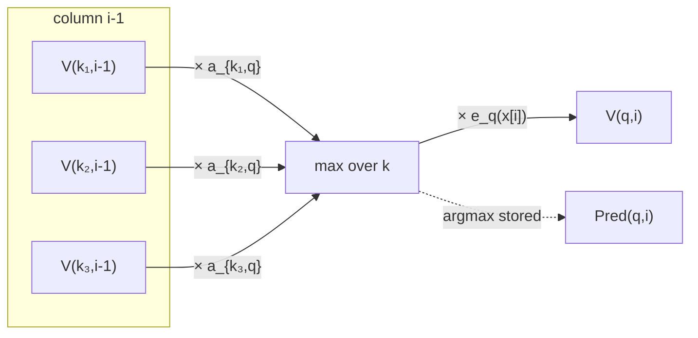

# Viterbi Algorithm

## Definition

Dynamic programming solution to the **decoding problem**: determine the path `π*` that maximises
the probability of generating the sequence `x` of symbols (gik_1_2, p. 17):

```
P(x, π) ≤ P(x, π*)      for every path π
```

## Idea

**Tabulate the maximum probabilities for all prefixes of `x` and all states.** Define:

```
V(q, i) = probability of the most probable path ending in state q
          and generating x[1..i]
```



## Pseudocode

```text
ALGORITHM Viterbi(M, x[1..ℓ])
  In:  HMM M = (Σ, Q, A, e) and sequence x[1..ℓ]
  Out: most probable path π*

  Init:
    for each q in Q:
      V(q, 0) <- 1  if q = 0
                 0  otherwise

  Iteration:
    for i = 1 to ℓ:
      for each q in Q:
        V(q, i)    <- e_q(x[i]) * max{ V(k, i-1) * a_{k,q} | k in Q }
        Pred(q, i) <- the k in Q that satisfies the max above

  Termination:
    P(x, π*) <- max{ V(k, ℓ) * a_{k,0} | k in Q }
    π*_ℓ     <- the k in Q where the max is attained

  Traceback:
    for i = ℓ-1 down to 1:
      π*_i <- Pred(π*_(i+1), i+1)

  return π*
```

> [!warning]
> Indexing note: states are indexed from 0 (the begin/end state `0`, alias `b`/`e`); sequence
> positions run `1..ℓ` with column `0` reserved for initialisation.

## Worked example

Dishonest casino: `Q = {fair, loaded}`, `a_{fair,fair} = 0.95`, `a_{fair,loaded} = 0.05`,
`a_{loaded,loaded} = 0.9`, `a_{loaded,fair} = 0.1`; `e_fair(6) = 1/6`,
`e_loaded(6) = 1/2`. Suppose after position `i−1` we have `V(fair, i−1) = 0.02` and
`V(loaded, i−1) = 0.004`, and `x[i] = 6`:

```
V(fair, i)   = (1/6) · max{ 0.02·0.95, 0.004·0.10 }
             = (1/6) · max{ 0.019, 0.0004 } = (1/6)(0.019)  ≈ 0.00317   Pred = fair

V(loaded, i) = (1/2) · max{ 0.02·0.05, 0.004·0.90 }
             = (1/2) · max{ 0.001, 0.0036 } = (1/2)(0.0036) = 0.0018     Pred = loaded
```

## Complexity

The algorithm computes a table of size `O(|Q| · ℓ)`, and each entry costs `O(|Q|)`
(gik_1_2, p. 17):

| Resource | Bound |
|---|---|
| Time | `O(\|Q\|² · ℓ)` |
| Space | `O(\|Q\| · ℓ)` (needed for traceback) |

## Invariant / correctness argument

`V(q, i)` is the probability of the *best* path generating `x[1..i]` and ending in `q`. Any best
path to `(q, i)` must arrive from some predecessor `k` at `i−1`, and its prefix must itself be a
best path to `(k, i−1)` — otherwise swapping in a better prefix would yield a better total. This
optimal-substructure property is what licenses the `max` recurrence.

## Pitfalls & exam traps

> [!warning]
> - **Normally use log instead of multiplying, and sum up** (gik_1_2, p. 17). Products of `ℓ`
>   probabilities underflow fast. See [[log-space-computation]] and exercise 1.3 in [[sheet-01]].
> - Viterbi returns one single best path. If many paths have comparable probability, i.e.
>   `P(x, π) ≈ P(x, π*)`, do **not** use Viterbi — use [[posterior-decoding]] instead
>   (gik_1_2, p. 20).
> - Do not forget the final transition `a_{k,0}` into the end state at termination.
> - `Pred` must be stored during the iteration; it cannot be recovered from `V` alone afterwards
>   without recomputation.

## Variants

- [[posterior-decoding]] — position-wise most probable states instead of the globally most
  probable path.
- [[forward-algorithm]] — identical recurrence with `max` replaced by `Σ`, answering the
  evaluation problem instead.

## Related

- [[hidden-markov-model]] — the model being decoded.
- [[hmm-three-problems]] — where decoding sits among the three tasks.
- [[forward-algorithm]], [[backward-algorithm]] — the sum-based counterparts.
- [[sheet-01]] — exercise 1.3 rewrites this recurrence in log space.

## Sources

- gik_1_2, p. 17 (unit 2); exercise 1.3, p. 25.
