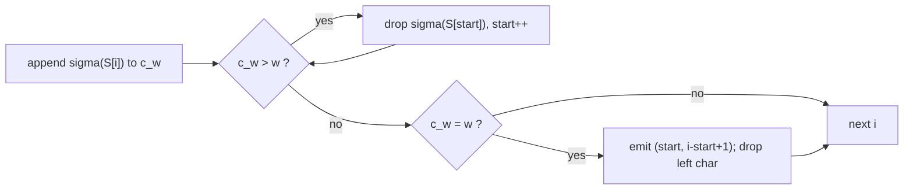

# Weighted Substring Matching

## Definition

For `u ∈ A*` the **weight** (Gewicht) of `u` under a per-character weight function `σ` is
(fsa_part2, p. 9):

```
σ(u) = Σ_{i=1}^{|u|} σ(u[i])
```

**Weighted substring matching problem** (Gewichtetes Substring-Matching-Problem): given a sequence
`S ∈ A^n` and a prescribed weight (vorgegebenes Gewicht) `w > 0`, determine

```
Sol(σ, S, w) = { (j, l) | 1 <= j <= n,  1 <= l <= n+1-j,  σ(S[j .. j+l-1]) = w }
```

i.e. every substring of `S` whose total weight is exactly `w`, reported as a (start, length) pair
(fsa_part2, p. 9).

Symbols: `σ : A -> R` — character weight; `S` — the text, `n = |S|`; `w` — target weight;
`j` — 1-based start position; `l` — length.

## Why it matters

The motivating setting is mass-spectrometry-style search, where each residue carries a mass and one
looks for peptides of a given total mass. Naively there are `O(n^2)` substrings; the sliding-window
algorithm finds **all** solutions in `O(|S|)`, which is optimal up to the output size
(fsa_part2, p. 9).

> [!note] Outside source
> The mass-spectrometry framing is the standard motivation for weighted substring matching; the
> handwritten page states only the abstract problem. Flagged as background, not lecture content.

## Construction / Mechanism

Two pointers delimit a window `S[start .. i]` with running weight `c_w`. Characters are appended at
the right; whenever the running weight exceeds `w` the window is shrunk from the left until it no
longer does; whenever it equals `w` a solution is emitted and the window is shrunk by one
(fsa_part2, p. 9, German note at the foot of the page).



## Pseudocode

The page gives a Python-like sliding window with 0-based indices; rewritten in the uniform style
with **1-based** indexing:

```text
ALGORITHM WeightedSubstringMatch(S[1..n], sigma, w)
  c_w   <- 0                                  // weight of the current window
  start <- 1                                  // left end of the current window
  for i = 1 to n:
    c_w <- c_w + sigma(S[i])                  // extend window to the right
    while c_w > w:                            // shrink from the left while too heavy
      c_w  <- c_w - sigma(S[start])
      start <- start + 1
    if c_w = w:
      report (start, i - start + 1)           // solution: S[start .. i]
      c_w   <- c_w - sigma(S[start])          // shrink by one and continue
      start <- start + 1
  return all reported pairs                   // = Sol(sigma, S, w)
```

## Invariant / correctness argument

**Invariant.** At the top of each iteration of the `for` loop, `c_w = σ(S[start .. i-1])` and no
substring ending before `i` and starting at or after `start` has weight `w` that has not already
been reported.

- The `while` loop restores `c_w <= w` before the equality test, so the window is the *longest*
  suffix of `S[1..i]` with weight `<= w`.
- Because `σ > 0` is assumed (the target `w > 0` and shrinking must terminate), window weight is
  **monotone**: extending increases `c_w`, shrinking decreases it. Therefore a start position
  discarded while `c_w > w` can never yield weight `w` with a later, longer right end — it would
  only be heavier.
- Hence no solution is missed, and every reported pair satisfies `σ(S[start..i]) = w` by the
  invariant.

> [!warning]
> The monotonicity argument **requires `σ(c) > 0` for all characters `c`**. With zero or negative
> weights the shrink step is not safe and the two-pointer method breaks. The page does not state
> this precondition explicitly.

## Variants

- **All solutions vs. first solution**: stopping after the first `report` gives an early-exit
  variant; the loop as written enumerates all of `Sol(σ, S, w)`.
- **Weight at most `w`**: drop the equality test and report the window at every `i`; the same
  invariant gives the longest `<= w` window ending at each position.
- **Weight in an interval `[w_lo, w_hi]`**: keep the shrink condition at `c_w > w_hi` and report
  whenever `c_w >= w_lo`.

> [!note] Inference
> The variants are immediate modifications of the stated algorithm, not content of p. 9.

## Complexity

| Operation | Time | Space |
|---|---:|---:|
| Right-pointer advance over `S` | `O(n)` total | `O(1)` |
| Left-pointer advance (`start` is non-decreasing) | `O(n)` total, amortised | `O(1)` |
| **Whole algorithm** | `O(\|S\|)` plus `O(\|Sol\|)` output | `O(1)` extra |

(fsa_part2, p. 9)

## Worked example

`A = {a, b, c}` with `σ(a) = 1`, `σ(b) = 2`, `σ(c) = 3`; `S = a b c a b`, `n = 5`, `w = 3`.

| `i` | `S[i]` | `c_w` after add | shrink? | `start` | report |
|---:|---|---:|---|---:|---|
| 1 | a | 1 | no | 1 | — |
| 2 | b | 3 | no | 1 | **(1, 2)** = `ab`; then `c_w <- 2`, `start <- 2` |
| 3 | c | 5 | `5 > 3`: drop `σ(b)=2` → `c_w = 3`, `start = 3` | 3 | **(3, 1)** = `c`; then `c_w <- 0`, `start <- 4` |
| 4 | a | 1 | no | 4 | — |
| 5 | b | 3 | no | 4 | **(4, 2)** = `ab` |

`Sol(σ, S, 3) = { (1,2), (3,1), (4,2) }` — substrings `ab`, `c`, `ab`. `start` moved `1 → 2 → 3 → 4`
monotonically; each character was added once and removed at most once, giving the `O(n)` bound.

## Pitfalls & exam traps

> [!warning]
> - The reported length is `i - start + 1`, computed **before** `start` is incremented. Incrementing
>   first produces an off-by-one.
> - After a hit the window must be shrunk by one; otherwise `c_w` stays at `w` and the same start is
>   reported repeatedly at the next character of weight 0 — and with all-positive weights the next
>   test would be skipped incorrectly.
> - The `while` is a loop, not an `if`: one new heavy character may force several left shrinks.
> - Linear time is **amortised** — a single iteration may shrink many times, but `start` only ever
>   moves forward, so total work is `O(n)`.
> - The page's pseudocode is 0-based (`range(len(seq))`, `yield start+1, ...`); the version here is
>   1-based throughout.
> - Positive weights are a hidden precondition (see the correctness argument).

## Related

- [[q-gram]] — the other fixed-window scan of this unit; here the window length is *variable* and
  the weight is fixed, which is the exact dual.
- [[match-count]] — fixed-length window with an incremental update, same amortisation idea.
- [[score-function]] — generalises per-character weights to pair scores.
- [[fsa_part2]] — source page for this unit.

## Sources

- fsa_part2, p. 9 (raw file `raw/foundations_seqzence_analysis_part2.pdf`)
