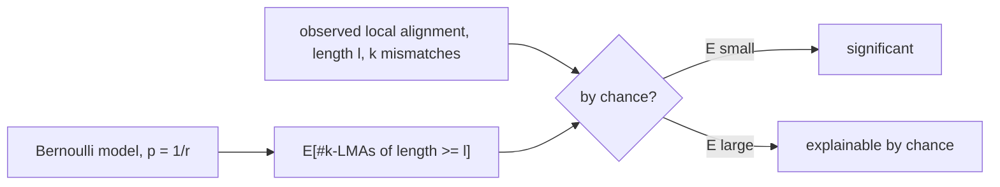

# Alignment Significance

## Definition

The **significance of a local alignment** (Signifikanz lokaler Alignments) answers: *is this local
alignment occurring by chance or not?* It is quantified by the **E-value**, computed under a simple
model of random sequences. **The smaller the E-value, the more significant the local alignment**
(fsa_part3, p. 6).

Part 3 restricts attention to local alignments **without indels** whose number of mismatches is
below a threshold, so the alignment is measured by the [[hamming-distance]]

```
H(x, y) = | { i | 1 <= i <= |x| , x[i] != y[i] } |        requires |x| = |y|
```

(fsa_part3, p. 6).

**Problem** (fsa_part3, p. 6). Given `u` with `|u| = m` and `v` with `|v| = n`, determine pairs of
substrings of `u` and `v` allowing at most `k ≥ 0` mismatches; `k` is the **mismatch threshold**.

## Why it matters

Any two sufficiently long random sequences share matches. A local alignment is therefore only
interesting if it is *better than chance*, and "better than chance" needs a null model to be
measured against. The Bernoulli model below gives the expected number of exact matches and of
k-mismatch alignments in random sequences of the given lengths; an observed count far above that
expectation is what makes a hit reportable. This is the theory that
[[karlin-altschul-statistics]] turns into the E-value that [[blast]] prints next to every hit, and
it is what sets the seed length `q` in [[fasta-database-search]] and [[blast]]: too short and the
expected count explodes into noise.

## Local k-mismatch alignment

A **local k-mismatch alignment** of `u` and `v` (**k-LMA**) of length `ℓ` is a triple `(ℓ, i, j)`
such that (fsa_part3, p. 7):

1. `k < ℓ` — the number of mismatches is smaller than the length;
2. `1 ≤ i ≤ m − ℓ + 1` and `1 ≤ j ≤ n − ℓ + 1`, so `u[i..i+ℓ−1]` and `v[j..j+ℓ−1]` are substrings
   of length `ℓ`;
3. `H( u[i..i+ℓ−1], v[j..j+ℓ−1] ) ≤ k` — at most `k` mismatches.

Each alignment is then extended maximally to both sides (fsa_part3, p. 7):

| Property | Condition |
|---|---|
| **left-maximal** | `i = 1` **or** `j = 1` **or** `u[i−1] ≠ v[j−1]` |
| **right-maximal** | `i+ℓ = m` **or** `j+ℓ = n` **or** `u[i+ℓ] ≠ v[j+ℓ]` |
| **maximal** | both hold |

> [!warning]
> The right-maximality boundary conditions are written `i+ℓ = m` / `j+ℓ = n` on p. 7. Since the
> substring is `u[i..i+ℓ−1]`, the character to the right is `u[i+ℓ]`, which exists iff
> `i+ℓ ≤ m`. The boundary case is therefore `i+ℓ = m+1`, i.e. `i+ℓ > m`. Reproduce the lecture's
> wording in an exam but be aware of the off-by-one when computing.

Symbols: `m = |u|`, `n = |v|`; `ℓ` — alignment length; `i`, `j` — start positions in `u` and `v`;
`k` — mismatch threshold; `r = |A|`; `p` — per-character match probability.

## The E-value

```
E-value = | { (ℓ', i', j') | (ℓ', i', j') is a k'-LMA in u' and v',  ℓ <= ℓ',  k' <= k } |
```

where `u'`, `v'` are **random** sequences with `|u'| = |u|`, `|v'| = |v|` (fsa_part3, p. 7). In
words: the number of local alignments of the same length or longer, with the same or fewer
mismatches, that one would *expect* to find between two random sequences of the same size as `u`
and `v`.

**Random sequence model**: the uniform **Bernoulli model**, `r = |A|`, `p(char) = 1/r`
(fsa_part3, p. 7). For DNA, `p = 1/4`.



## Construction / Mechanism — deriving the expected counts

### Case `k = 0`: maximal exact matches

With `k = 0` the k-LMAs are **maximal exact matches** (fsa_part3, p. 8).

**Key counting identity** (fsa_part3, p. 8): for every pair of sequences `u`, `v`, the number of
maximal exact matches of length `≥ ℓ` equals the number of **left-maximal** exact matches of length
**exactly** `ℓ`. This replaces an awkward "`≥ ℓ` and both-sided maximal" event by a fixed-length
one-sided event, which is what makes the probability computable.

The expectation is then assembled position by position (fsa_part3, p. 8):

```
E[#events] = Σ_{position p} Pr[ event occurs at position p ]
```

A position is a pair `(i, j) ∈ [1..m] × [1..n]` — hence the factor `m·n`. The event at `(i,j)` is:
`ℓ` consecutive character pairs match (probability `p^ℓ`) **and** the pair immediately to the left
mismatches, giving left-maximality (probability `1 − p`). Therefore

```
E[ # of maximal exact matches of length >= ℓ ] = m · n · p^ℓ · (1 − p)
```

(fsa_part3, p. 8).

### Case `k > 0`: allowing mismatches

The `k` mismatch positions may sit anywhere among the `ℓ` positions. For a set `X` with `|X| = ℓ`,
the number of subsets `Y ⊆ X` with `|Y| = k` is the binomial coefficient (fsa_part3, p. 9)

```
C(ℓ, k) = ℓ! / ( k! · (ℓ−k)! )
```

so

```
Pr[ H(x,y) = k ] = C(ℓ,k) · p^{ℓ−k} · (1−p)^{k}
```

and (fsa_part3, p. 9)

```
E[ # of maximal <= k-LMAs of length >= ℓ ] = m · n · C(ℓ,k) · p^{ℓ−k} · (1−p)^{k+2}
```

> [!question]
> p. 9 gives `(1−p)^{k+2}` without derivation. The `k` factors come from `Pr[H = k]`; the extra
> `+2` presumably charges one mismatching pair on each side for left- *and* right-maximality,
> whereas the `k = 0` formula on p. 8 charges only `(1−p)^1` (left-maximality alone, by the
> counting identity). The two formulas are therefore **not** consistent at `k = 0`:
> `m·n·C(ℓ,0)·p^ℓ·(1−p)^2 ≠ m·n·p^ℓ·(1−p)`. Both are reproduced as transcribed.

## Pseudocode

```text
ALGORITHM EValueExact(m, n, l, r)                 # k = 0, p. 8
  p <- 1 / r
  return m * n * p^l * (1 - p)

ALGORITHM EValueKLMA(m, n, l, k, r)               # k > 0, p. 9
  p <- 1 / r
  binom <- l! / ( k! * (l-k)! )
  return m * n * binom * p^(l-k) * (1-p)^(k+2)

ALGORITHM MinimalSignificantLength(m, n, k, r, E_target)
  l <- k + 1                                      # constraint k < l
  while EValueKLMA(m, n, l, k, r) > E_target:
    l <- l + 1
  return l                                        # shortest length that is significant
```

## Complexity

| Operation | Time | Space |
|---|---:|---:|
| Evaluate one E-value formula | `O(1)` with precomputed factorials / `O(ℓ)` naively | `O(1)` |
| Smallest significant `ℓ` for fixed `k` | `O(ℓ*)` evaluations | `O(1)` |

> [!note] Inference
> p. 9 states no running time; the formulas are closed-form, so evaluation is constant time once
> `C(ℓ,k)` is available.

## Worked example

### Maximality on small strings

`u = a c g t a c g` (`m = 7`), `v = t a c g a a c` (`n = 7`), `k = 1`.

Candidate `(ℓ, i, j) = (4, 1, 2)`: `u[1..4] = acgt`, `v[2..5] = acga`, `H = 1 ≤ k` ✓, and
`k = 1 < 4 = ℓ` ✓ — a valid 1-LMA.

| check | computation | verdict |
|---|---|---|
| left-maximal | `i = 1` | ✓ (boundary) |
| right-maximal | `u[5] = a`, `v[6] = a`, equal | ✗ — extend |

Extending right:

| `ℓ` | `u[1..ℓ]` | `v[2..ℓ+1]` | `H` | next pair | right-maximal? |
|---:|---|---|---:|---|---|
| 4 | `acgt` | `acga` | 1 | `u[5]=a`, `v[6]=a` | no |
| 5 | `acgta` | `acgaa` | 1 | `u[6]=c`, `v[7]=c` | no |
| 6 | `acgtac` | `acgaac` | 1 | `v[8]` does not exist | **yes** |

So `(6, 1, 2)` is a **maximal** 1-LMA with one mismatch (`u[4] = t` vs `v[5] = a`).

### E-values for DNA

`A = {A,C,G,T}`, `r = 4`, `p = 0.25`, `1−p = 0.75`, and `m = n = 1000` so `m·n = 10^6`.

`k = 0`, formula `m·n·p^ℓ·(1−p)`:

| `ℓ` | `p^ℓ` | `E` |
|---:|---:|---:|
| 8 | `1.526·10⁻⁵` | `11.4` |
| 10 | `9.537·10⁻⁷` | `0.715` |
| 12 | `5.960·10⁻⁸` | **`0.0447`** |

An exact match of length 12 between two random 1 kb sequences is expected about once every 22
comparisons — significant. A length-8 match is expected ~11 times per comparison — noise.

`ℓ = 12` fixed, varying `k`, formula `m·n·C(12,k)·p^{12−k}·(1−p)^{k+2}`:

| `k` | `C(12,k)` | `p^{12−k}` | `(1−p)^{k+2}` | `E` |
|---:|---:|---:|---:|---:|
| 1 | 12 | `2.384·10⁻⁷` | `0.4219` | `1.21` |
| 2 | 66 | `9.537·10⁻⁷` | `0.3164` | `19.9` |

Allowing one mismatch makes a length-12 hit ~27× more likely by chance; allowing two makes it
noise. **Mismatch tolerance costs significance exponentially** — the practical lesson.

## Pitfalls & exam traps

> [!warning]
> - The E-value is an **expected count**, not a probability. It can exceed 1.
> - "Smaller is more significant" — do not read it like a score.
> - The condition is `k < ℓ`: an alignment may not consist entirely of mismatches.
> - `H` is only defined for **equal-length** strings; that is why this framework handles no indels.
> - The `m·n` factor counts **start position pairs**, not characters. It ignores the boundary
>   correction `(m−ℓ+1)(n−ℓ+1)`, which is a good approximation only for `ℓ ≪ m, n`.
> - `(1−p)` in the `k = 0` formula is the **left-maximality** factor, not a mismatch probability
>   in the alignment.
> - The right-maximality boundary test on p. 7 is off by one (see the warning above).
> - Parameters `p = 1/r` assume a **uniform** Bernoulli model; skewed composition (GC-rich genomes)
>   breaks it immediately.

## Related

- [[hamming-distance]] — the mismatch count this entire framework is built on.
- [[karlin-altschul-statistics]] — the score-based E-value theory used by BLAST, the generalisation
  of this mismatch-count version.
- [[blast]] — reports MSPs together with an E-value; stage 3 produces exactly the ungapped,
  maximal, indel-free alignments analysed here.
- [[local-similarity]] — the general notion of a locally similar region being tested.
- [[maximal-unique-match]] — maximal exact matches as a data-structure problem rather than a
  statistical one.
- [[smith-waterman]] — computes optimal local alignments whose significance this quantifies.
- [[probability-basics]] — expectation as a sum of per-position probabilities.
- [[fsa_part3]] — source page for this unit.

## Sources

- fsa_part3, pp. 6–9 (`raw/foundations_sequence_analysis_part3.pdf`)
