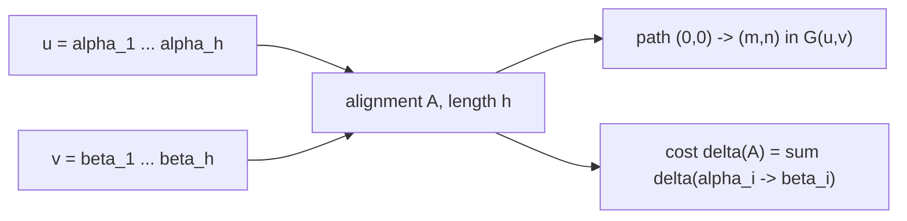

# Alignment

## Definition

An alignment (Alignment) `A` of two strings `u` and `v` is a sequence of
[[edit-operation|edit operations]] (fsa_part1, p. 2)

```
A = ( α_1 -> β_1 , ... , α_h -> β_h )
```

such that

```
u = α_1 α_2 ... α_h      and      v = β_1 β_2 ... β_h
```

where `ε` contributes nothing to the concatenation. `h` is the **length** of the alignment.
Written as a two-row matrix with `α_i` above `β_i`, gaps drawn as `-`:

```
( α_1  ...  α_h )
( β_1  ...  β_h )
```

## Why it matters

The alignment is the *witness*: the edit distance is a number, the alignment is the explanation of
how the two sequences differ (fsa_part1, p. 2). Every alignment is a path in the
[[edit-graph]], every optimal alignment a shortest path, which is what makes the whole
[[edit-distance-dp|DP]] work.

## Construction / Mechanism

Let `id` = number of insertions and deletions and `r` = number of replacements in `A`. Then
(fsa_part1, p. 3)

```
|u| + |v| = id + 2 · r        and        h = id + r
```



## Length lemma

> **Lemma (alignment length ≈ sequence length).** For `u, v` with `m = |u|`, `n = |v|` and any
> alignment `A = (α_1 → β_1, …, α_h → β_h)` of `u` and `v` (fsa_part1, p. 3):
>
> ```
> m + n >= h >= max{ m , n }
> ```

**Proof sketch.** Each column consumes at least one character in total, so
`h <= m + n` — the extreme is reached when every column is an indel, i.e. `r = 0` and
`h = id = m + n`. Each column consumes at most one character from `u`, so `h >= m`; likewise
`h >= n`; hence `h >= max{m,n}`. Substituting `h = id + r` into `m + n = id + 2r` gives
`h = m + n - r`, so the two bounds are the cases `r = 0` and `r = min{m,n}`.

> [!note] Inference
> `h = m + n - r` is the direct consequence of the two counting identities on p. 3; the script
> states the bounds but not this identity explicitly.

## Complexity

| Operation | Time | Space |
|---|---|---|
| Write down / read an alignment of length `h` | `O(h)`, with `max{m,n} <= h <= m+n` | `O(h)` |
| Evaluate `δ(A)` for a given alignment `A` | `O(h)` | `O(1)` |
| Find a *minimum-cost* alignment | `O(mn)` — see [[edit-distance-dp]] | `O(mn)`, or `O(min{m,n})` for the cost alone |
| Number of distinct alignments of `u`, `v` | exponential — see [[counting-alignments]] | — |

## Worked example

`u = ACGT` (`m = 4`), `v = AGT` (`n = 3`). Bound: `7 >= h >= 4`.

Alignment with `r = 3`, `id = 1`, so `h = 4`:

```
A C G T
A - G T
```

Check: `m + n = 7 = id + 2r = 1 + 6` ✓, `h = id + r = 4` ✓.

Alignment with `r = 0`, `id = 7`, so `h = 7` (every column an indel):

```
A C G T - - -
- - - - A G T
```

Check: `h = 7 = m + n` ✓ — the upper bound is attained.

## Pitfalls & exam traps

> [!warning]
> - `h` is **not** `max{m,n}` in general; that is only the lower bound (all possible columns are
>   replacements).
> - A column `(ε, ε)` is forbidden, so `h` is finite and bounded by `m + n`.
> - Two alignments that differ only in the order of consecutive indels are *different* alignments
>   under this definition — that is exactly why `Aligns(m,n)` is so much bigger than
>   `Subseq(m,n)` (fsa_part1, p. 4, see [[counting-alignments]]).
> - An alignment is defined without any reference to cost; optimality only enters via
>   [[cost-function]].

## Related

- [[edit-operation]] — the columns an alignment is built from.
- [[counting-alignments]] — how many alignments of `(m,n)` exist.
- [[cost-function]] — makes an alignment optimal or not.
- [[edit-graph]] — alignment ≙ path from `(0,0)` to `(m,n)`.
- [[edit-distance-dp]] — computes an optimal alignment.
- [[local-similarity]] — alignments of *substrings* rather than whole sequences.

- [[fsa_part1]] ? source page for this part of the module.

## Sources

- fsa_part1, pp. 2–4 (`raw/foundations_sequence_analysis_part1.pdf`)
