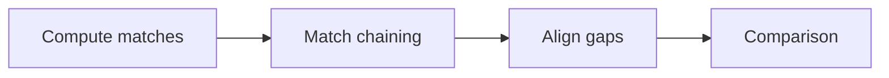

# Anchor-Based Sequence Comparison

## Definition

Anchor-based sequence comparison computes local matches, chains high-scoring collinear non-overlapping matches, then aligns the regions between anchors (gik_3_4, p. 26).

## Why it matters

It reduces long-sequence comparison by using reliable local matches as anchors before spending alignment work on the gaps (gik_3_4, p. 26).

## Construction / Mechanism



The notes list maximal unique matches, maximal exact matches, and exact `q`-grams as possible anchors; inexact matches can be weighted by alignment score (gik_3_4, p. 28). Unit 5 fills in the missing generation step: [[maximal-unique-match]] extracts MUM anchors from a [[suffix-tree]] before [[match-chaining]] (gik_5, p. 22).

## Pseudocode

```text
ALGORITHM AnchorBasedComparison(u, v)
  M <- ComputeMatches(u, v)
  C <- MatchChaining(M)
  for each gap between consecutive matches in C:
    align the intervening substrings
  return C and the gap alignments
```

## Complexity

| Stage | Time | Space |
|---|---:|---:|
| Match generation | `O(n)` for MUMs with suffix trees | `O(n)` |
| Simple chaining of `b` matches | `O(b^2)` | `O(b)` |
| Efficient global chaining | `O(b log b)` | `O(b)` |

## Worked example

Matches `(u:1..3,v:2..4)` and `(u:8..10,v:9..11)` are collinear, so they can anchor the comparison and leave only the intervening substrings to align (gik_3_4, p. 26).

## Pitfalls & exam traps

> [!warning]
> - Chaining selects anchors; it does not align gaps.
> - Collinear means same order in both sequences.
> - A high-scoring local match may still be unusable if it crosses another chosen anchor.

## Related

- [[match-chaining]] — formal phase-2 problem.
- [[match-chaining-algorithm]] — computes chains.
- [[unit-edit-distance]] — may score gap alignments or inexact matches.

## Sources

- gik_3_4, pp. 26, 28
- gik_5, p. 22
