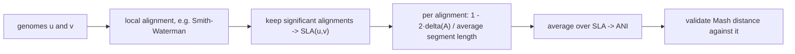

# Average Nucleotide Identity

## Definition

**Average nucleotide identity** (ANI, durchschnittliche Nukleotididentität) is an
alignment-based genome similarity measure computed from `SLA(u, v)`, the set of **significant
local alignments** of `u` and `v` (fsa_part2, p. 16):

```
ANI(u, v) = (1 / |SLA(u,v)|) · Σ_{A ∈ SLA(u,v)} ( 1 - 2·δ(A) / (|A.u| + |A.v|) )
```

Symbols:

- `SLA(u, v)` — the set of significant local alignments between `u` and `v`;
- `A` — one such alignment; `δ(A)` — its cost under the cost function `δ`;
- `A.u`, `A.v` — the two aligned rows (segments) of `A`, with lengths `|A.u|`, `|A.v|`.

The term `2·δ(A) / (|A.u| + |A.v|)` is the **relative number of errors** in `A` (the cost
normalised by the average segment length); subtracting it from 1 gives the per-alignment identity,
and ANI is the mean over all significant local alignments (fsa_part2, p. 16).

## Why it matters

ANI is the **gold standard** (trusted measure) used to establish that [[mash-distance]] is a
reliable distance estimator: the sketch-based estimate is validated by comparison against ANI
(fsa_part2, p. 16). It is the expensive, alignment-based ground truth that the alignment-free
methods of this unit aim to approximate cheaply.

## Construction / Mechanism



Producing `SLA(u,v)` requires local alignment ([[smith-waterman]]) plus a significance criterion
([[alignment-significance]]); this is why ANI does not scale to all-against-all comparison of large
sequence collections, which is exactly the gap Mash fills.

> [!note] Inference
> The lecture does not specify which local aligner or which significance test produces `SLA(u,v)`;
> the pipeline above names the standard components covered elsewhere in the module.

## Complexity

| Operation | Time | Space |
|---|---:|---:|
| Local alignment of `u`, `v` (`m = \|u\|`, `n = \|v\|`) | `O(m·n)` | `O(m·n)` |
| Averaging over `SLA(u,v)` | `O(\|SLA(u,v)\|)` | `O(1)` |
| Contrast: `MD_{q,s}(u,v)` | `O((m+n)(q + log s))` | `O(s)` |

> [!note] Inference
> The `O(mn)` figure is the standard local-alignment bound from the alignment part of the module,
> not stated on p. 16. The page only asserts that ANI serves as the gold standard.

## Worked example

Suppose `SLA(u, v)` contains two alignments:

| `A` | `δ(A)` | `\|A.u\|` | `\|A.v\|` | relative errors `2δ/(\|A.u\|+\|A.v\|)` | identity |
|---|---:|---:|---:|---:|---:|
| `A_1` | 5 | 100 | 100 | `10/200 = 0.05` | 0.95 |
| `A_2` | 12 | 150 | 140 | `24/290 = 0.0828` | 0.9172 |

`ANI(u, v) = (0.95 + 0.9172) / 2 = 0.9336`, i.e. ≈ 93.4 % identity.

A Mash distance of `MD = 0.066` on the same pair would correspond to `1 - 0.066 = 0.934` identity —
agreement of this kind is what the validation on p. 16 looks for.

## Pitfalls & exam traps

> [!warning]
> - ANI is a **similarity** in `[0, 1]`; Mash distance is a distance. Compare `ANI` with
>   `1 - MD`, not with `MD`.
> - The normaliser is the **average** of the two segment lengths (hence the factor 2 in the
>   numerator), not the length of either row alone.
> - Only **significant** local alignments enter the average; including spurious short alignments
>   drags ANI down and is why the significance filter is part of the definition.
> - ANI is an unweighted mean over alignments, so one short alignment counts as much as one long
>   one.
> - ANI requires full alignment and therefore does **not** scale to all-against-all comparisons —
>   that is the whole motivation for sketching.

## Related

- [[mash-distance]] — the alignment-free estimator validated against ANI.
- [[minhash-sketch]] — the sketching machinery behind that estimator.
- [[smith-waterman]] — produces the local alignments that make up `SLA(u,v)`.
- [[alignment-significance]] — the criterion selecting which local alignments are "significant".
- [[cost-function]] — supplies `δ(A)`, the alignment cost in the numerator.
- [[fsa_part2]] — source page for this unit.

## Sources

- fsa_part2, p. 16 (raw file `raw/foundations_seqzence_analysis_part2.pdf`)
