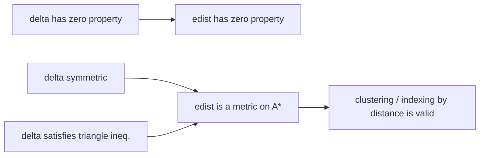

# Cost Function

## Definition

A cost function (Kostenfunktion) `δ` assigns a cost to every [[edit-operation]] subject to
(fsa_part1, p. 5):

```
δ(α -> β) >= 0        // R : replacements
δ(α -> ε) >  0        // I, D : indels are strictly positive
```

The cost of an [[alignment]] `A = (α_1 → β_1, …, α_h → β_h)` is

```
δ(A) = Σ_{i=1}^{h} δ(α_i -> β_i)
```

Optional properties of `δ` (fsa_part1, p. 5):

| Property | Condition |
|---|---|
| symmetric | `δ(α → β) = δ(β → α)` |
| zero property | `δ(α → β) = 0  ⟺  α = β` |
| triangle inequality | `δ(α → β) <= δ(α → γ) + δ(γ → β)` |

## Why it matters

The cost function is the only place where biology enters the alignment machinery. The DP
recurrence of [[edit-distance-dp]] never changes; swapping `δ` is what turns the same matrix into
unit edit distance, Levenshtein distance, a transversion-aware DNA model or a protein substitution
model. Which of the four properties below `δ` satisfies decides whether the resulting
`edist_δ` is a genuine metric — and therefore whether it may be fed to the distance-based
clustering and tree-building methods of [[upgma]] and [[neighbor-joining]], which assume one.

## Edit distance

The **edit distance** (Editierdistanz) is the minimum alignment cost (fsa_part1, p. 5):

```
edist_δ(u, v) = min { δ(A) | A is an alignment of u and v }
```

An alignment `A` is **optimal** iff `δ(A) = edist_δ(u,v)`. There can be **more than one** optimal
alignment (fsa_part1, p. 6). The **edit distance problem** is to compute `edist_δ(u,v)` *and all*
optimal alignments (fsa_part1, p. 6).

## Standard cost models

**Unit cost (Einheitskosten)** (fsa_part1, p. 5):

```
δ(α -> β) = 0  , if α = β  (α, β ∈ A)
          = 1  , otherwise
```

`edist_δ` under unit cost is the **unit edit distance** = **Levenshtein distance**
(fsa_part1, pp. 5–6). See [[unit-edit-distance]].

**Hamming cost** (fsa_part1, p. 5):

```
δ(α -> β) = 0   , α, β ∈ A , α = β
          = 1   , α, β ∈ A , α != β
          = ∞   , otherwise      // indels forbidden
```

This reduces `edist_δ` to the [[hamming-distance]].

## Metric property

> `f : M × M → ℝ^{*+}` is a **metric** iff (fsa_part1, p. 6):
> 1. `f(x,y) = 0 ⟺ x = y` — zero property
> 2. `f(x,y) = f(y,x)` — symmetry
> 3. `f(x,y) <= f(x,z) + f(z,y)` — triangle inequality
>
> If (2) and (3) hold and only `x = y ⟹ f(x,y) = 0`, `f` is a **pseudo metric**.

Transfer (fsa_part1, pp. 5–6):

- if `δ` has (1), then `edist_δ` has (1);
- if `δ` has (2) **and** (3), then `edist_δ` is a **metric on `A*`**.



## Reversal lemma

> **Lemma.** For all `δ` and all `u, v ∈ A*` (fsa_part1, p. 6):
>
> ```
> edist_δ(u, v) = edist_δ(u^{-1}, v^{-1})
> ```
>
> where `w^{-1}` is the reverse of `w`.

Reversing both strings reverses every alignment column-by-column; the multiset of edit operations
is unchanged, so the cost sum is unchanged, and the map is a bijection between the alignment sets.
This is what licenses running the [[edit-distance-dp|DP]] backwards — the basis of the
divide-and-conquer linear-space variant (fsa_part1, p. 12).

## Worked example

`u = AC`, `v = AGC`, unit cost.

- Alignment `A_1 = (A→A, ε→G, C→C)`: cost `0 + 1 + 0 = 1`.
- Alignment `A_2 = (A→A, C→G, ε→C)`: cost `0 + 1 + 1 = 2`.
- Alignment `A_3 = (A→ε, C→ε, ε→A, ε→G, ε→C)`: cost `5`.

`edist_δ(AC, AGC) = 1`, attained by `A_1`, which is therefore optimal.

Reversal check: `u^{-1} = CA`, `v^{-1} = CGA`, optimal alignment `(C→C, ε→G, A→A)`, cost `1` ✓.

## Pitfalls & exam traps

> [!warning]
> - `δ(α → ε) > 0` is **strict**: zero-cost indels would make arbitrarily long alignments free and
>   `edist_δ` would lose the zero property. (Free indels *are* deliberately allowed, but only at
>   the boundaries, in [[approximate-string-matching]] and [[overlap-alignment]].)
> - Symmetry of `δ` alone is not enough for a metric — you need the triangle inequality too.
> - Zero property of `δ` gives the zero property of `edist_δ`, nothing more.
> - "Levenshtein distance" = unit edit distance; it is *not* a synonym for "edit distance" in
>   general.
> - A score function is **not** a cost function: it is maximised, may be negative, and need not be
>   a metric — see [[score-function]].

## Related

- [[edit-operation]] — the domain of `δ`.
- [[alignment]] — `δ(A)` is a sum over the columns of `A`.
- [[hamming-distance]] — the `δ(α→ε) = ∞` special case.
- [[edit-distance-dp]] — computes `edist_δ`.
- [[edit-graph]] — `δ` is the edge weight function `w`.
- [[score-function]] — the maximisation counterpart used for local similarity.
- [[gap-cost-model]] — replaces per-character indel costs by per-gap costs.
- [[unit-edit-distance]] — the GIK treatment of the unit-cost case.

- [[fsa_part1]] ? source page for this part of the module.

## Sources

- fsa_part1, pp. 5–6, 12 (`raw/foundations_sequence_analysis_part1.pdf`)
