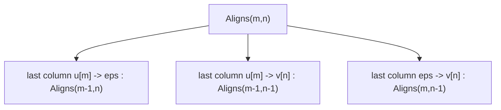

# Counting Alignments

## Definition

`Aligns(m, n)` is the number of [[alignment|alignments]] of two fixed sequences `u`, `v` with
`|u| = m`, `|v| = n`. It depends **only** on `m` and `n`, not on the characters
(fsa_part1, p. 3):

```
Aligns(m, n) =
    1                                                     , if m = 0 or n = 0
    Aligns(m-1, n) + Aligns(m-1, n-1) + Aligns(m, n-1)    , else
```

`Subseq(m, n)` is the number of **subsequences** (Teilfolgen) — alignments counted up to the order
of consecutive indels (fsa_part1, p. 4):

```
Subseq(m, n) = Σ_{r=0}^{min(m,n)}  C(m, r) · C(n, r)
```

where `C(a,b)` is the binomial coefficient "`a` choose `b`" and `r` the number of aligned
(replacement) pairs.

## Why it matters

It is the justification for dynamic programming: the number of alignments is exponential, so
enumerate-and-score is hopeless, while the [[edit-distance-dp|DP]] over the [[edit-graph]] solves
the same problem in `O(mn)` (fsa_part1, pp. 3, 11).

## Construction / Mechanism

The recurrence is the last-column case distinction of an alignment of `u[1..m]` and `v[1..n]` —
exactly the three incoming edges of node `(m,n)` in the edit graph:



**Subsequence definition** (fsa_part1, p. 4): a subsequence of `u` and `v` is a sequence of index
pairs `(i_1,j_1), …, (i_r,j_r)` with

```
1 <= i_1 < ... < i_r <= m    and    1 <= j_1 < ... < j_r <= n
```

`(i_h, j_h)` means the replacement `u[i_h] → v[j_h]`; all other characters are deleted from `u`
resp. inserted into `v`. Choosing the `r` aligned positions in `u` and in `v` independently gives
`C(m,r) · C(n,r)`, summed over all feasible `r`.

## Asymptotics

| Quantity | Approximation | Source |
|---|---|---|
| `Aligns(m,n)` | `≈ (1 + √2)^(2n+1) · √n` — **Stanton–Cowan numbers** | fsa_part1, p. 3 |
| `Subseq(m,n)` | `≈ 2^(2n) · ( 4 · √(n·π) )^(-1)` | fsa_part1, p. 4 |

Both are exponential in `n`; `(1+√2)^2 ≈ 5.83 > 4`, so

```
Aligns(m, n)  >>  Subseq(m, n)
```

which the script notes "does not matter in reality" (fsa_part1, p. 4) — the DP never enumerates
either.

## Complexity

| Operation | Time | Space |
|---|---|---|
| Fill the `Aligns` table up to `(m,n)` | `O(mn)` | `O(mn)`, or `O(min{m,n})` row-by-row |
| Read off a single `Aligns(m,n)` | `O(1)` after the fill | — |
| Enumerate all alignments explicitly | `Θ(Aligns(m,n))` — exponential | — |

> [!warning]
> The table is cheap; the enumeration is not. Counting alignments is `O(mn)`, but *listing* them
> is exponential in `min{m,n}`. See [[edit-distance-dp]] for the `O(mn + z)` output-sensitive
> variant that enumerates only the `z` optimal ones.

## Worked example

Filling the `Aligns` table for `m, n <= 3` (row = `m`, column = `n`; borders are 1 by the base
case):

| `m \ n` | 0 | 1 | 2 | 3 |
|---|---:|---:|---:|---:|
| **0** | 1 | 1 | 1 | 1 |
| **1** | 1 | 3 | 5 | 7 |
| **2** | 1 | 5 | 13 | 25 |
| **3** | 1 | 7 | 25 | 63 |

E.g. `Aligns(2,2) = Aligns(1,2) + Aligns(1,1) + Aligns(2,1) = 5 + 3 + 5 = 13`.
These are the **Delannoy numbers**; `Aligns(3,3) = 63`.

Compare `Subseq(2,2) = Σ_{r=0}^{2} C(2,r)² = 1 + 4 + 1 = 6` against `Aligns(2,2) = 13` — already
a factor >2 at length 2.

> [!note] Outside source
> The name *Delannoy numbers* for the central entries `1, 3, 13, 63, …` is standard combinatorics,
> not stated in the script; the script calls the approximation *Stanton–Cowan numbers*
> (fsa_part1, p. 3).

## Pitfalls & exam traps

> [!warning]
> - Base case is `1`, **not** `0`: there is exactly one alignment of `u` with `ε` (delete
>   everything).
> - The recurrence has **three** terms — forgetting the diagonal gives the lattice-path count,
>   not the alignment count.
> - `Subseq` sums over `r = 0 .. min(m,n)`, not to `m` or `n`.
> - The Stanton–Cowan form is written in `n` only; it assumes `m ≈ n`.

## Related

- [[alignment]] — the objects being counted.
- [[edit-operation]] — order of consecutive indels is what distinguishes `Aligns` from `Subseq`.
- [[edit-graph]] — the recurrence is the node in-degree structure of `G(u,v)`.
- [[edit-distance-dp]] — avoids enumeration; also enumerates all optimal alignments in `O(mn+z)`.

- [[fsa_part1]] ? source page for this part of the module.

## Sources

- fsa_part1, pp. 3–4 (`raw/foundations_sequence_analysis_part1.pdf`)
