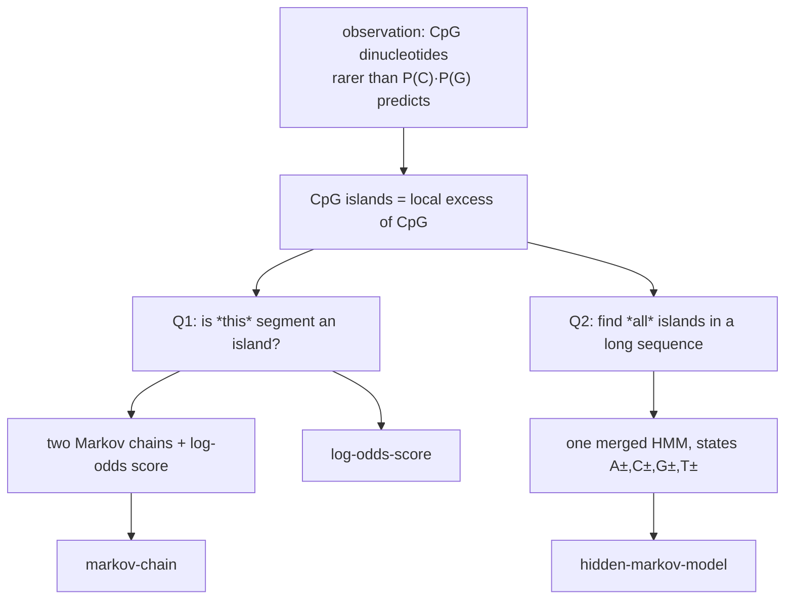

# CpG Islands

## Definition

**CpGs are rarer in the genome than would be expected from the independent probabilities of C
and G.** A **CpG island** is a region where we see many more CpGs than elsewhere — a useful
marker (gik_1_2, p. 12).

"CpG" means a `C` followed by a `G` along one strand (the `p` is the phosphate linking them),
as opposed to a C–G base pair across strands.

## Why it matters

CpG islands are the motivating example for the whole of unit 2. Two questions drive the
modelling (gik_1_2, p. 12):

1. **Given a short segment of a genomic sequence, decide whether this segment comes from a
   CpG island or not.** → solved with two [[markov-chain|Markov chains]] and a
   [[log-odds-score]].
2. **Find all CpG islands in a large genomic sequence.** → requires a
   [[hidden-markov-model]] and [[viterbi-algorithm|Viterbi]] or [[posterior-decoding]].

## Why the independent model fails

Under the position-independent [[probabilistic-model]] of unit 1,
`P(CG) = q_C · q_G ≈ 0.25 · 0.25 = 0.0625`. Real genomes show far fewer CpGs than this, because
methylated cytosine in a CpG context deaminates to thymine over evolutionary time. The
discrepancy is not noise — it is structure, and capturing it requires conditioning each symbol
on its predecessor. That is exactly a [[markov-chain]].

> [!note] Outside source
> The deamination mechanism is standard molecular-biology background, not stated in the lecture
> notes; the notes only state the statistical fact that CpGs are rarer than expected
> (gik_1_2, p. 12).

## Pitfalls & exam traps

> [!warning]
> - CpG (`C` then `G` on one strand) ≠ a C–G base pair. The `p` matters.
> - The signal is in the **dinucleotide frequency**, not the frequency of C and G individually.
>   A GC-rich region is not automatically a CpG island.

## Related

- [[markov-chain]] — the model that captures dinucleotide dependence.
- [[log-odds-score]] — the decision rule for question 1.
- [[hidden-markov-model]] — the model for question 2.
- [[posterior-decoding]] — the posterior probability that a given position lies in an island.

## Sources

- gik_1_2, p. 12 (unit 2, "Modelling Context in Sequences").
