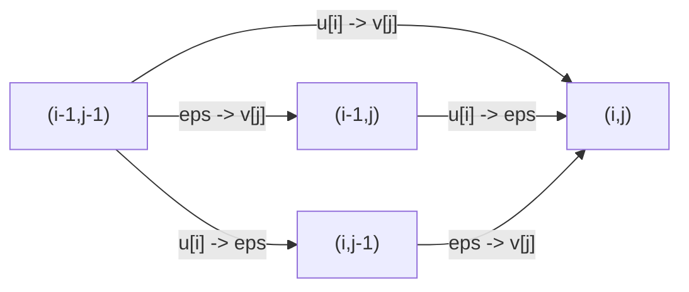

# Edit Graph

## Definition

The edit graph (Editiergraph) `G(u,v)` of two strings `u` (`|u| = m`) and `v` (`|v| = n`) is an
edge-labelled directed graph whose nodes are the pairs `(i,j)`, `0 <= i <= m`, `0 <= j <= n`
(fsa_part1, p. 8). Edges:

| Edge | Range | Label | Kind |
|---|---|---|---|
| `(i-1, j) → (i, j)` | `1<=i<=m`, `0<=j<=n` | `u[i] → ε` | deletion |
| `(i, j-1) → (i, j)` | `0<=i<=m`, `1<=j<=n` | `ε → v[j]` | insertion |
| `(i-1, j-1) → (i, j)` | `1<=i<=m`, `1<=j<=n` | `u[i] → v[j]` | replacement |

Edge weights come from the [[cost-function]] (fsa_part1, p. 9):

```
w( (i',j') --[α -> β]--> (i,j) ) = δ(α -> β)
```

## Why it matters

**Path ≙ alignment.** Every path from `(i',j')` to `(i,j)` is labelled by an
[[alignment]] of `u[i'+1 .. i]` and `v[j'+1 .. j]`, and conversely (fsa_part1, pp. 8–9).
Consequently a **shortest path = optimal alignment**, and

```
edit distance problem  ≡  shortest-path problem in G(u,v) from (0,0) to (m,n)
```

All edges increase `i`, `j` or both, so `G(u,v)` has **no cycles**: it is a **DAG**
(fsa_part1, p. 9). That is what makes the `O(|V|+|E|) = O(mn)` DP correct.

## Shortest paths — the machinery it rests on

A **path** in `(V,E)` is a node sequence `v_0, …, v_h` with `(v_i, v_{i+1}) ∈ E`; its length is
`h`, its weight `w(p) = Σ_{i=0}^{h-1} w(v_i → v_{i+1})` (fsa_part1, p. 7).

```
Δ(s, x) = min { w(p) | p a path from s to x }   , if such a path exists
        = ∞                                      , else
```

The **shortest-path problem** for `s, x` is to compute `Δ(s,x)` and a path realising it
(fsa_part1, p. 7).

> **Theorem (optimal substructure).** A shortest path from `s` to `u` that includes a path from
> `x` to `y` contains a shortest path from `x` to `y` (fsa_part1, p. 7).

> **Triangle inequality for `Δ`.** `Δ(s,u) <= Δ(s,x) + Δ(x,u)` for all `s, u, x ∈ V`
> (fsa_part1, p. 8).

> **Shortest paths in a DAG.** For `x ∈ V` with `s ≺ x` in a topological order (fsa_part1, p. 8):
>
> ```
> Δ(s, x) = min { Δ(s, y) + w(y -> x) | y -> x ∈ E }
> ```
>
> computable in `O(|V| + |E|)`.

**Negative edges** (fsa_part1, p. 7): they occur naturally (chemistry: compounds = nodes,
reactions = edges, energy = label). They can be removed by shifting all weights by
`− min{ w(e) | e ∈ E }`.

> [!warning]
> Uniform weight shifting changes the relative cost of paths of **different lengths**, so it does
> not in general preserve the shortest path. In `G(u,v)` paths have different lengths `h`
> (see the [[alignment|length lemma]]), so do not shift edit-graph weights casually.
> *(Inference — the script states the shift trick generically on p. 7 without this caveat.)*

## Construction / Mechanism

The unit square: three edges enter `(i,j)` (fsa_part1, p. 8).



> [!warning] Orientation convention
> On p. 8 the script draws `(i-1,j)` to the **right** of `(i-1,j-1)` (so `j` grows downward in
> that one sketch) while the matrix picture on p. 10 has `i` = row, `j` = column. The Mermaid
> diagram above reproduces the p. 8 edge set; read it as "three edges enter `(i,j)`", not as a
> geometric claim.

## Complexity

| Operation | Time | Space |
|---|---|---|
| Build `G(u,v)` explicitly | `O(mn)` | `O(mn)` |
| Topological order of `G(u,v)` | `O(mn)` — implicit, by rows or antidiagonals | `O(1)` extra |
| Shortest source-to-sink path (DAG relaxation) | `O(mn)` | `O(mn)`, or `O(min{m,n})` for the cost alone |
| Number of nodes / edges | `(m+1)(n+1)` nodes, `<= 3mn + m + n` edges | — |

Because `G(u,v)` is a DAG with a known topological order, no priority queue is needed: relaxing
edges row by row is already optimal, which is why the DP of [[edit-distance-dp]] is a plain
double loop rather than Dijkstra.

## Topological orders

A topological order (topologische Ordnung) `≺` of `G = (V,E)` satisfies `y → x ∈ E ⟹ y ≺ x`
(fsa_part1, p. 9). Two are used in `G(u,v)`:

| Order | Definition | Processing |
|---|---|---|
| **columnwise** | `(i',j') ≺ (i,j) ⟺ j' < j  or  (j' = j and i' < i)` | top-to-bottom within a column, columns left to right |
| **rowwise** | `(i',j') ≺ (i,j) ⟺ i' < i  or  (i' = i and j' < j)` | left-to-right within a row, rows top to bottom |

Both satisfy `(i,j-1) ≺ (i,j)` (I), `(i-1,j-1) ≺ (i,j)` (R), `(i-1,j) ≺ (i,j)` (D)
(fsa_part1, p. 9) — i.e. both are valid evaluation orders for the DP.

## Worked example

`u = AC` (`m=2`), `v = AG` (`n=2`), unit cost. The path
`(0,0) →[A→A] (1,1) →[C→G] (2,2)` has weight `0 + 1 = 1` and is labelled by the alignment

```
A C
A G
```

The path `(0,0) →[ε→A] (0,1) →[ε→G] (0,2) →[A→ε] (1,2) →[C→ε] (2,2)` has weight `4` and is
labelled by the all-indel alignment. `Δ((0,0),(2,2)) = 1`.

## Pitfalls & exam traps

> [!warning]
> - Node `(i,j)` means "`i` characters of `u` and `j` of `v` consumed" — it is a *boundary*
>   between characters, hence `(m+1)(n+1)` nodes, not `mn`.
> - The path label reads `u[i'+1 .. i]`, with the **+1**: a path from `(i',j')` consumes `u` from
>   index `i'+1`.
> - A path in `G(u,v)` is always monotone; there is no "going back", which is exactly the DAG
>   property.
> - Only **three** edges enter any interior node — row 0 and column 0 nodes have one each,
>   `(0,0)` none.

## Related

- [[alignment]] — the object a path is labelled with.
- [[cost-function]] — supplies the edge weights `w = δ`.
- [[edit-distance-dp]] — the `E_δ` table is `Δ((0,0),(i,j))`.
- [[smith-waterman]] — same graph, free start/end nodes and a score instead of a cost.
- [[approximate-string-matching]] — same graph with row 0 free.
- [[overlap-alignment]] — same graph with row 0 and column 0 free.
- [[gap-cost-model]] — extends `G(u,v)` with jump edges resp. three layers.
- [[unit-edit-distance]] — the GIK page on the unit-cost instance of this DP.

- [[fsa_part1]] ? source page for this part of the module.

## Sources

- fsa_part1, pp. 7–10 (`raw/foundations_sequence_analysis_part1.pdf`)
