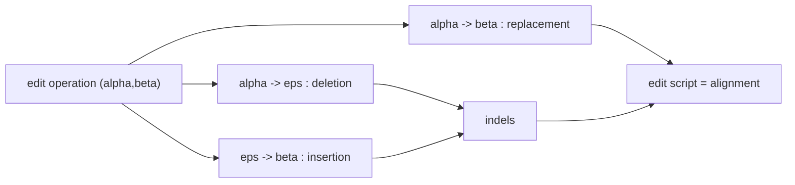
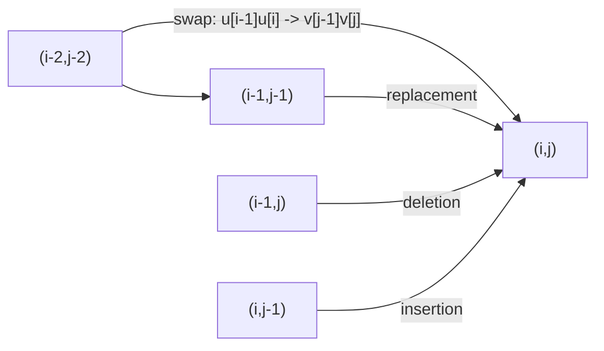

# Edit Operation

## Definition

An edit operation (Editieroperation) is a pair (fsa_part1, p. 2)

```
(α, β) ∈ ( A^1 ∪ {ε} ) × ( A^1 ∪ {ε} ) \ {(ε, ε)}
```

where `A` is the alphabet, `A^1` the set of single characters, and `ε` the empty string. The pair
`(ε, ε)` is excluded, so every operation consumes at least one character. Written `α → β`.

Three kinds (fsa_part1, p. 2):

| Written | Name | Class |
|---|---|---|
| `α → ε` | **deletion** (D) of `α` | indel |
| `ε → β` | **insertion** (I) of `β` | indel |
| `α → β` | **replacement** (R) of `α` by `β` | — |

A replacement with `α = β` is an **identity**/match; under unit cost it is free
(see [[cost-function]]).

## Why it matters

The edit-distance model represents the difference between two sequences not as one opaque number
but as a *collection of elementary differences* — this collection is exactly an
[[alignment]] (fsa_part1, p. 2). Every edit operation is one edge of the [[edit-graph]], so the
whole DP machinery is just a shortest-path computation over edit operations.

## Construction / Mechanism

An **edit script** is the ordered sequence of operations `(α_1 → β_1, …, α_h → β_h)` that turns
`u` into `v`. Reading the first components in order and concatenating them (with `ε` contributing
nothing) gives back `u`; the second components give `v`. That is precisely the definition of an
alignment, so **edit script ≙ alignment** (fsa_part1, p. 2).



## Worked example

`u = TGCA`, `v = TGA`. One edit script of length `h = 4`:

```
( T -> T , G -> G , C -> eps , A -> A )
```

As a two-row matrix:

```
T G C A
T G - A
```

First row concatenated: `TGCA = u`. Second row concatenated (the `-` is `ε`): `TGA = v`. ✓
Operation counts: `id = 1` (one deletion), `r = 3` (three replacements, all identities), and
`|u| + |v| = 4 + 3 = 7 = id + 2r = 1 + 6` ✓ (fsa_part1, p. 3).

## Pitfalls & exam traps

> [!warning]
> - `(ε, ε)` is **excluded** — otherwise alignments of unbounded length would exist and
>   `Aligns(m,n)` would be infinite (see [[counting-alignments]]).
> - A match is a *replacement* `α → α`, not a fourth kind of operation. There are exactly three
>   kinds, and the DP recurrence therefore has exactly three incoming edges per cell.
> - `α → β` operates on **single** characters. Whole-segment operations `(abc → ε)` only exist in
>   the extended gap model, see [[gap-cost-model]] (fsa_part1, p. 25).
> - Order matters for the script but not for the result: consecutive indels in either order yield
>   the same pair `(u,v)`, which is why [[counting-alignments|subsequences]] collapse them.

## Part 3 addendum — the swap (transposition) operation

Part 3 adds a **fourth** kind of operation: the **swap / transposition** (Vertauschen)
`ab → ba` with `a, b ∈ A` (fsa_part3, p. 3). It models the common typo/mutation in which two
adjacent characters exchange places, which the three-operation model must pay for with two
replacements.

Cost function `δ'` on character **pairs** (fsa_part3, p. 3):

```
δ'(ab -> ba) = 0                 for a, b ∈ A
δ'(ab -> cd) > 0                 for a, b, c, d ∈ A, if a ≠ d or b ≠ c
```

### Extension of the edit graph

The operation adds a **long diagonal edge** skipping two rows and two columns of the
[[edit-graph]] (fsa_part3, p. 3) — the handwritten note reads *"Wie zwei replacements!"*
("like two replacements"):

```
(i-2, j-2)  --[ u[i-1]u[i] -> v[j-1]v[j] ]-->  (i, j)
```

with weight `δ'( u[i−1]u[i] → v[j−1]v[j] )`.



### Extra case in the recurrence

The [[edit-distance-dp]] recurrence gains one more argument of the minimum, valid for all
`i ≥ 2` and `j ≥ 2` (fsa_part3, p. 3):

```
E_δ(i, j) = min( ... the three usual cases ... ,
                 E_δ(i-2, j-2) + δ'( u[i-1]u[i] -> v[j-1]v[j] ) )
```

Cells with `i < 2` or `j < 2` keep the three-way minimum, so the initialisation is unchanged.
Time stays `O(mn)` — one extra constant-time predecessor per cell.

> [!question]
> p. 3 gives the cost twice and inconsistently. After the `δ'(ab → ba) = 0` /
> `δ'(ab → cd) > 0` definition above, it restates (marked "⊗ 2"):
> `δ'(ab → cd) = 0` if `a = d` and `b = c`, and `= ∞` otherwise. The second form makes a swap free
> and *every other* two-character operation impossible, i.e. the extra edge exists only for a true
> transposition. That reading is the usable one — the extra edge is taken only when
> `u[i−1] = v[j]` and `u[i] = v[j−1]` — but it contradicts the "`> 0`" of the first form. Both are
> reproduced as transcribed.

> [!warning]
> This is the **Damerau** extension. With transpositions the distance is no longer a simple
> three-predecessor shortest path: an alignment is no longer a sequence of single-character
> operations, so the "edit script ≙ alignment" identification above needs the two-character
> columns added to it.

## Related

- [[alignment]] — the formal object an edit script is identified with.
- [[cost-function]] — assigns a cost `δ(α → β)` to each operation.
- [[edit-graph]] — each operation is one labelled edge.
- [[gap-cost-model]] — extends the operation set to whole segments `A⁺ → ε`.
- [[hamming-distance]] — the model obtained by forbidding indels.
- [[edit-distance-dp]] — the recurrence the swap operation adds a fourth case to.
- [[fsa_part3]] — source page for the part-3 swap addendum.

- [[fsa_part1]] ? source page for this part of the module.

## Sources

- fsa_part1, pp. 2, 3, 5, 25 (`raw/foundations_sequence_analysis_part1.pdf`)
- fsa_part3, p. 3 (`raw/foundations_sequence_analysis_part3.pdf`) — swap / transposition
