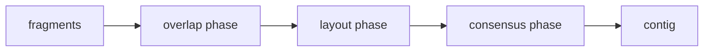

# Fragment Assembly

## Definition

Fragment assembly reconstructs a target sequence from shotgun-sequenced fragments whose original
positions, orientations and sometimes even error-free sequences are unknown (gik_6, p. 16).

## Why it matters

It connects unit-5 suffix-prefix overlaps to genome-scale reconstruction. Assembly uses overlaps,
layout, consensus and error handling rather than only exact indexing (gik_6, pp. 16-19).

## Construction / Mechanism



The notes list base-calling errors, chimeric fragments, contamination, repeats, insufficient
coverage and unknown orientation as major complications (gik_6, pp. 16-19).

## Pseudocode

```text
ALGORITHM OverlapLayoutConsensus(F)
  compute candidate suffix-prefix overlaps between fragments in F
  choose a consistent layout using overlaps and orientations
  for each column of the layout:
    choose the majority-supported base as consensus
  return assembled contigs
```

## Complexity

| Operation | Time | Space |
|---|---:|---:|
| Naive all-pairs overlaps | `O(k^2 L^2)` for `k` reads of length `L` | `O(k^2)` overlaps |
| Indexed overlaps via suffix methods | see [[all-pairs-suffix-prefix-matching]] | index dependent |
| Consensus from fixed layout | linear in aligned bases | layout size |

## Worked example

Fragments `ACCGT`, `CGTGC`, and `TTACC` overlap as `TTACC` + `ACCGT` + `CGTGC`, giving contig
`TTACCGTGC`. A mismatching low-support base in one column is ignored by majority consensus, which
is why multiple coverage helps base-calling errors (gik_6, p. 17).

## Pitfalls & exam traps

> [!warning]
> - Long overlaps are evidence, not proof: repeats can create false layouts.
> - Consensus cannot fix systematic errors or low coverage at a position.
> - A fragment may come from either strand; orientation doubles possibilities (gik_6, p. 19).

## GSA cross-reference (module GSA, fsa_part1)

> [!note]
> The GSA module (*Grundlagen der Sequenzanalyse*) covers the same overlap–layout–consensus
> pipeline independently. The section below cross-references that treatment; the GIK content
> above is unchanged.

**Shotgun sequencing.** Target sequences run from 30 000 to millions of bases, so one sequences
random continuous stretches 5'→3' starting at a random position in one of the two strands; the
outputs are **reads** of unknown direction and position (fsa_part1, p. 20). The **read assembly
problem** is to reconstruct the target by assembling the reads in the correct orientation and
order (fsa_part1, p. 20).

**Phases** (fsa_part1, p. 20) — same three as above:

- *overlap phase*: determine suffix/prefix overlaps for all pairs of reads;
- *layout phase*: derive a multiple alignment from the relative positioning of the reads, with
  gap symbols introduced;
- *consensus phase*: read the target off the columns of the multiple alignment.

**Error budget.** Reads are not exact. With `ε` = errors per base (`0 <= ε <= 1`), two reads of
length `m` are compared allowing `2mε` errors, so the overlap phase computes *approximate*
overlaps (fsa_part1, p. 20). Equivalently, an overlap alignment `A` is accepted if
`δ(A) <= k = C·(|f| + |f'|)` (fsa_part1, p. 21).

**Overlaps.** GSA formalises the overlap phase as a DP: four admissible configurations
(suffix/prefix, prefix/suffix, and the two containments), `len(A) = (|u| + |v|)/2`, and an
`(m+1)×(n+1)` table `Ov_δ` with both the top row and the left column free (fsa_part1, pp. 21–23).
See [[overlap-alignment]] for the recurrence, the four path types and a worked example.

## Related

- [[overlap-alignment]] — the GSA `Ov_δ` DP that implements the overlap phase for a read pair.
- [[all-pairs-suffix-prefix-matching]] — computes overlap candidates.
- [[overlap-graph]] — graph view of layout choices.
- [[shortest-common-superstring]] — idealised assembly model used in the notes.
- [[string-graph]] — removes contained reads and transitive overlaps.

## Sources

- gik_6, pp. 16-19
- fsa_part1, pp. 20-23 (`raw/foundations_sequence_analysis_part1.pdf`)
