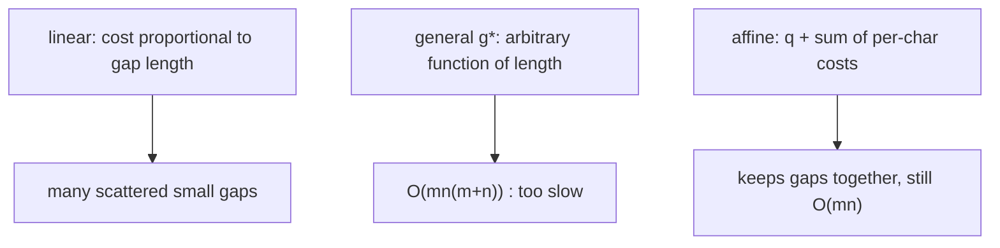
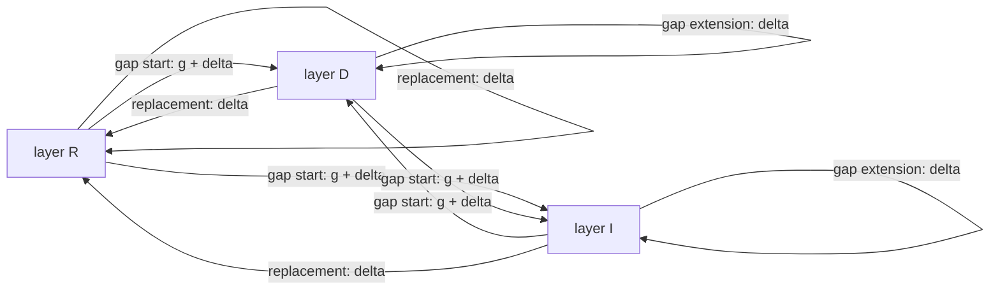

# Gap Cost Model

## Definition

Usual evolutionary processes involve individual **point mutations** — R, D, I of a single
nucleotide or residue. But sometimes an entire **segment** is deleted or inserted as a *single
event* (fsa_part1, p. 25). A **gap** (Lücke) is an interval of unaligned (indel) characters; the
edit operation set is extended to

```
(α, β) ∈ (A × A) ∪ (A⁺ × {ε}) ∪ ({ε} × A⁺)
```

with `|gap| >= 1` in the second and third components (fsa_part1, p. 25). Example: `(abc → ε)` is
one operation, not three.

## Why it matters

Charging a gap of length `ℓ` as `ℓ` independent insertions is biologically wrong: a single
replication slippage or a single intron deletes a whole block at once, so one long gap is far more
likely than `ℓ` scattered ones. A gap-cost model that charges an opening penalty once and then a
cheaper per-symbol extension reproduces that bias. The price is paid in the DP: the cost of a cell
is no longer a function of three neighbours alone, because it depends on *how* the predecessor was
reached — which is exactly what forces the three-layer graph below and the three matrices of
[[gotoh-affine-gap-alignment]].

## The three models

| Model | Cost of a gap of length `ℓ` | Edges in `G(u,v)` | Time | Space |
|---|---|---:|---:|---:|
| **linear** (plain [[cost-function]]) | `ℓ · δ(a → ε)` summed per character | `O(mn)` | `O(mn)` | `O(mn)` |
| **general / arbitrary** `g*` | `g*(ℓ)`, any computable function | `O(mn(m+n))` | `O(mn(m+n))` | `O(mn)` |
| **affine** | `q + Σ_{i=1}^{ℓ} δ(w[i] → ε)` | `O(mn)` (3 layers) | `O(mn)` | `O(mn)` |

(fsa_part1, pp. 25–26, 29.)



## General gap costs

Costs are given by an arbitrary computable function `g*` on the **length** of the gap. For
`w ∈ A⁺` (fsa_part1, p. 25):

```
δ*(w -> ε) = δ*(ε -> w) = g*(|w|)
```

The cost of an alignment `δ*(A)` is the sum of the gap costs and the replacement costs.

The **extended edit graph** gets long "jump" edges (fsa_part1, p. 25):

```
(i', j) --[ u[i'+1 .. i] -> ε ]--> (i, j)   , for all i' , 0 <= i' <= i-1
(i, j') --[ ε -> v[j'+1 .. j] ]--> (i, j)   , for all j' , 0 <= j' <= j-1
```

Number of edges: `O(mn(m+n))`.

The DP table `GGC_{δ,g*}(i,j)` holds the generalised edit distance of `u[1..i]` and `v[1..j]`
(fsa_part1, p. 26):

```
GGC(i,j) =
  0                                                              , i = j = 0
  min {
    min{ GGC(i', j)  + g*(i - i') | 0 <= i' <= i-1 }              , i > 0
    min{ GGC(i,  j') + g*(j - j') | 0 <= j' <= j-1 }              , j > 0
    GGC(i-1, j-1) + δ(u[i] -> v[j])                               , i, j > 0
  }
```

Each entry costs `O(m+n)` (it scans a whole row and column prefix), so the total is
`O(mn(m+n))` — the script annotates this "Needleman–Wunsch algorithm" (fsa_part1, p. 26).

> [!warning]
> The script's label "Needleman–Wunsch" here refers to the **general-gap-cost** `O(mn(m+n))`
> variant, not the plain `O(mn)` global alignment DP that the name is usually attached to
> elsewhere. Read the complexity, not the name.

## Affine gap costs

Each gap is charged the sum of per-symbol costs **plus a gap initiation cost `q`**
(fsa_part1, p. 26). For `w ∈ A⁺`:

```
δ_affine(w -> ε) = q + Σ_{i=1}^{|w|} δ(w[i] -> ε)
δ_affine(ε -> w) = q + Σ_{i=1}^{|w|} δ(ε -> w[i])
```

and `δ_affine(A)` accordingly for a whole alignment. The **edit distance problem with affine gap
costs** is to find alignments minimising `δ_affine(A)` (fsa_part1, p. 26).

> Affine gap costs provide an **incentive to keep gaps together** rather than scattering many
> small gaps (fsa_part1, p. 27) — each new gap pays `q` again.

## The three-layer edit graph

Instead of long edges, mark which edge **starts** and which **ends** a gap. Each grid position
gets **three** nodes `(i,j,R)`, `(i,j,D)`, `(i,j,I)` (fsa_part1, p. 27):

```
replacement edge:  (i-1, j-1, X) --[ u[i] -> v[j] ]--> (i, j, R)  , X ∈ {R, D, I}
insertion  edge:   (i,   j-1, X) --[ ε    -> v[j] ]--> (i, j, I)  , X ∈ {R, D, I}
deletion   edge:   (i-1, j,   X) --[ u[i] -> ε    ]--> (i, j, D)  , X ∈ {R, D, I}
```



### Edge cost table (fsa_part1, p. 28)

| Kind of edge | Edit operation | Cost |
|---|---|---|
| `(i-1, j-1, X) --[u[i] → v[j]]--> (i, j, R)`, `X ∈ {R,D,I}` | replacement | `δ(u[i] → v[j])` |
| `(i-1, j, D) --[u[i] → ε]--> (i, j, D)` | gap extension | `δ(u[i] → ε)` |
| `(i, j-1, I) --[ε → v[j]]--> (i, j, I)` | gap extension | `δ(ε → v[j])` |
| `(i-1, j, R) --[u[i] → ε]--> (i, j, D)` | gap start | `g + δ(u[i] → ε)` |
| `(i-1, j, I) --[u[i] → ε]--> (i, j, D)` | gap start | `g + δ(u[i] → ε)` |
| `(i, j-1, R) --[ε → v[j]]--> (i, j, I)` | gap start | `g + δ(ε → v[j])` |
| `(i, j-1, D) --[ε → v[j]]--> (i, j, I)` | gap start | `g + δ(ε → v[j])` |

Gap-extension edges stay **inside** a layer (`D→D`, `I→I`); gap-start edges **switch** into `D`
resp. `I` from a different layer and pay the extra `g`. A replacement edge may be entered from any
layer (fsa_part1, p. 28).

**Path/alignment correspondence** (fsa_part1, p. 28): a path `(i',j',X) → … → (i,j,Y)` corresponds
to an alignment of `u[i'+1 .. i]` and `v[j'+1 .. j]` that **ends** with edit operation `Y`.

- start entries: `(0,0,R)`, `(0,0,D)`, `(0,0,I)`
- final entries: `(m,n,R)`, `(m,n,D)`, `(m,n,I)`

The DP over this graph is [[gotoh-affine-gap-alignment]].

## Complexity

| Gap-cost model | Alignment time | Alignment space | Algorithm |
|---|---|---|---|
| Linear, `g(ℓ) = ℓ·d` | `O(mn)` | `O(mn)`, `O(min{m,n})` for the cost | [[edit-distance-dp]] |
| Affine, `g(ℓ) = g + ℓ·e` | `O(mn)` | `3·O(mn)`, `O(min{m,n})` for the cost | [[gotoh-affine-gap-alignment]] |
| General / arbitrary `g(ℓ)` | `O(mn(m+n))` | `O(mn)` | full row/column scan per cell |

The affine model is the sweet spot: it buys the "one long gap beats many short ones" bias for the
same asymptotic time as the linear model, paying only a constant factor of 3 in space. The general
model costs a factor of `m+n` more time because every cell must look back along its whole row and
column rather than at a single predecessor.

## Worked example

`u = ACCCGT`, `v = AGT` with per-character indel cost `δ(a → ε) = 1`, mismatch cost 1, and gap
initiation `q = 3`. The deletion of `CCC` (three characters, one block):

| Model | Gap cost of `CCC → ε` |
|---|---:|
| linear | `3 · 1 = 3` |
| affine (`q = 3`) | `3 + 3 · 1 = 6` |
| affine, three separate 1-gaps | `3 · (3 + 1) = 12` |

Under affine costs, one block of 3 (cost 6) beats three scattered gaps of 1 (cost 12) — this is
the "keep gaps together" incentive (fsa_part1, p. 27). Under linear costs both cost 3 and the
model is indifferent.

## Pitfalls & exam traps

> [!warning]
> - The script writes the initiation cost as `q` on p. 26 and as `g` in the edge table on
>   pp. 28–29. They are the same constant.
> - Affine is `O(mn)` time *and* space, but with constant factor **3** — the script annotates
>   "But 3×" (fsa_part1, p. 29).
> - A `D → I` or `I → D` transition is a **gap start** and pays `g`: switching gap direction opens
>   a new gap.
> - `g*` general gap costs are `O(mn(m+n))`; the affine special case is the reason anyone uses
>   gaps at all in practice.
> - Linear gap costs are the `q = 0` special case of affine, and then the three layers collapse
>   back to [[edit-distance-dp]].

## Related

- [[gotoh-affine-gap-alignment]] — the DP recurrences over the three layers.
- [[cost-function]] — the per-character `δ` the gap models are built on.
- [[edit-graph]] — the base graph that is extended with jump edges resp. layers.
- [[edit-operation]] — gaps extend the operation set from `A¹` to `A⁺`.
- [[score-function]] — gap models combine with a replacement score matrix like BLOSUM62.

- [[fsa_part1]] ? source page for this part of the module.

## Sources

- fsa_part1, pp. 25–29 (`raw/foundations_sequence_analysis_part1.pdf`)
